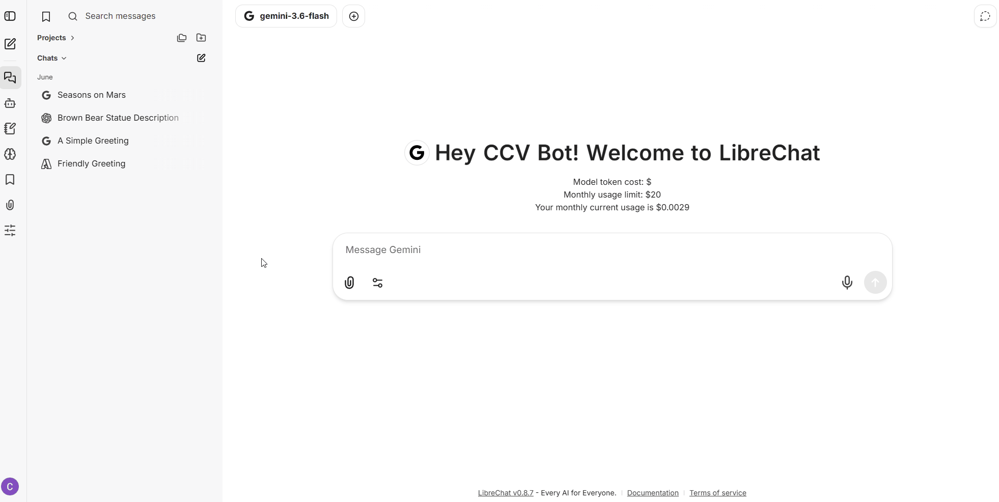
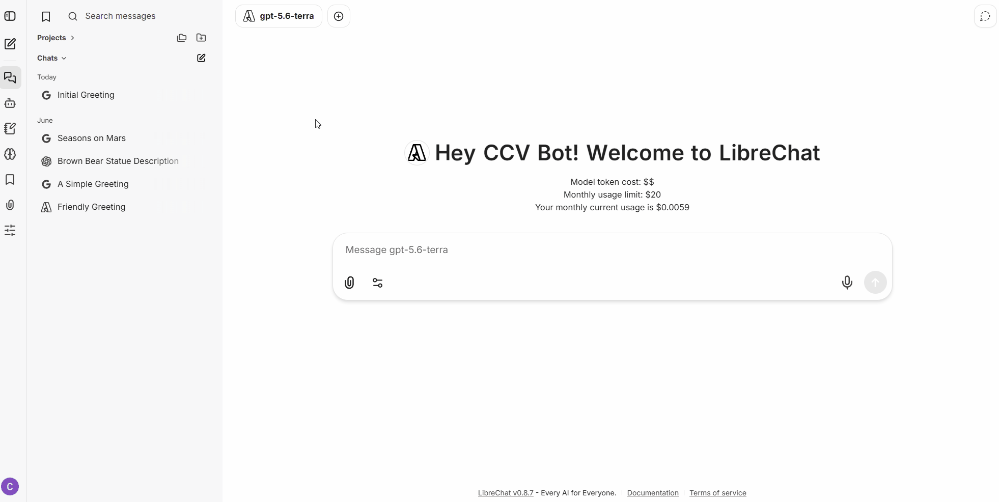
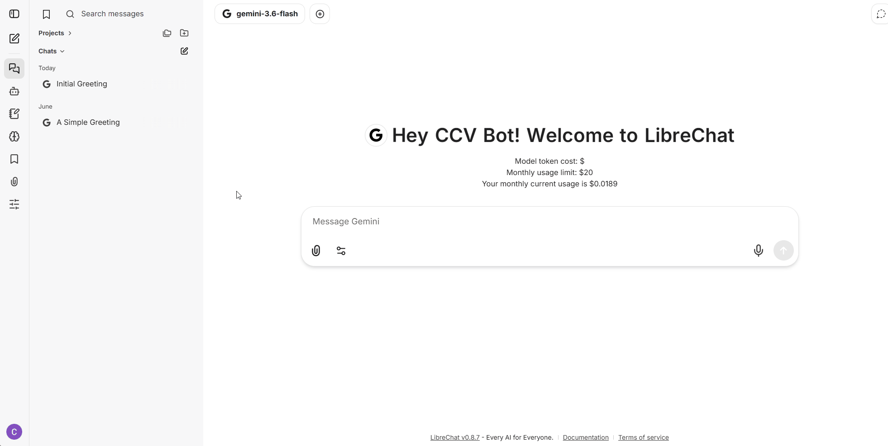

# LibreChat

LibreChat is an Open Source web application that allows you to interact with multiple Large Language Models (LLMs) in a single, unified workspace. It provides advanced capabilities such as multi-language support, the ability to use documents and images in your prompts, personalized model settings, and custom presets.

We have deployed this application for Brown’s use within our infrastructure, providing access to state of the art models with Enterprise-level privacy guarantees. Each user is given a certain amount of free credits per month. To learn more about your free-credits, please visit our [Cost and Limits page](../../costs-and-limits.md).

## Getting started

### Logging In

To start using LibreChat, simply log in using your university credentials.

1. Navigate to [librechat.ccv.brown.edu](http://librechat.ccv.brown.edu).
2. Click or tap the **Continue With Google** button.
3. Log in to Google with your Brown email if prompted.
4. If this is your first time logging in, complete the two-factor authentication (2FA) prompt to create your account.

Once authenticated, you will be redirected to the main chat interface.

### Starting a New Chat

To begin a conversation:

1. Click the **New Chat** button .png>) in the left panel.
2. Select your desired model from the endpoint selector (e.g., GPT-5.6, Claude5, etc.) located at the top of the chat window.
3. Type your message in the input box at the bottom and press **Enter or click the send message button**   **at the bottom right of the chat area**.

<figure><figcaption></figcaption></figure>

### Switching Models

LibreChat allows you to switch between different AI models easily:

* Click the model name at the top of the current chat.
* Select a different provider or specific model version from the dropdown menu to see which one works best for your specific task.

<figure><figcaption></figcaption></figure>

#### Browse Chat History

You can review your previous conversations and continue where you left off.

1. In the left menu, click **Chat History** (the third option from the top).
2. Select any previous conversation to review or continue the chat.

<figure><figcaption></figcaption></figure>

### Model Selection and Availability

We provide access to a large selection of [premium and open-source models from various providers](https://docs.google.com/spreadsheets/d/1BY24ps-nLNp3wldrtRjvo0Edqmzyf3t97qS5flEZ-e0/edit?usp=sharing). We select models based on their **performance, cost-efficiency, and strong commitment to privacy**. Generally, you can expect access to the two most recent versions of state-of-the-art models that meet our required security practices.

### Using Attachments (Files & Images)

You can upload documents or images to provide context to the AI:

1. Select the model you want to use in the model selection dropdown
2. Click the **paperclip icon** or **image icon** next to the chat input bar.
3. Select the files from your computer.
4. Once uploaded, type your prompt (e.g., "Summarize this PDF" or "Describe this image") and send the message.

<figure><figcaption></figcaption></figure>
