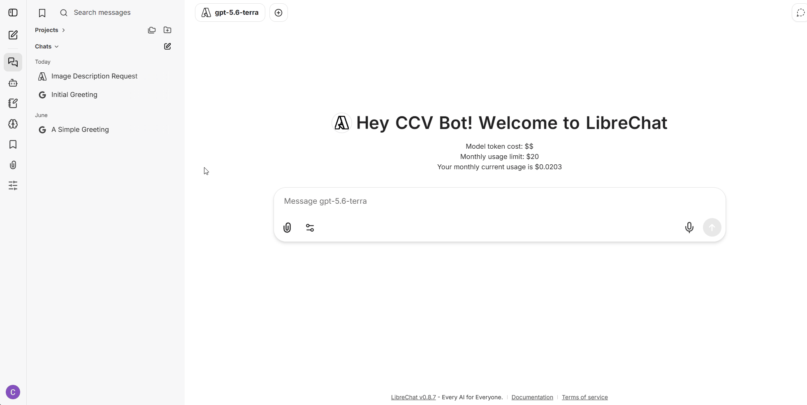
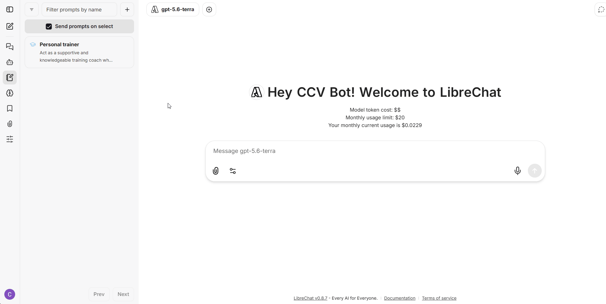
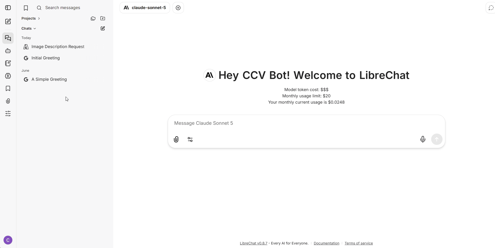
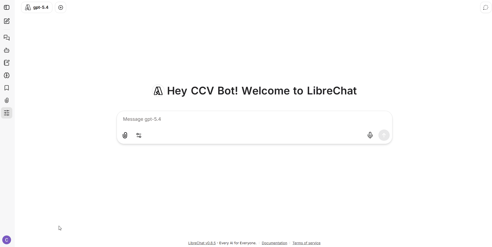
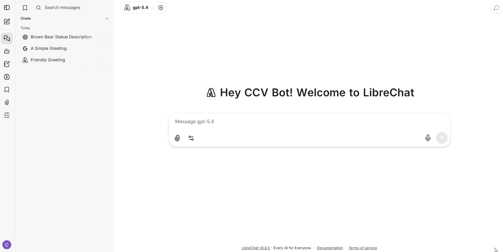

# Advanced Usage

## **Model Configurations**

You can personalize how the AI behaves by accessing the control panel. To open it, click the control icon   located in the left panel.

<figure><figcaption></figcaption></figure>

Here are the key settings you can adjust:

### 1. Parameters - Temperature (Creativity)

The **Temperature** setting controls how "creative" or "random" the AI's responses are.

* **Lower values (e.g., 0 - 0.5):** The model becomes more focused, precise, and deterministic. Use this for coding, data analysis, or factual answers.
* **Higher values (e.g., 0.8 - 1.0):** The model becomes more creative and unpredictable. Use this for brainstorming, storytelling, or generating varied ideas.

### Creating and Using Prompts

1.  **Create a Prompt:**

    * Select the **Prompts** tab.
    * Click the **Add Prompt** button (+)
    * Give a name and a the prompt in the text area
    * Press the **Create Prompt button**

    <figure><figcaption></figcaption></figure>
2.  **Use a Prompt:**

    * Select the model you want to use
    * Click on your desired prompt from the list in the **Prompts** tab.
    * This will automatically apply the prompt to your chat input. The AI will now follow these instructions for the rest of the conversation.

    <figure><figcaption></figcaption></figure>

Take into account that prompts use additional tokens/credits per message. Your credit per month limit can be affected by this.

### 3. Manage Uploaded Files

In this section, you can review and manage the documents or images you have attached to the current and previous conversations.

* Click on the **Attached Files** section to view a list of your uploaded files, including their names and upload dates. Below this list.
* Click the **Manage Files** button to manually select and delete any files you no longer need.

<figure><figcaption></figcaption></figure>

## **Configure Speech-to-Text and Text-to-Speech**

LibreChat offers audio capabilities that allow you to listen to responses and dictate your messages.

### Text-to-Speech (Read Aloud)

You can have LibreChat read responses aloud by clicking the **speaker icon** (Read Aloud) located at the bottom of any message.

### Speech-to-Text (Voice Typing)

Instead of typing, you can use your microphone to dictate questions. simply click the **microphone icon** located within the chat input box to start recording.

### Changing the Voice

To customize the voice used for reading responses:

1. Click on your **Profile** icon in the bottom-left corner.
2. Select **Settings**.
3. Navigate to the **Speech** tab.
4. Under the **Text to Speech** section, choose your preferred voice from the dropdown menu.

<figure><figcaption></figcaption></figure>

### Using Dual Conversation (Compare Mode)

LibreChat allows you to send the same message to two different models simultaneously, making it easy to compare their responses.

1. **Select the First Model**: Choose your primary model from the model dropdown list at the top of the chat.
2. **Add a Second Model**: Click the **plus (+)** button located immediately to the right of the model dropdown.
3. **Select the Second Model**: A new dropdown will appear. Choose the second model you wish to compare.
4. **Start Chatting**: Type your message in the chatbox and press **Enter**. Both models will generate responses side-by-side in the chat window.

Take into account that some models have different response times.

<figure><figcaption></figcaption></figure>

## How to build and agent

For detailed instructions, please refer to the official [LibreChat documentation website](https://www.librechat.ai/docs/features/agents).
