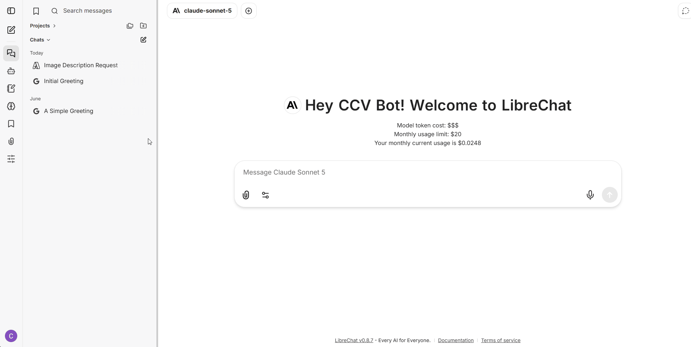
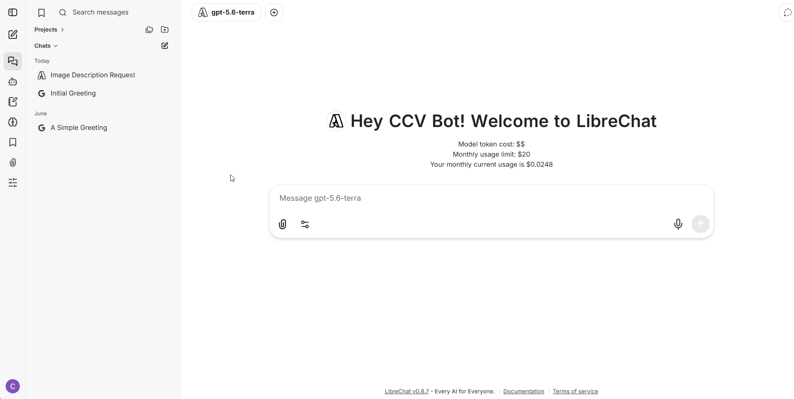
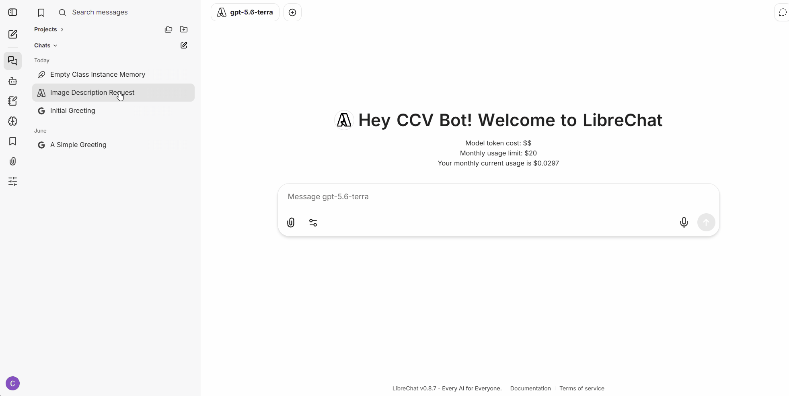

# Creating and Using Agents

LibreChat allows the creation of agents to automate tasks, provide specialized expertise, and assist users through natural language conversations tailored to specific goals and workflows. These agents can be customized with unique instructions, tools, and knowledge sources to support a wide range of use cases, from technical assistance and research to coaching and productivity.

#### Create an Agent

1. Go to the **Agents** tab in the left sidebar.
2. Enter a name and select a category for the agent.
3. Add the agent's instructions.
4. Select and configure a model for the agent.
5. Save the model configuration settings.
6. Scroll to the bottom of the page and click **Save**.
7. The model should appear inside the model selection dropdown in the **My Agents** group

<figure><figcaption></figcaption></figure>

#### Use an Agent

1. Open the model selection dropdown.
2. In the **My Agents** section, select the agent you want to use.
3. Once selected, enter your message in the chat box.

<figure><figcaption></figcaption></figure>

#### Edit an Agent

1. Go to the **Agents** tab in the left sidebar.
2. From the dropdown menu at the top, select the agent you want to edit.
3. Update the desired settings. To change the model, click the **Model** button to open the model configuration menu.
4. When you are finished, scroll to the bottom of the page and click **Save**.

<figure><figcaption></figcaption></figure>

