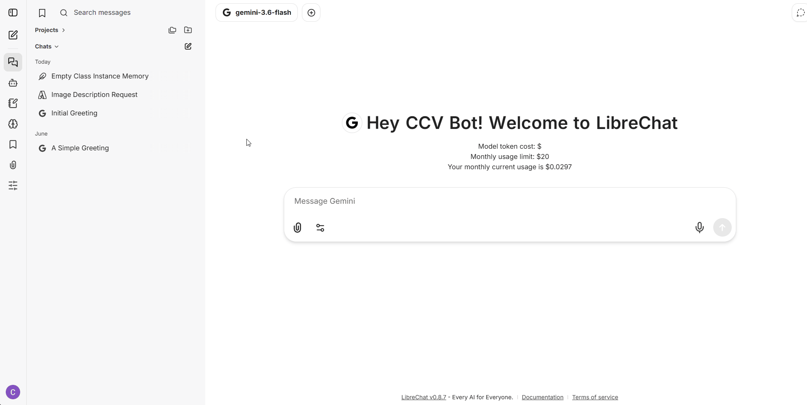

# Sharing Agents


This feature is available only to Brown faculty, staff, and students sponsored by a faculty member. Before you can share an agent that you have created, we will need to enable this feature for you. Please submit a ticket (link) or email support@ccv.brown.edu, and we will help you with this.


1. Go to the **Agents** tab in the left sidebar.
2. From the dropdown menu at the top, select the agent you want to share.
3.  Scroll down and click the share button&#x20;

    <figure><figcaption></figcaption></figure>
4. In the modal window, choose the group with which you want to share the agent.
5. You can modify the level of access and ownership that the group has for the agent.
6. Save your changes

<figure><figcaption></figcaption></figure>
