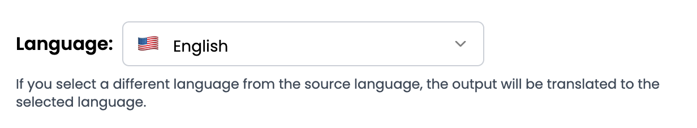

# Performing translation

Starting in v1.1.2, Translate supports creating transcriptions in any of the following 15 languages other than the source language of the audio/video files, provided that the users choose the Google Gemini model:

* 🇬🇧 English
* 🇸🇦 Arabic
* 🇨🇳 Chinese (Mandarin)
* 🇳🇱 Dutch
* 🇪🇸 Spanish
* 🇮🇹 Italian
* 🇩🇪 German
* 🇷🇺 Russian
* 🇵🇹 Portuguese
* 🇯🇵 Japanese
* 🇰🇷 Korean
* 🇫🇷 French
* 🇻🇳 Vietnamese
* 🇮🇳 Hindi
* 🇮🇩 Indonesian

To perform translation, please [create a job](./). When selecting a language, simply choose a target language that is different from the source language of original media, and the resulting transcription will be in the selected target language.

<figure><figcaption></figcaption></figure>
