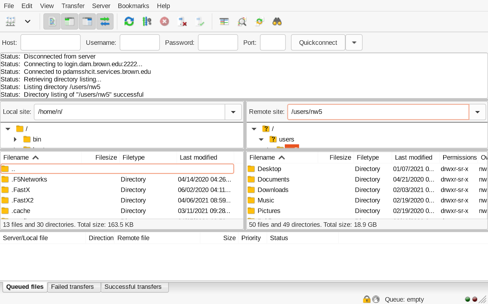

# Linux Workstations

If you're an Applied Math user and would prefer a Linux system as your primary computer, follow the link below to submit a request:

[**Request a Linux Workstation**](https://forms.gle/YUx8fg6dzvZZUZXm6)

## Getting Started

Your Linux workstation will come with Ubuntu LTS installed. Multiple monitors and dedicated GPUs may be provided, but are subject to availability.

If you have inherited an existing Linux computer, note that the [CCV ResSys team](mailto:ccv-sysadmins@brown.edu) will still need to grant APMA Linux privileges to your account before you are able to sign in.

* Log into the Ubuntu desktop with your Brown username and password. You may need to select **Not Listed** if your name is not automatically displayed.
* Save files to your home directory: `/users/`**`<your-username>`**. It is the only location that is backed up and is available on all APMA Linux systems.
* Additional software can be installed from the command line with `sudo`. Most graphical software installers won't function in this environment.
* Various [commercial software](../faq-tips/commercial-software.md) packages can be made available upon request.

## Remote Access

To access your workstation remotely, you should first make note of its host name. This can be found on an attached label and is in the format of `apma-ws-##` or `apma-gpu-##`. Don't forget to keep your computer powered on when you leave.

When off-campus, use [Brown VPN](https://it.brown.edu/services/virtual-private-network-vpn) to first connect to the Brown network.

* SSH: ` ssh`` `` `**`<your-computer-name>`**`.dam.brown.edu`
*   Graphical: `https://`**`<your-computer-name>`**`.dam.brown.edu:3300`

    (bypass the security certificate warnings to connect)

The [OIT SSH Gateway](https://ithelp.brown.edu/kb/articles/use-the-ssh-gateway) is an alternate method for SSH access that does not require the Brown VPN.

## Transferring Data

Files can be transferred to/from your Linux home directory using an SFTP client. [Filezilla](https://www.brown.edu/information-technology/software/catalog/filezilla) is available on the Brown software page and supports Windows, Mac, and Linux.

1. Off-campus users must first connect to the [Brown VPN](https://ithelp.brown.edu/kb/articles/get-started-with-brown-s-vpn-virtual-private-network).
2. In Filezilla, click **File** > **Site** **Manager**.
3.  Click **New Site,** enter “**DAM home**” as the name.

    `Protocol: SFTP`

    `Host: login.dam.brown.edu`

    `Port: 22`

    `Logon Type: Interactive`

    `User: <your-username>`
4. Click **Connect**.
   1. Click **OK** to accept the server host key.
   2. Enter your Password and click **OK**.
   3. You may be prompted to select a Duo authentication method. Enter the number of your choice and click **OK**. (Note: this looks very similar to a password prompt.)
5.  Navigate to your home directory `/users/<your-username>` in the right pane (Remote site).

    <figure><figcaption></figcaption></figure>
6. Upload files by dragging them from your local computer (left pane) to the server (right pane).
