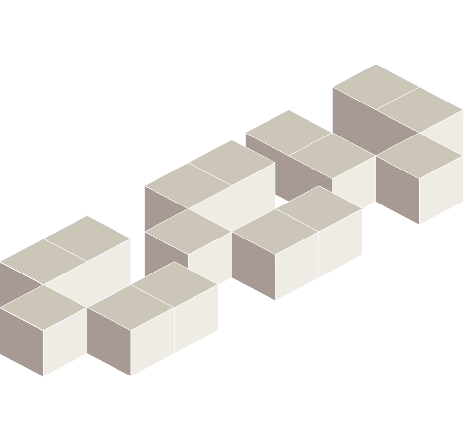

---
layout:
  width: wide
  title:
    visible: true
  description:
    visible: true
  tableOfContents:
    visible: false
  outline:
    visible: false
  pagination:
    visible: true
  metadata:
    visible: true
  tags:
    visible: true
  actions:
    visible: true
  anchors:
    visible: true
---

# CCV Documentation

<table data-view="cards"><thead><tr><th></th><th></th></tr></thead><tbody><tr><td><h2><a href="https://app.gitbook.com/o/-LLCCXzgv2-pRyGi-QB2/s/XaSdR1JjDGbvccnFNb3t/">AI Tools</a></h2></td><td>Transcribe, LibreChat</td></tr><tr><td><h2><a href="https://app.gitbook.com/o/-LLCCXzgv2-pRyGi-QB2/s/-LcWJ6pKCQH6l3rl9IQa/">Oscar</a></h2></td><td></td></tr><tr><td><h2><a href="https://app.gitbook.com/s/rhWgUCotdswQSGxxHnhk/">Storage and Transfer</a></h2></td><td>Campus File Storage, Globus, Hibernate, Starfish, and more</td></tr><tr><td><h2><a href="https://app.gitbook.com/o/-LLCCXzgv2-pRyGi-QB2/s/-LcWdZhwLCll1J0u091B/">Stronghold</a></h2></td><td></td></tr><tr><td><h2><a href="https://app.gitbook.com/o/-LLCCXzgv2-pRyGi-QB2/s/AyXYvu8Nmxx8GSuMZQrQ/">Applied Math Research Systems</a></h2></td><td></td></tr></tbody></table>

Looking for older materials? Check out our [documentation archive](https://docs.ccv.brown.edu/archive).

