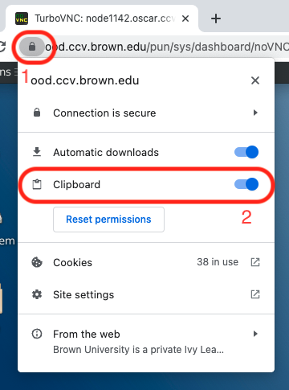

# Desktop App (VNC)

The Desktop app on Open OnDemand is a replacement for the older VNC Java client. This app allows you to launch a Desktop GUI on Oscar.


Advanced users looking for more resources can try the [Desktop (Advanced) app](desktop-app-vnc.md#desktop-advanced).



Do not load any `anaconda` module in your .modules or .bashrc file. These modules prevent Desktop sessions from starting correctly. You may load them inside the Desktop session.


## Launching Desktop App (VNC)

### 0. Launch Open OnDemand

[Launch Open OnDemand (OOD)](https://ood.ccv.brown.edu) and log in with you Brown Credentials.

### 1. Select the **`Desktop`** option in **`Interactive Apps`** dropdown list:

<figure><figcaption></figcaption></figure>

### 2. Choose the resource option:

<figure><figcaption></figcaption></figure>

### 3. Wait and Launch! (VNC)

<figure><figcaption></figcaption></figure>


You may change the **Image Quality** if your internet connection is bad. Image quality can be changed in the middle of the session.


<div align="center"><figure><figcaption></figcaption></figure></div>

## Reconnecting to session

A session may get disconnected if it is not active for a while:

<figure><figcaption></figcaption></figure>

If the session **disconnects** as shown above, please **don't** click the "Connect" button on the screen. You may go to **Open OnDemand** page and click “**My Interactive Sessions**” to find the session again:

<figure><figcaption></figcaption></figure>


Please don’t launch a new session if you have an existing session. You cannot launch two desktop sessions at the same time.



Sometimes, the “My interactive Sessions” button is shortened to look like:




## Copying and pasting text



If you are using Google Chrome, switch on the "Clipboard" permission and you can directly copy and paste text into the OOD Desktop from any other program.

1. Click the Lock icon to the left of the URL
2. Switch on the "Clipboard" permission





Click the side panel button on the extreme left hand side of the screen.

* To copy text into the Desktop session, paste the data into the Clipboard. It will be available to paste inside the Desktop session.
* To copy text from the Desktop session, open the Clipboard. The copied text will be displayed inside it. You can select and copy the text inside the Clipboard and paste it to an external program.

<figure><figcaption></figcaption></figure>



## Desktop (Advanced)

If you need **more** or **different** **resources** than those available from the default Desktop session, you should use the Advanced Desktop app. Resources requested here count against the resources allowed for your Oscar account.

### 1. Select the Desktop (Advanced) app under Interactive Apps.

<figure><figcaption></figcaption></figure>

### 2. Choose required resources

Fill out the form with your required resources.

* **Account**: Enter your **condo** account name. If you are not a member of a condo, leave this **blank**
* **Desktop Environment**: Choose **XFCE**. KDE works for CPU jobs, but may not be able to use GPU acceleration correctly.
* **Number of hours**: Choose appropriately. Your Desktop session will end abruptly after this time has lapsed. Requesting a very long session will result in a lower job priority.
* **Partition**: Equivalent to `#SBATCH -p` option. The desktop session will run on this partition.
* **Num Cores:** Equivalent to the `#SBATCH -n` option.
* **Num GPUs**: Equivalent to the `#SBATCH --gres=gpu:` option. This field is **ignored** if the partition does not have any GPU nodes, e.g. batch
* **Memory (GB):** Equivalent to the `#SBATCH --mem=` option.
* **Reservation:** Equivalent to the `#SBATCH --reservation=` option. Leave **blank** if you are not using a reservation.

### 3. Wait and Launch (Advanced)!

Wait and launch this session like the regular Desktop session.

## Modify the Terminal App

Inside the Desktop session , click on Applications in the top left

Applications -> Settings -> Default Applications

<figure><figcaption></figcaption></figure>

In the new Window, click on the "Utilities" tab and choose "Gnome Terminal" in the drop down menu under "Terminal Emulator"

<figure><figcaption></figcaption></figure>

Then click on "Applications -> Terminal Emulator" to launch the terminal:

<figure><figcaption></figcaption></figure>

### If the steps mentioned above do not work:

1. Close the Desktop session
2.  Inside a terminal (outside the Desktop session), run this command:

    ```bash
    rm -r ~/.ood_config
    ```
3. Start a new desktop session.

### Change the Terminal icon for launcher panel

Please drag and drop the "Terminal Emulator" icon from the "Applications" menu to the launcher panel at the bottom of the screen, it will be inserted to the launcher panel:

<figure><figcaption></figcaption></figure>

Then click on "Create Launcher":

<figure><figcaption></figcaption></figure>

You may remove the old terminal icon after adding the new icon:

<figure><figcaption></figcaption></figure>
