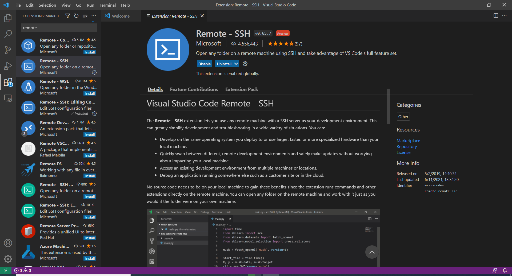
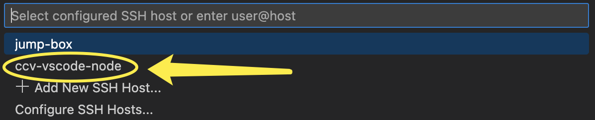
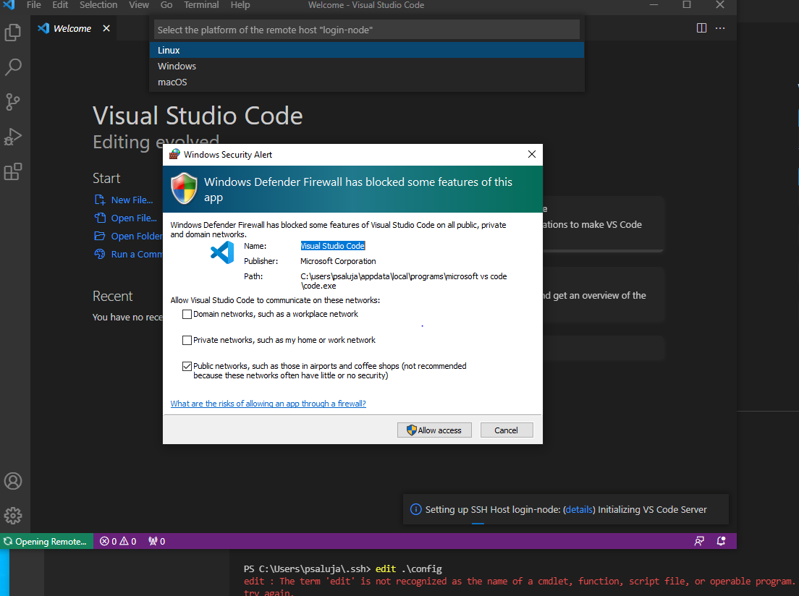

# Remote IDE (VS Code)

## VS Code one-time setup


To use VS Code you must be on a Brown compliant network or connected to the VPN. Please install the [Brown VPN client](https://vpn.brown.edu/) before proceeding.


To use VS Code you will need to be connected to the VPN. Please install the [Brown VPN client](https://vpn.brown.edu) before proceeding.

### Step 1: Install VSCode Extension

Install the [Remote Development extension pack](https://aka.ms/vscode-remote/download/extension) for VS Code:

<figure><figcaption></figcaption></figure>

### Step 2: Setup Passwordless SSH

Make sure you have set up passwordless SSH authentication to Oscar. If you haven't, please refer to this [documentation page](https://docs.ccv.brown.edu/oscar/connecting-to-oscar/ssh/ssh-key-login-passwordless-ssh).


If you have **Windows Subsystem for Linux (WSL)** installed in your computer, you need to follow the instructions for Windows (PowerShell).


### Step 3: Edit the SSH config file

Add the following to your SSH config file. Replace `<username>` with your Oscar username.



The `config` file is located at:

`~/.ssh/config`



The `config` file is located at:

```sh
C:\Users\<uname>\.ssh\config
```




If you have **Windows Subsystem for Linux (WSL)** installed in your computer, you need to follow the instructions for Windows (PowerShell).


```ssh-config
Host jump-box
    HostName ssh.ccv.brown.edu
    User <username>
    StrictHostKeyChecking accept-new

Host ccv-vscode-node
    HostName <vscode>
    User <username>
    ProxyCommand ssh -q -W %h:%p jump-box
    StrictHostKeyChecking accept-new
```

You need to randomly replace `<vscode>` with `vscode1` or `vscode2`

### Step 4: Connect to Oscar

Open the Command Palette in VS Code (`Cmd+Shift+P` on Mac, `Ctrl+Shift+P` on Windows/Linux)

Select `Remote-SSH: Connect to Host…`

Choose `ccv-vscode-node` from the list


<figure><figcaption></figcaption></figure>

### Step 5: Initial Setup

Install and set up of VS Code



After a moment, VS Code will connect to the SSH server and set itself up.



After a moment, VS Code will connect to the SSH server and set itself up. You might see the Firewall prompt, please click allow.





### Step 6: Apply Recommended Settings


**Do this once after your first connection.** Without it, VS Code will try to index all files you have access to on Oscar, including large datasets which wastes resources on the shared node and slows things down for everyone.


Open a terminal in VS Code and run:

```bash
cp -v /oscar/runtime/software/utility/settings.json /users/$USER/.vscode-server/data/Machine/settings.json
```

or manually create `/users/$USER/.vscode-server/data/Machine/settings.json` file with following contents


```json
{
  "files.watcherExclude": {
    "**/.git/objects/**": true,
    "**/.git/subtree-cache/**": true,
    "**/node_modules/**": true,
    "/usr/local/**": true,
    "/oscar/**": true,
    "/nfs/**": true,
    "/files22_research/**": true,
    "/files22_lrsresearch/**": true,
    "/HEP/**": true,
    "/sss/**": true
  },
  "files.watcherImplementation": "parcel",
  "files.autoSave": "off",
  "search.followSymlinks": false,
  "search.exclude": {
    "**/.git/objects/**": true,
    "**/.git/subtree-cache/**": true,
    "**/node_modules/**": true,
    "/usr/local/**": true,
    "/oscar/**": true,
    "/nfs/**": true,
    "/files22_research/**": true,
    "/files22_lrsresearch/**": true,
    "/HEP/**": true,
    "/sss/**": true
  },
  "editor.formatOnSave": false,
  "editor.formatOnType": false,
  "python.analysis.indexing": false,
  "python.analysis.diagnosticMode": "openFilesOnly",
  "python.analysis.autoImportCompletions": false,
  "python.analysis.exclude": [
    "/oscar/**",
    "/nfs/**",
    "/files22_research/**",
    "/files22_lrsresearch/**",
    "/HEP/**",
    "/sss/**",
    "**/node_modules/**"
  ],
  "npm.autoDetect": "off",
  "typescript.tsc.autoDetect": "off",
  "jake.autoDetect": "off",
  "grunt.autoDetect": "off",
  "gulp.autoDetect": "off",
  "git.enabled": false,
  "git.autofetch": false,
  "git.autorefresh": false,
  "git.decorations.enabled": false,
  "extensions.autoUpdate": false,
  "extensions.autoCheckUpdates": false,
  "extensions.ignoreRecommendations": true,
  "telemetry.telemetryLevel": "off",
  "remote.SSH.remoteServerListenOnSocket": true
}
```


Then reconnect to VS Code for the settings to take effect:

1. Click the green `><` icon in the bottom-left corner of VS Code
2. Select `Connect to Host`

<figure><figcaption></figcaption></figure>

3. Choose `ccv-vscode-node`

<figure><figcaption></figcaption></figure>


### Important: What is VSCode Node For

The VSCode node is a **shared resource** with over 300 users active at any given time. It is intended for:

* Editing files
* Light terminal use
* Browsing code

**Do not run computationally intensive work** (R, Python scripts, model training, etc.) directly on the VSCode node. These should be submitted as jobs to the cluster. Your processes will be automatically throttled if they exceed the per-user resource limits.

To run an interactive job on a compute node: `interact -n 4 -m 16g -t 01:00:00`&#x20;

Use `interact -h` for list of options.

Note that when you launch an interactive job, your terminal processes go to the compute node but VSCode processes/extensions itself stays on the VSCode node.
