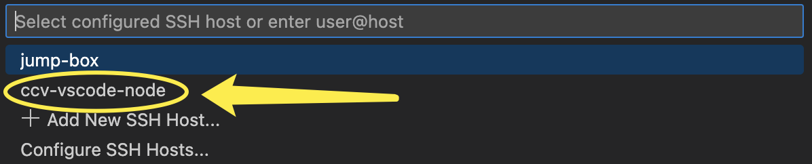

# From Non-compliant Networks (2-FA)


This guide is only for users connecting from Non-Brown Compliant Networks. 2-FA is mandatory.


1. Install the [Remote Development extension pack](https://aka.ms/vscode-remote/download/extension) for VSCode
2.  Open VSCode settings

    * On Windows/Linux - **File** > **Preferences** > **Settings**
    * On macOS - **Code** > **Preferences** > **Settings**

    Search for `symlink` and make sure the symlink searching is unchecked

    
3.  Under VSCode settings, search for `remote ssh timeout` and manually enter a timeout value i.e. `50s`. It should give you enough time to complete 2-Factor Authentication.

    
4.  Edit the `~/.ssh/config` file on your local machine, add the following lines. Replace `<username>` with your Oscar username.

    ```console
    # Jump box with public IP address
    Host jump-box
      HostName ssh.ccv.brown.edu
      User <username>
    # Target machine with private IP address
    Host ccv-vscode-node
      HostName vscode1
      User <username>
      ProxyCommand ssh -q -W %h:%p jump-box
    ```
5.  In VSCode, select **Remote-SSH: Connect to Host…** and after the list populates select `ccv-vscode-node`

    

    <figure><figcaption></figcaption></figure>
6.  When prompted in VSCode, please enter your Brown password and complete the DUO authentication. After that, wait about 30 seconds and VSCode should connect to Oscar.

    <figure><figcaption></figcaption></figure>
