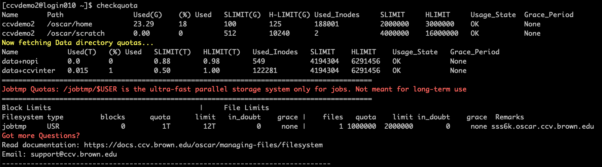
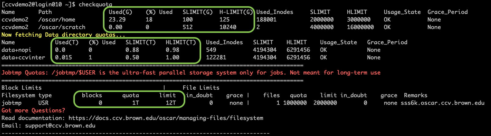
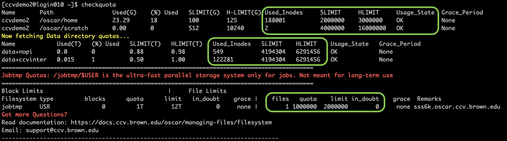

# Understanding Disk Quotas

## Checkquota

Use the command `checkquota` to view your current disk usage and quotas. Here's an example output of this command

<figure><figcaption>
Output of the <code>checkquota</code> command
</figcaption></figure>

In the output of the `checkquota` command, each line represents a top level directory that you have access to such us `/oscar/home`, `/oscar/scratch` `/data`, and `/jobtmp` (a temporary storage directory for your jobs). The columns of the output show different types of quotas and limits that we explain below.

## Types of Quota:

Disk usage and quotas are calculated separately for [top level directories](../filesystem.md). Two types of quotas are calculated for each of these directories:

### Disk space usage

This usage is expressed in Gigabytes (G) or Terabytes (T) . This is the total size of all the files in that directory and it does not depend upon the number of files. Run the command `checkquota` to see your disk usage and quota. Here's an example:

<figure><figcaption>
Output of the <code>checkquota</code> command highlighting disk usage statistics
</figcaption></figure>

### Inode usage

This is the total number of files and directories in the particular directory. This number does not depend upon the size of the files. Run the command checkquota to see your inode usage and quota. Here's an example:

<figure><figcaption>
Output of the <code>checkquota</code> command highlighting inode statistics
</figcaption></figure>

## Soft Limits vs Hard Limits

All quotas have a soft limit (SLimit) and hard limit (HLimit). When usage exceeds the soft limit, a grace period associated with this limit begins. During the grace period, the usage is allowed to increase up to the hard limit. When the usage reaches the hard limit or when the grace period expires, the user is not allowed to write any files to that particular directory.

## Usage State

The "Usage State" column shows the status of the grace period for a particular directory. Here are some of the status messages:

### `SOFT_EXCEEDED`

This indicates that your usage of the disk space or inodes has exceeded the soft limit and you are still within the grace period. Check the `Grace_Period` column to see the number of days left in the grace period. You may continue writing data into this directory until the end of the grace period, as long as you do not exceed the hard limit

### `GRACE_EXPIRED`

This indicates that your usage has exceeded the soft limit AND the grace period has expired. You will not be able to write data into that directory, but you can remove files.

### `HARD_EXCEEDED`

This indicates that your usage has reached the hard limit. You will not be able to write data into that directory, but you can remove data.

### `OK`

This indicates that your usage of the disk space as well as inodes in within the soft quota.
