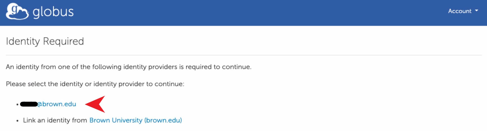

# Brown Google Drive and Shared Drive

## Creating a Globus Collection


_**Note:**_ ​If you are already a subscriber of Globus service and have a Globus account, some of the permissions pages might not show up during this process.


1. Navigate to [https://www.globus.org/](https://www.globus.org/), then click the 'Login' button in Figure 1.

<figure><figcaption>
Figure 1. Globus Web page
</figcaption></figure>

2\. Select Brown University as Organization, then click 'Continue' in Figure 2.


PLEASE DO NOT USE 'Sign in with Google'


<figure><figcaption>
Figure 2. Globus Web App Login
</figcaption></figure>

3\. The page will redirect to the SSO Authentication page. Use your AD credentials.

<figure><figcaption>
Figure 3. SSO Page
</figcaption></figure>

4\. Navigate to File Manager, and enter '**BrownU\_GlobusMEP\_Google**' in Collection Search to create a collection for your Google Drive. Similarly, you can enter '**BrownU\_GlobusMEP\_Google\_SharedDrive**' in Collection Search to create a collection for your Google Shared Drive as shown in Figure 4:

<figure><figcaption>
Figure 4: Collection Search
</figcaption></figure>

5\. Click the appropriate collection (regular or shared drive) in the list from Collection Search, if it is your first time to access the BrownU\_GlobusMEP\_Google collection (Step 5 - 7), click the 'Continue' button in Figure 5 to be authenticated.

<figure><figcaption>
Figure 5: Authentication and Consent Required
</figcaption></figure>

6\. Click the "\<your\_brown\_shortid>@brown.edu" in Figure 6.

<figure><figcaption>
Figure 6: Identity Selection
</figcaption></figure>

7\. Click the 'Allow' button in Figure 7 to grant permissions to Globus Web App. You should read the Terms of Service and Privacy Policy.

<figure><figcaption>
Figure 7: Globus Consents
</figcaption></figure>


If you get either of the following messages after clicking 'Allow', please consult our [Troubleshooting page](https://docs.ccv.brown.edu/storage-and-transfer/globus/support/troubleshooting).



8\. After authentication, the collection is displayed in File Manager as shown in Figure 8.

9\. You may bookmark your selected folder, by clicking the Bookmark icon which is to the right of the Path search textbox, entering the name for the selected folder, and then click the 'Create Bookmark' button as shown in Figure 9.

* **Bookmark Syntax​:** We want this name to be a standard for management purposes. ​Note: Non-Standard Names might not get associated with Brown Subscription. ​Please avoid putting your Brown ShortID in place of Name/Initial.
  1. **Syntax​:** ​BrownU​\_\<Name/Initials>\_GDrive **OR** BrownU​\_\<Name/Initials>\_GSDrive
  2. **Example:** BrownU\_JaneSmith\_GDrive **OR** BrownU​\_JaneSmith\_GSDrive

<figure><figcaption>
Figure 9: Bookmark Creation
</figcaption></figure>

After that, a confirmation will be displayed as in Figure 10. Once a bookmark is saved, you can access it later by clicking the 'BOOKMARKS' icon in the left panel, and then click the bookmark from the list of your saved bookmarks, as shown in Figure 11.

<figure><figcaption>
Figure 10: Bookmark Saved
</figcaption></figure>

<figure><figcaption>
Figure 11: Saved Bookmarks
</figcaption></figure>

You can also refer to [**Globus Documentation**](https://docs.globus.org/how-to/access-google-storage/) for accessing your Google Drive(s).

## Transfer data

11\. You can transfer to any other Globus Collection that you have permission to. Once you are in your collection, to select either source/target collection, you can either click on "Transfer or Sync to" in the right menu or click the 'Dual Pane' in the Panels menu in the top right corner of the 'File Manager' window. Now you can search for the secondary collection that you want to transfer data to/from.

If you want to use Globus Online to move data to/from your own machine, you can install Globus Connect Personal. Installing Globus Connect Personal allows you to create an endpoint on your computer that you can use to transfer data to and from your computer. For installation, please visit: [https://www.globus.org/globus-connect-personal](https://www.globus.org/globus-connect-personal)

12\. You can then select the files you want to transfer. And click the 'Start' button.

13\. You should see "Transfer request submitted successfully" and an id for the transfer. Click "View Details" to see transfer progress. if you have started a transfer between two remote machines you don't have to keep your computer connect to Globus\*\*. When the transfer is complete you will receive an email.


**\*\*If you are using Globus Connect Personal for a transfer to/from your machine, Globus personal needs to stay running on your machine for the transfer to complete.**


### Tips for Transferring Data between Globus and Google Drive

For Google Drive, there are "rate limits" on how much data and how many files a user can transfer in any 24 hour period. The following two tips can help to alleviate the restrictions from the rates limits:

* Transfer a subfolder as a job. A user can submit 2-3 jobs at a time.
* If the folder or subfolder contains a lot of small files, compress the folder or subfolders using zip or tar before the transfer.

## Globus links

* If you need more information on How Globus works, please refer to [HowTo Videos located ​here​](https://docs.globus.org/how-to/instructional-videos/).
* Check out [the Globus docs page](https://docs.globus.org/how-to/) for more info.
