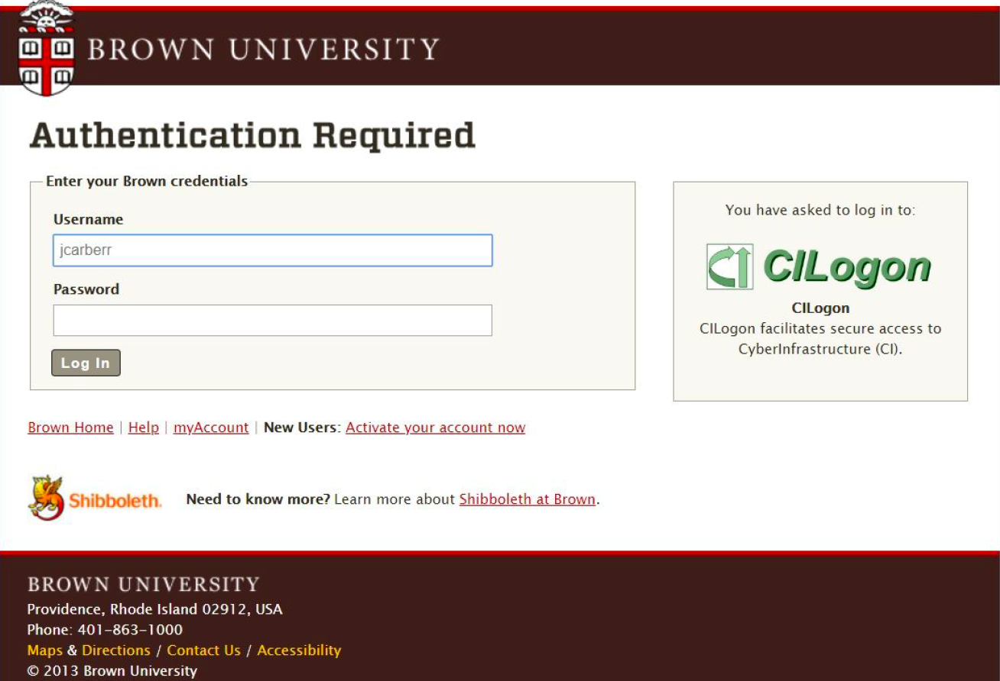
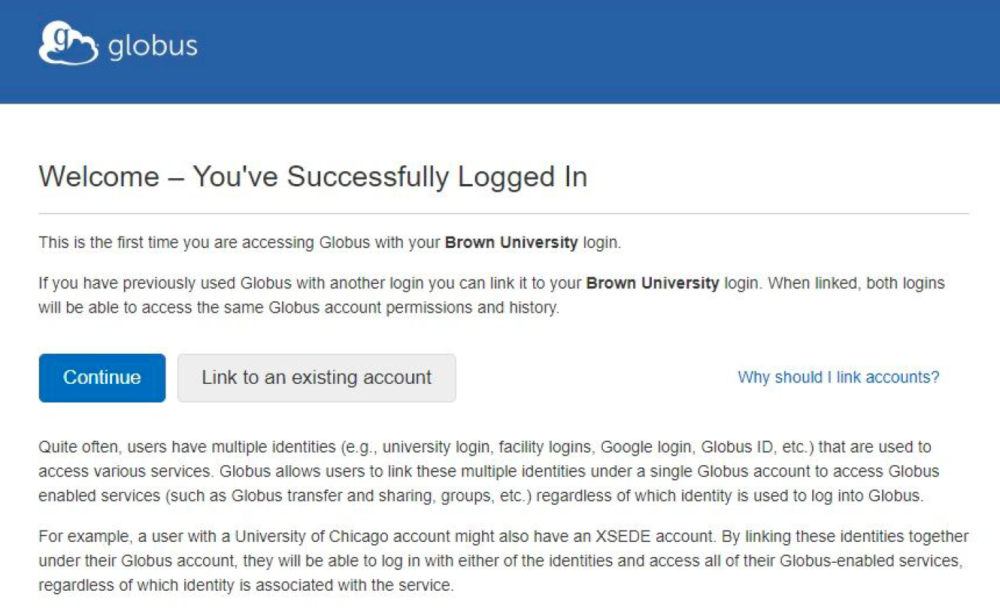
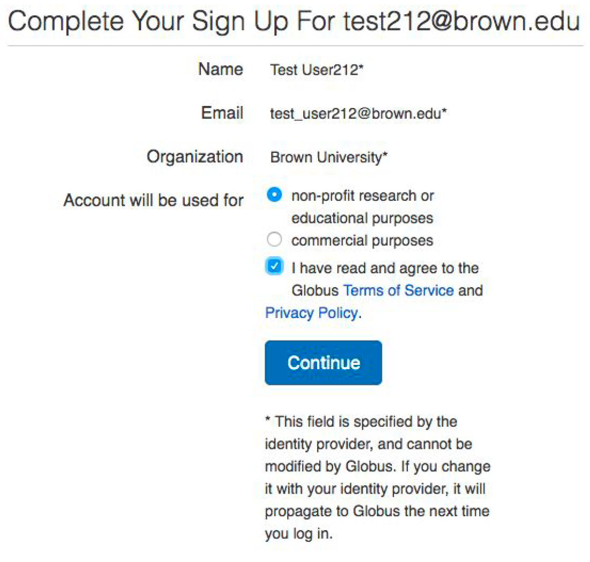
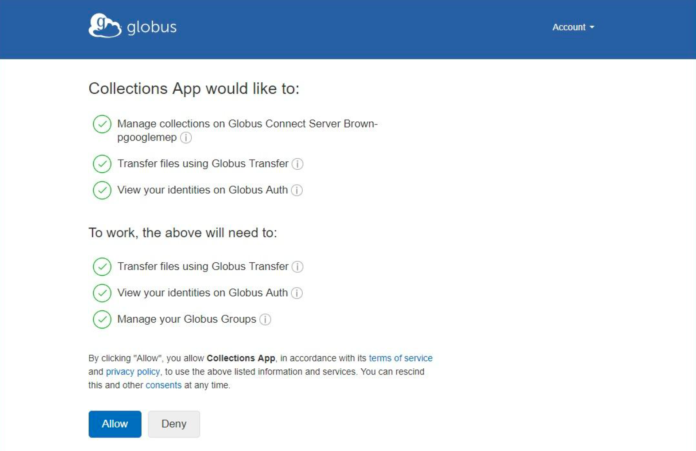
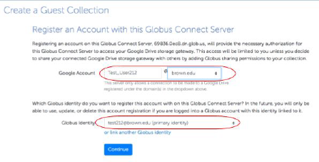
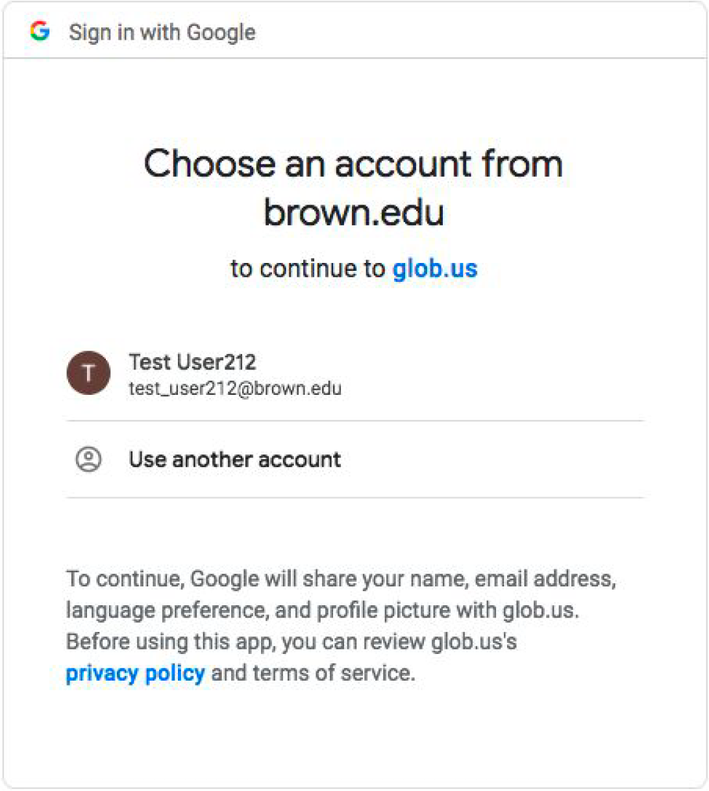
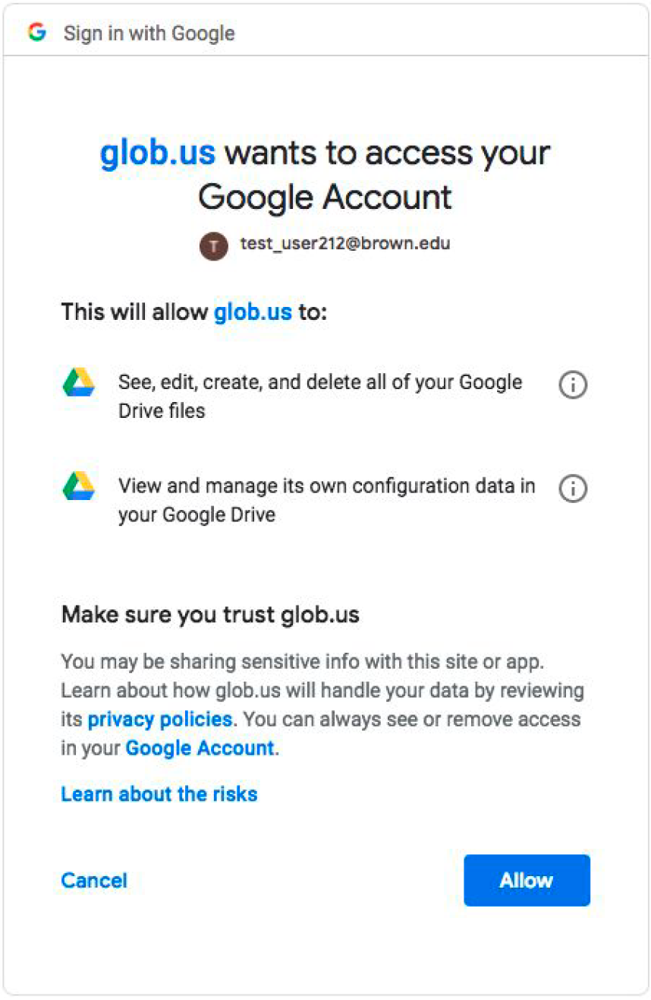
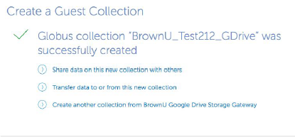
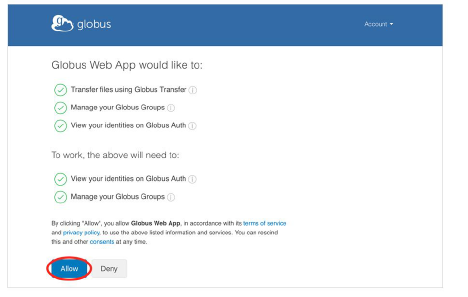
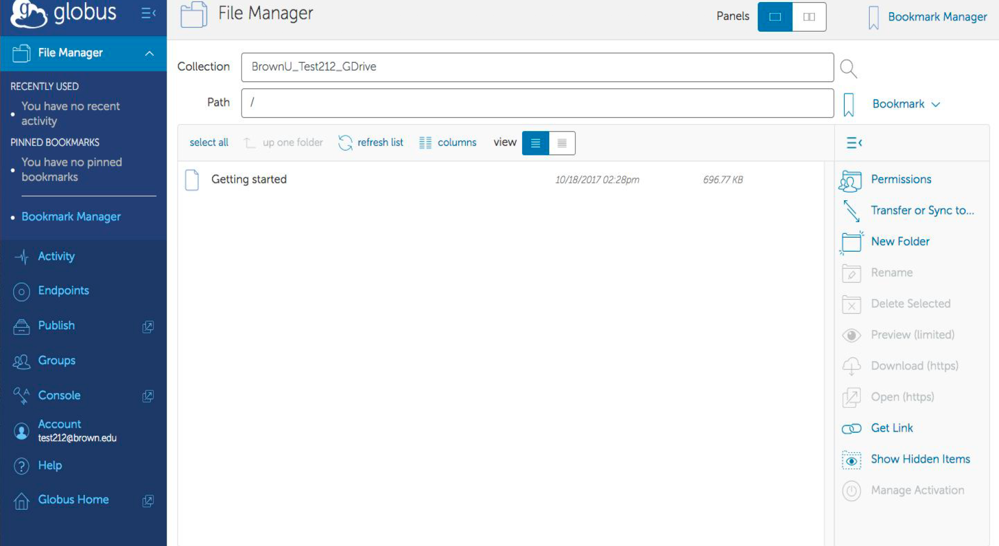

# Brown Google Shared Drive (Deprecated)


**IMPORTANT NOTICE:** Globus Endpoint for 'Brown Google Shared Drive' will be unavailable from June 3- 5 due to maintenance. During maintenance, users will not be able to create new collections or do any data transfers.


## Tips for Transferring Data to Google Drive

For Google Drive, there are "rates limits" on how much data and how many files a user can transfer in any 24 hour period. The following two tips can help to alleviate the restrictions from the rates limits:

* Transfer a subfolder as a job. A user can submit 2-3 jobs at a time.
* If the folder or subfolder contains a lot of small files, compress the folder or subfolders using zip or tar before the transfer.

## Steps to Create a Globus Endpoint

### 1. Click this link to get started:



### 2. Link your Brown username (shortid) to your Brown Globus Identity

You should land on a page similar to this. Select ‘Brown University’ and click ‘Continue’.

.png>)

After selecting continue you will be redirected to the Brown University authentication page - enter your Brown username and use Two-Step Verification as usual.

Once the login is successful, you might land on a page as shown below. Click ‘Continue’.

Complete your sign up by selecting account options and agreeing to the Terms of Service and Privacy Policy.

You need to allow the Globus Collections App to manage your file transfers. Click ​Allow​.

Link your Brown email address to your Brown Globus Identity. Type your Brown email address in the Google Account section and click Continue.

You will be redirected to the Google sign-in page. Select your Brown Google email account to continue.

Grant Globus (glob.us) access to your Google Drive.

### 3. Create a Guest Collection

You will be presented with a screen that has two options. Select the second option which is labeled 'BrownU Google Shared Drive Storage Gateway (Google Drive)'.

.png>)

**IMPORTANT:** At this point, you are ready to create your Google Drive Collection.

.png>)

* [ ] **Storage Gateway (green highlight):** Should read ‘BrownU Google Shared Drive Storage Gateway (Google Drive)’. If it does not, click on 'choose a different one' (highlighted in yellow above) and select the _third_ option when the previous page is presented again.
* [ ] **Credentials:** Should specify your Brown Gmail account by default.
*   [ ] **Base Directory:** By default, the Gateway is pointing to your ‘Shared drives’ directory, so if you leave this field empty, the collection will contain all of your Google Shared Drives. If you want to share a specific Shared Drive in your ‘Shared drives’, please specify the drive's directory.

    Example: /Globus\_Share/
* [ ] **Collection Display Name:** We want this name to be a standard for management purposes. Note: Non-Standard Names might not get associated with Brown Subscription.
  1. **Syntax:** Brown&#x55;_\__\<SharedDriveName>\_GDrive
  2. **Example:** BrownU\_ResearchData\_GDrive


Be sure to format the display name according to the syntax given and avoid putting your Brown ShortID in place of Name/Initial. This standardization will help us keep track of Globus accounts associated with Brown.


* [ ] **Description and Keywords​:** You can add your own description and keywords if you like.
* [ ] **Default Directory:** ​This is relative to Base Directory. Leave it empty to default it to your Base Directory.
* [ ] ​Click on the checkbox labeled 'Force encryption on transfers to and from this collection' to make your transfers more secure. ​Note:​ Encryption will ensure that your data is encrypted as it moves from site to site, but there is a performance penalty for encryption, but if you aren't sure if your data needs to be encrypted in flight - we would say better safe than sorry.
* [ ] Click on ‘​Create Collection​’.

Once the Guest Collection is successfully created, you will land on a confirmation page similar to this. Click on ‘Transfer data to or from this new collection’.

### 4. Globus Web App

You will need to give Globus permission to use your identity to access information and perform actions (like file transfers) on your behalf.

You will be redirected to the Globus WebApp File Manager. You should be able to view your Google Drive contents in the File Manager. Click on appropriate tabs on the right to manage/transfer your data.

## Globus links

* If you need more information on How Globus works, please refer to [HowTo Videos located ​here​](https://docs.globus.org/how-to/instructional-videos/).
* Check out [the Globus docs page](https://docs.globus.org/how-to/) for more info.
