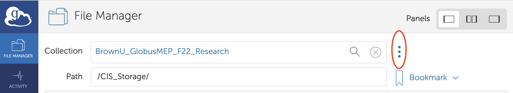
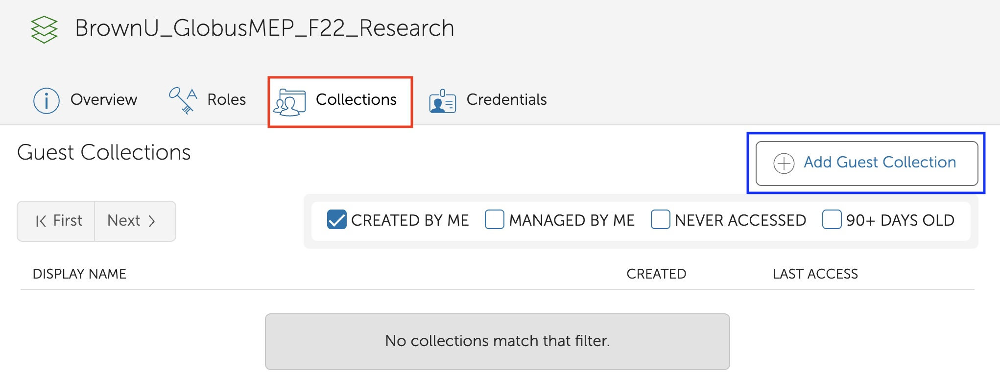
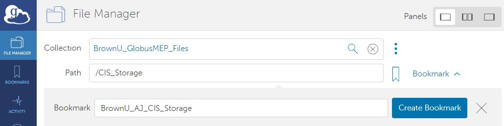
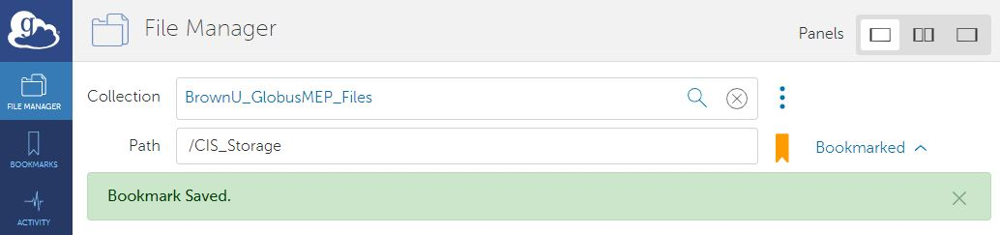
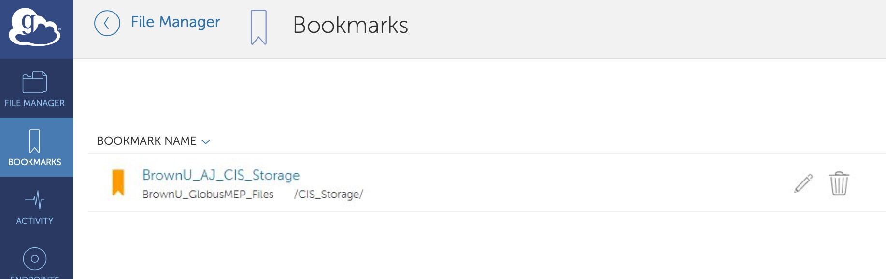

# Guest Collections and Bookmarks


### Prerequisites

* All users should have access to Research Folder on either '//files22.brown.edu/Research' OR '//files22.brown.edu/LRSResearch' shares. If you don’t have one, please contact your local ITSC support or _help@brown.edu_ to request access to an existing folder or create a new one. [More Info](https://ccv.brown.edu/services/file-storage-and-transfer).
*   All users should have &#x200B;_&#x75;idnumbe&#x72;_&#x200B; and &#x200B;_&#x67;idnumber_ ​associated with their _shortid_ in Brown

    AD. Without _uidnumber_ and _gidnumber_, Globus will not be able to authenticate to the storage.


If the main purpose for using Globus is to share/provide access with/to other users to do data transfers, then you need to create a **Globus Guest Collection.** If the purpose is to browse the folder or do data transfers personally, creating a **bookmark** would suffice.

## Creating a Globus Guest Collection

**Creating a Globus Guest Collection**: Once you search and browse to the appropriate collection/folder, please click the three dots as shown in Fig-10.

<figure><figcaption>
Figure 10:
</figcaption></figure>

Then click on "Collections" tab and then click on "Add Guest Collection" as shown in Fig-

<figure><figcaption>
Figure 11:
</figcaption></figure>

* **Guest Collection Syntax​:** We want this name to be a standard for management purposes. ​Note: Non-Standard Names might not get associated with Brown Subscription. ​Please avoid putting your Brown ShortID in place of Name/Initial.
  1. **Syntax​:** ​BrownU​\_\<Name/Initials>\_\<FolderName>
  2. **Example:** BrownU\_AJ\_OIT\_Storage
* Directory: Please enter the full path or browse to the location where you would like to create a collection.
* Display Name: Please enter a collection name following above mentioned syntax.
* Description: Type a short description that best suits the collection.

The rest of the fields are optional. Click on "Create Collection".

<figure><figcaption>
Figure 12:
</figcaption></figure>

### Creating a Bookmark

12\. **Creating a Bookmark:** You may bookmark your selected folder, by clicking the Bookmark icon which is to the right of the Path search textbox (figure 9), entering the name for the selected folder, and then click the 'Create Bookmark' button as shown in Figure 13.

* **Bookmark Syntax​:** We want this name to be a standard for management purposes. ​Note: Non-Standard Names might not get associated with Brown Subscription. ​Please avoid putting your Brown ShortID in place of Name/Initial.
  1. **Syntax​:** ​BrownU​\_\<Name/Initials>\_\<FolderName>
  2. **Example:** BrownU\_AJ\_CIS\_Storage

After that, a confirmation will be displayed as in Figure 14. Once a bookmark is saved, you can access it later by clicking the 'BOOKMARKS' icon in the left panel, and then click the bookmark from the list of your saved bookmarks, as shown in Figure 15.

## Transfer data

11\. You can transfer to any other Globus Collection that you have permission to. Once you are in your collection, to select either source/target collection, you can either click on "Transfer or Sync to" in the right menu or click the 'Dual Pane' in the Panels menu in the top right corner of the 'File Manager' window. Now you can search for the secondary collection that you want to transfer data to/from.

If you want to use Globus Online to move data to/from your own machine, you can install Globus Connect Personal. Installing Globus Connect Personal allows you to create an endpoint on your computer that you can use to transfer data to and from your computer. For installation, please visit: [https://www.globus.org/globus-connect-personal](https://www.globus.org/globus-connect-personal)

12\. You can then select the files you want to transfer. And click the 'Start' button.

13\. You should see "Transfer request submitted successfully" and an id for the transfer. Click "View Details" to see transfer progress. if you have started a transfer between two remote machines you don't have to keep your computer connect to Globus\*\*. When the transfer is complete you will receive an email.


**\*\*If you are using Globus Connect Personal for a transfer to/from your machine, Globus personal needs to stay running on your machine for the transfer to complete.**


### Tips for Transferring Data between Globus and Google Drive

For Google Drive, there are "rate limits" on how much data and how many files a user can transfer in any 24 hour period. The following two tips can help to alleviate the restrictions from the rates limits:

* Transfer a subfolder as a job. A user can submit 2-3 jobs at a time.
* If the folder or subfolder contains a lot of small files, compress the folder or subfolders using zip or tar before the transfer.

### [Troubleshooting Globus](../support/troubleshooting.md)

### Globus links

* If you need more information on How Globus works, please refer to [HowTo Videos located ​here​](https://docs.globus.org/how-to/instructional-videos/).
* Check out [the Globus docs page](https://docs.globus.org/how-to/) for more info.
