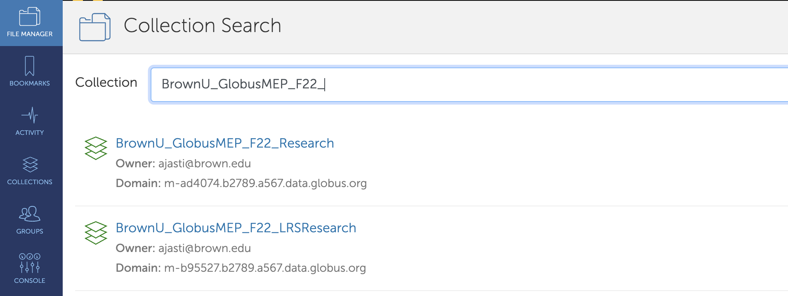
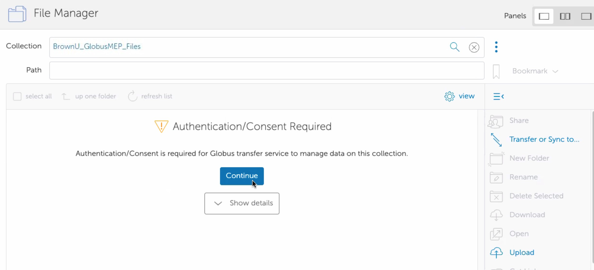
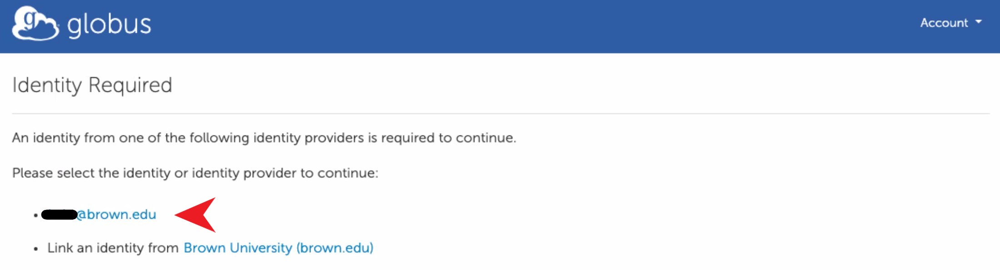
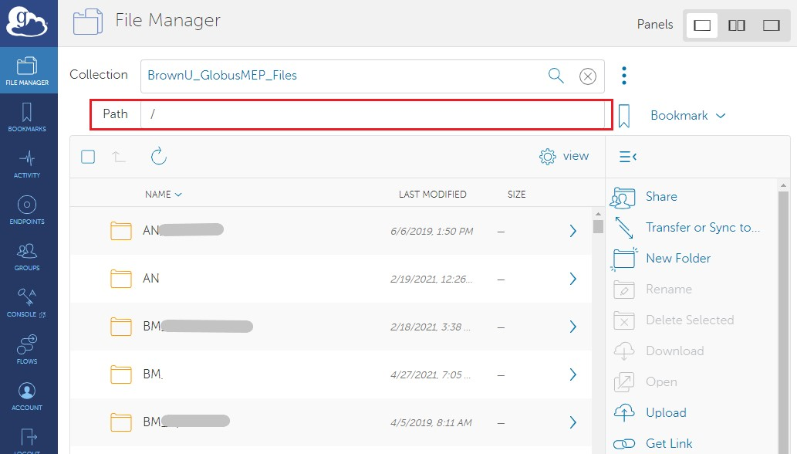
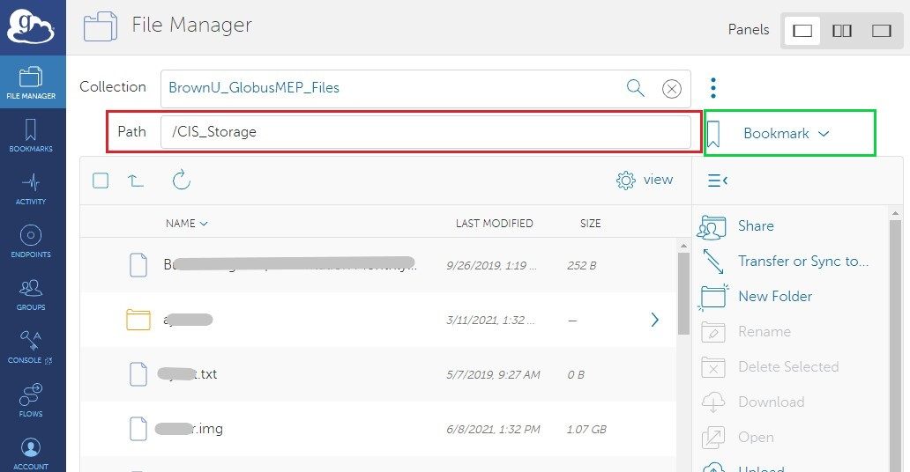

# files22.brown.edu

## Prerequisites

* All users should have access to Research Folder on either '//files22.brown.edu/Research' OR '//files22.brown.edu/LRSResearch' shares. If you don’t have one, please contact your local ITSC support or _help@brown.edu_ to request access to an existing folder or create a new one. [More Info](https://ccv.brown.edu/services/file-storage-and-transfer).
*   All users should have &#x200B;_&#x75;idnumbe&#x72;_&#x200B; and &#x200B;_&#x67;idnumber_ ​associated with their _shortid_ in Brown

    AD. Without _uidnumber_ and _gidnumber_, Globus will not be able to authenticate to the storage.

## 1. Creating a Globus Account


_**Note:**_ ​If you are already a subscriber of Globus service and have a Globus account, some of the permissions pages might not show up during this process.


1.1. Navigate to [https://www.globus.org/](https://www.globus.org/), then click the 'Login' button in Figure 1.

<figure><figcaption>
Figure 1. Globus Web page
</figcaption></figure>

1.2. Select Brown University as the Organization, then click 'Continue' in Figure 2.


PLEASE DO NOT USE "Sign in with Google"


<figure><figcaption>
Figure 2. Globus Web App Login
</figcaption></figure>

1.3. The page will redirect to the SSO Authentication page. Use your AD credentials.

<figure><figcaption>
Figure 3. SSO Page
</figcaption></figure>

### 2. Navigating to the base (mapped) collection

2.1. Once logged in, navigate to 'File Manager', and enter '_**BrownU**_**\_**_**GlobusMEP\_F22\_Research**_' OR '_**BrownU**_**\_**_**GlobusMEP\_F22\_LRSResearch**_' in Collection Search as shown in Figure 4:

<figure><figcaption>
Figure 4: Collection Search results
</figcaption></figure>

2.2. Click the appropriate collection in the list: **BrownU\_GlobusMEP\_F22\_{Research/LRSResearch}**, if it is your first time accessing the BrownU\_GlobusMEP\_Files collection (Step 5 - 7), click the 'Continue' button in Figure 5 to be authenticated.


**Note:** You can skip steps 5-7, if you have accessed 'BrownU\_GlobusMEP\_F22\_\*' collections before; you will not be prompted for authentication.


<figure><figcaption></figcaption></figure>

2.3. Click the "\<your\_brown\_shortid>@brown.edu" in Figure 6.

<figure><figcaption></figcaption></figure>

2.4. Click the 'Allow' button in Figure 7 to grant permissions to Globus Web App. You should read the Terms of Service and Privacy Policy.

<figure><figcaption></figcaption></figure>


_If you don’t have your ‘**uidnumber**’ and ‘**gidnumber'** set properly, you will not be able to create a collection. You might end up with an error page like '_&#x49;dentity set contains an identity from an allowed domain, but it does not map to a valid username for this connector' OR 'An unexpected error has occurred'. _Please contact ​help@brown.edu or your local ITSC to resolve the issue._


<figure><figcaption></figcaption></figure>

2.5. After authentication, the collection is displayed in File Manager as shown in Figure 8.

<figure><figcaption>
Figure 8: Folder Selection
</figcaption></figure>

2.6. In the 'Path' textbox, please enter your Researc&#x68;_&#x46;olderName. For Example: '"_**CIS\_Storage**_"_ as in **\\\files22.brown.edu\Research\CIS\_Storage**, as illustrated in Figure 9.

<figure><figcaption>
Figure 9: Select Research Folder
</figcaption></figure>

2.7. Once you browse to the appropriate folder, you can create a [**Globus Guest Collection**](files.brown.edu-1.md#creating-a-globus-guest-collection) or a [**Bookmark**](files.brown.edu-1.md#creating-a-bookmark). If the main purpose for using Globus is to share/provide access with/to other users to do data transfers, then you need to create a **Globus Guest Collection.** If the purpose is to browse the folder or do data transfers personally, creating a **bookmark** would suffice.
