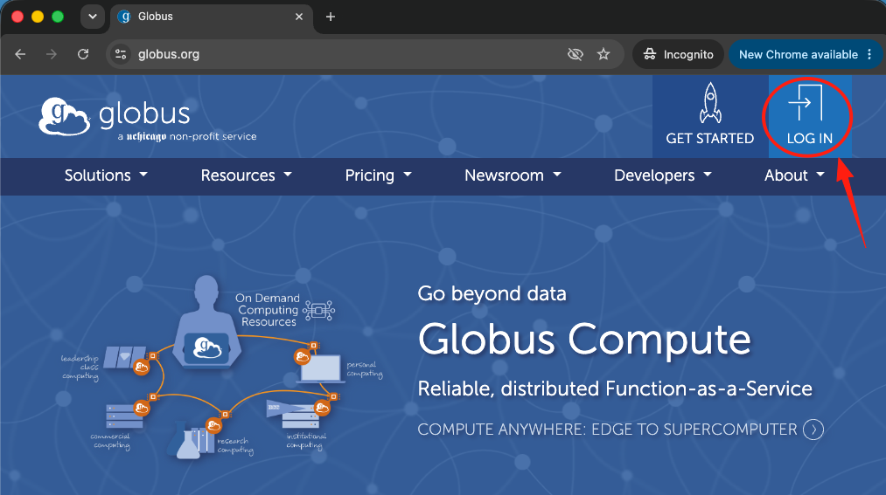
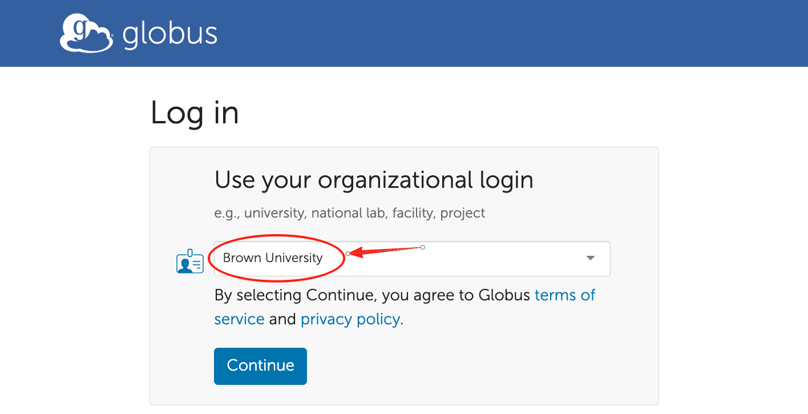
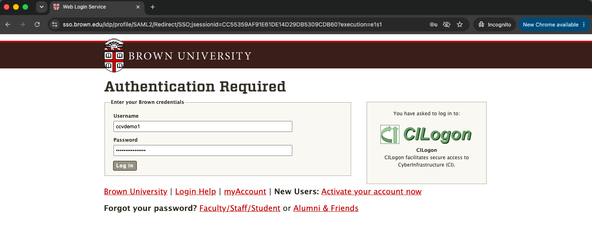
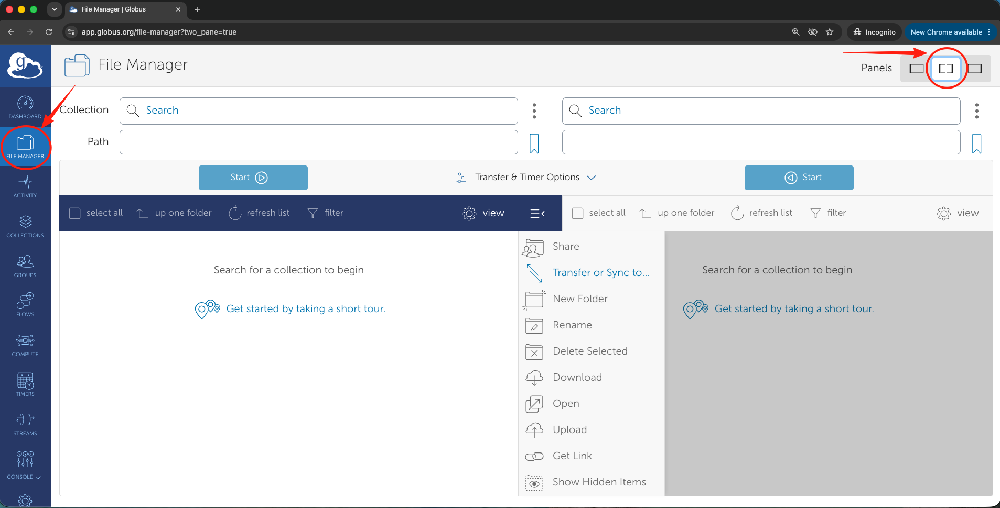
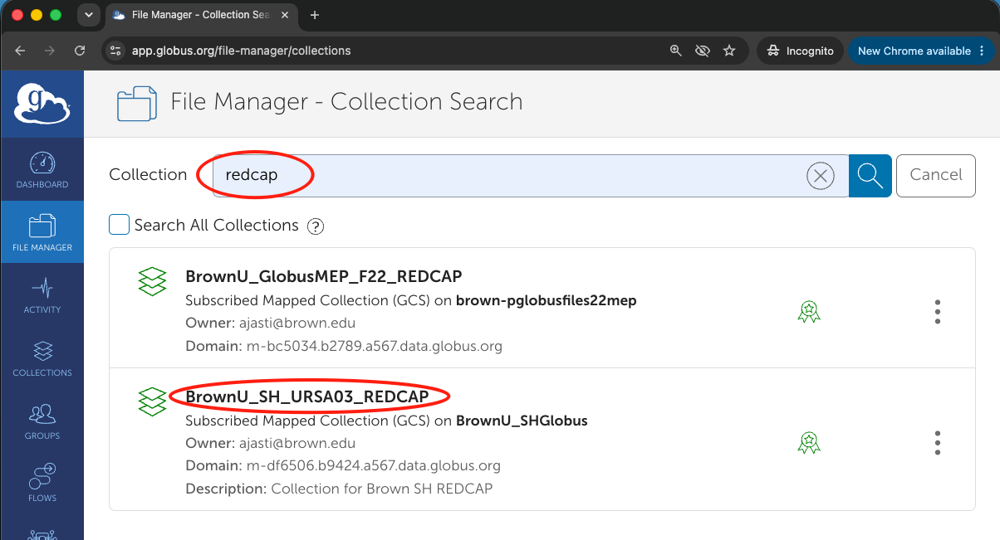
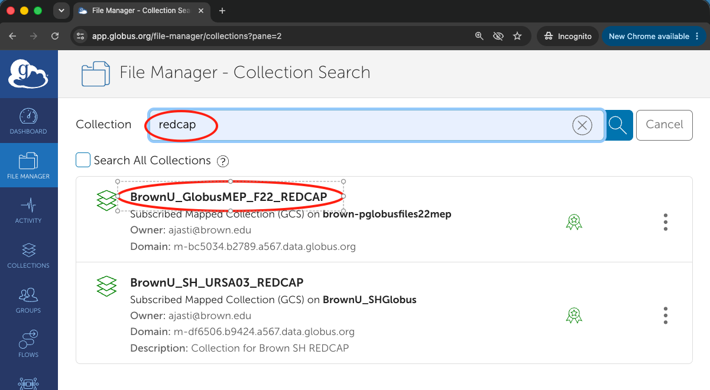
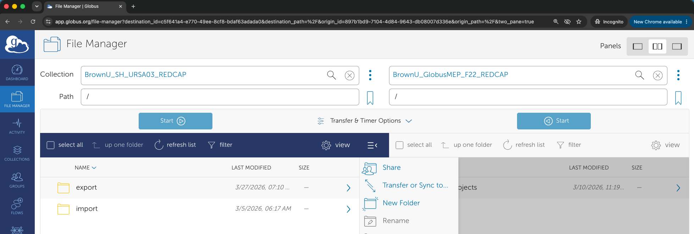
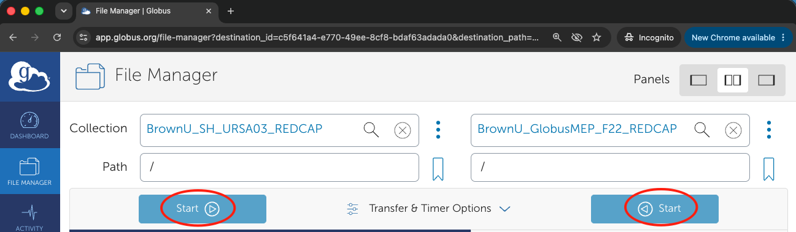
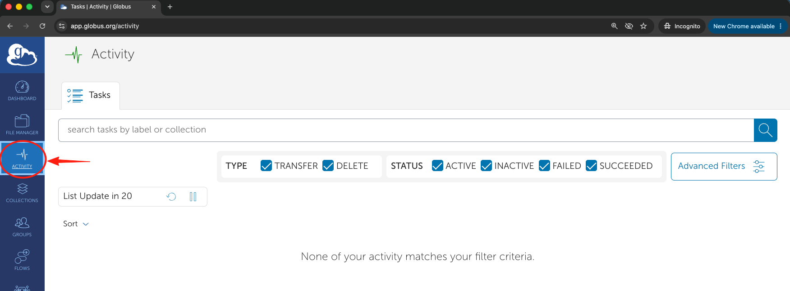

# REDCAP Collections

We utilize **Globus** to facilitate secure and efficient data transfers between REDCap and other Storage Systems. Globus provides a reliable, high-performance managed transfer service that is ideal for moving large datasets.

## Globus Collections

A Globus collection is associated with a storage system. Thus, if you need to transfer data between two storage systems, you need the names of their corresponding Globus collections. Some such collections are:

| Storage                       | Collection Name                  |
| ----------------------------- | -------------------------------- |
| REDCap Analytics Server       | BrownU\_GlobusMEP\_F22\_REDCAP   |
| Campus File Storage (Files22) | BrownU\_GlobusMEP\_F22\_Research |
| Stronghold URSA               | BrownU\_SH\_URSA03\_REDCAP       |
| Oscar                         | BrownU\_CCV\_Oscar               |


You can bookmark a folder in a particular collection by clicking the bookmark icon <i class="fa-bookmark">:bookmark:</i> next to the "Path" field


The following step-by-step guide outlines the transfer process. It shows a transfer between Stronghold URSA  and the REDCap Analytics Server, as an example. However, the same steps apply to any two collections.

***

## Step-by-Step Transfer Guide (Example: URSA-Win3)

### Step 1: Log In to Globus

1.  Navigate to the [Globus Web App](https://www.globus.org/) and click "LOG IN" button on the top right corner.

    <figure><figcaption></figcaption></figure>
2.  Select **Brown University** from the organizational dropdown menu and log in using your Brown credentials.

    <figure><figcaption></figcaption></figure>

    <figure><figcaption></figcaption></figure>

***

### Step 2: Access the Source and Destination Collections

1.  In the **File Manager** interface, split your view into two panels (dual-panel mode) to see both the source and destination simultaneously.

    <figure><figcaption></figcaption></figure>
2.  **For REDCap Data / Source:** Locate and connect to the specific collection or endpoint where your REDCap data is staged or hosted.

    * _Example:_ Search for the `URSA03` endpoint/collection and authenticate if prompted.

    <figure><figcaption></figcaption></figure>
3.  **For Brown Network Storage / Destination:** In the opposite panel, search for and select the collection corresponding to the Brown Network Storage.

    <figure><figcaption></figcaption></figure>

***

### Step 3: Navigate to the Target Directories

1. In the REDCap/source panel, navigate to the folder containing the specific data files you wish to transfer.
2.  In the **URSA-Win3** panel, navigate to the exact directory path where the files should be securely stored.

    <figure><figcaption></figcaption></figure>

***

### Step 4: Initiate the Transfer

1. Select the files or folders from the source panel that you need to move.
2.  Click the **Start ➡️** (or **Start ⬅️**, depending on your panel layout) button to initiate the transfer process from the source to the URSA-Win3 network storage.

    <figure><figcaption></figcaption></figure>

***

### Step 5: Monitor Transfer Status

*   Once initiated, Globus will manage the transfer asynchronously in the background. You can monitor the real-time progress of your transfer at any time by navigating to the Activity tab in the Globus sidebar.

    <figure><figcaption></figcaption></figure>
