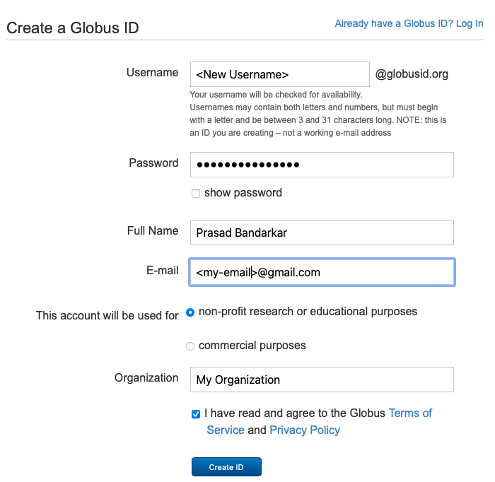
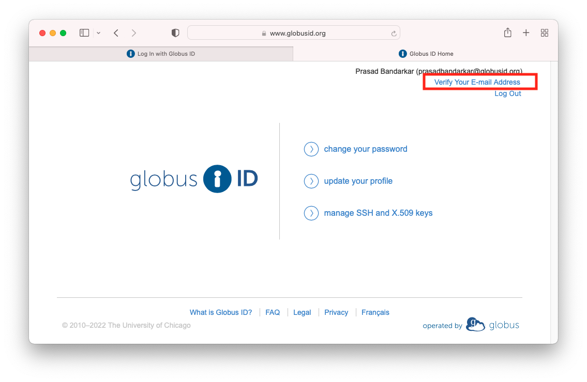

# Create Globus ID

**This step needs to be performed just ONCE, to create a Globus ID linked to your email.**

1. Visit [https://www.globusid.org/create](https://www.globusid.org/create) in your Browser
2. Choose a username and password. Enter your email that you will use to access this data in the "E-mail" field. Click "Create ID" after filling out the form.

<figure><figcaption></figcaption></figure>

3\. Click "Verify Your E-mail Address". This will send an email titled "**Globus ID Verification**" to your email. Check all the folders in your mail box, it might end up in a folder other than the inbox. Copy the verification code from that email and enter it in the next screen.

<figure><figcaption></figcaption></figure>

Your Globus ID and your Globus account is now ready for use.
