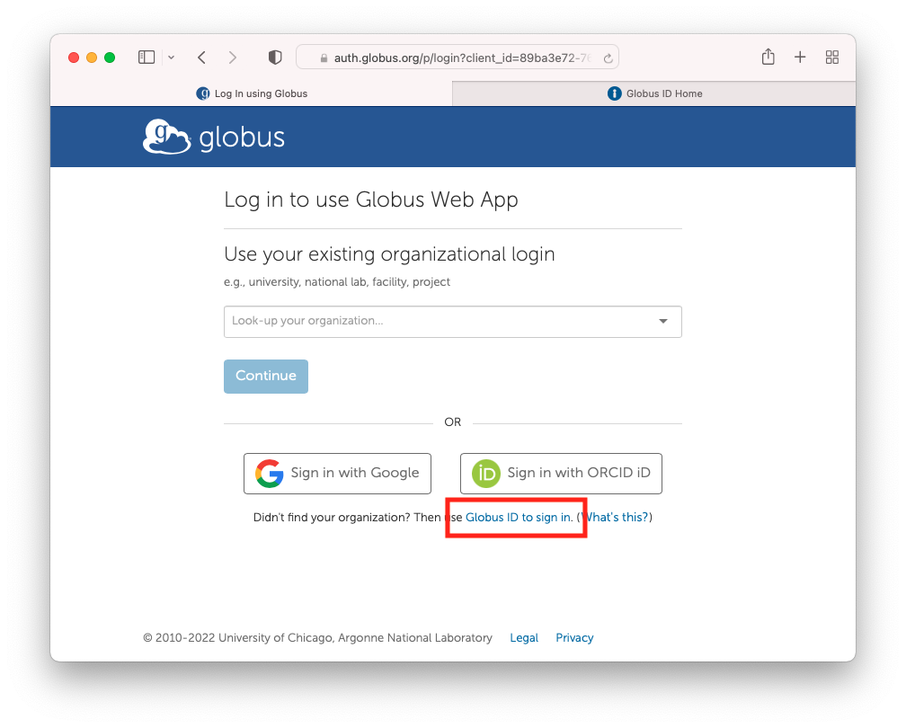
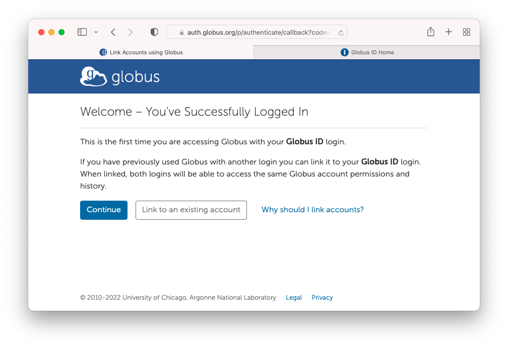
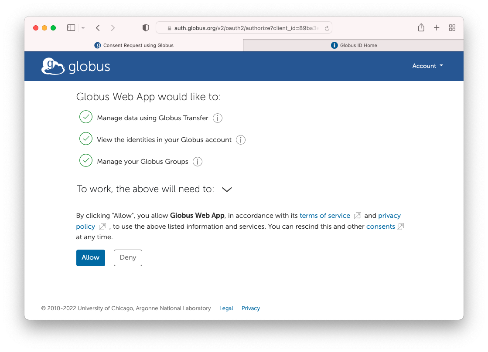
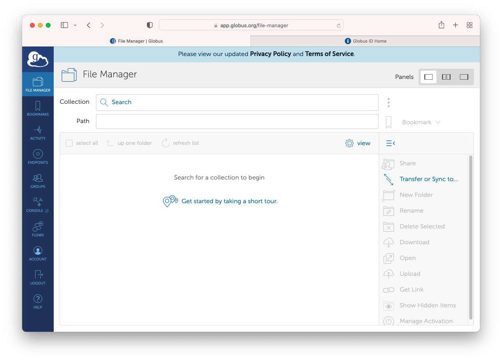

# Log in to Globus

**These instructions assume you have already created your Globus ID. To create a Globus ID, visit** [create-globus-id.md](create-globus-id.md "mention")

1. Visit [https://app.globus.org](https://app.globus.org) . If you aren't already signed in, you will see the following page. Click on "**Globus ID to sign in**"

<figure><figcaption></figcaption></figure>

2\. Enter your **Globus ID** and **password** in the next screen to log in.

<figure><figcaption></figcaption></figure>

3\. Click "**Continue**".

Optional step: If you have previously used Globus with another login, you can link that account by clicking "Link to an existing account".

<figure><figcaption></figcaption></figure>

4\. If prompted, click "**Allow**" to grant permissions to the Globus Web App.

<figure><figcaption></figcaption></figure>

4\. You are now logged into Globus

<figure><figcaption></figcaption></figure>
