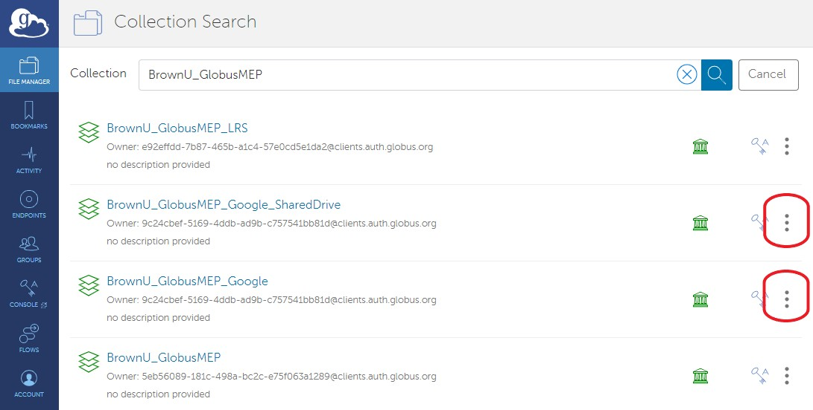
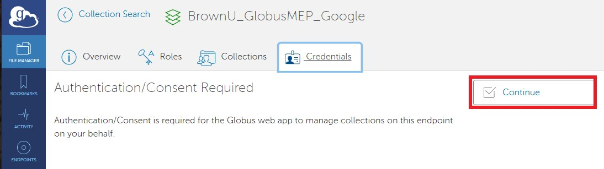
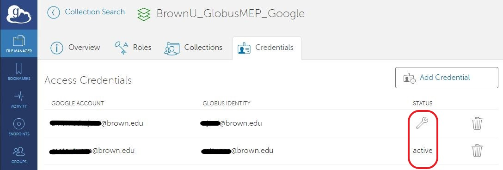

# Troubleshooting

## Index

* [Resetting Google Authentication Credentials](troubleshooting.md#resetting-google-authentication-credentials)
* [Error Listing Directory](troubleshooting.md#error-listing-directory-due-to-expired-google-auth-token-for-google-drive-endpoints)
* [Guest Collection Page Error](troubleshooting.md#guest-collection-page-error)

## Resetting Google Authentication Credentials

<div align="center"></div>

<div align="center"></div>

If you see either of the error messages above, please follow the steps outline below.

* Goto [collections](https://app.globus.org/file-manager/collections). Alternatively, you can search collections in the '_**File Manager**_' window.
* Search for '_**BrownU\_GlobusMEP**_''.

<div align="center"></div>

* Click on three dots next to "_BrownU\_GoogleMEP\_Google_" for Google Drive **OR** _'_"_BrownU\_GoogleMEP\_Google\_SharedDrive_" for Google Shared Drive as shown above.
* Click on the '_**Credentials**_' tab and then click '_**Continue**_'

<div align="center"></div>

* Once you hit continue, '_**Access Credentials**_' page should open (See below picture). This page will the Google account (brown email) and the associated Globus identity (shortid@brown.edu) and the appropriate authentication status. You can have three possibilities:
  1. If you don't see any credentials, please click _**'Add Credential'**_' and follow the google prompts.
  2.  If you see a '_**wrench**_' symbol under Status, click on the '_**wrench**_' symbol and follow the google prompts.

      .png>) 
  3. If the status is '_**Active**_' you should be all set. If the error persists, please delete the credential (by clicking on the trash can icon), log out, and log back in. Then return to this page and follow step 1



Once the status is 'Active', click on '_**Overview**_' tab and then click '_**Open in File Manager**_'.

If you are still unable to access your 'Google Drive' or 'Google Shared Drive', please email ccv-support@brown.edu along with error details.

## 'Error Listing Directory' due to expired 'Google Auth Token' for Google Drive Endpoints

Error: _"**invalid\_grant"**\*_ from Google. Debug details:

```console
Error listing directory '/' on endpoint 'af4982a2-ab6d-4935-a1a7-c201a7367aeb': 
Command Failed: Error (list) 
Endpoint: BrownU_$username_GDrive (af4982a2-ab6d-4935-a1a7-c201a7367aeb) 
Server: 7c6985.a567.dn.glob.us:443 
Command: MLST / Message: Fatal FTP Response --- 
Details: 500-GlobusError: v=1 c=INTERNAL_ERROR\r\n500-\r\n500-GD-Method: "POST"\r\n
500-GD-URI: "https://accounts.google.com/o/oauth2/token"\r\n
500-GD-Response-Code: "400"\r\n500-GD-Error: "invalid_grant"\r\n
500-GD-Error-Description: "Bad Request"\r\n500 End.\r\n
```

If you are getting above listed error, please follow these steps to refresh your Google auth token for Globus.

1. Please use this [link](https://docs.ccv.brown.edu/storage-and-transfer/globus/creating-endpoints/creation-of-globus-endpoint-for-brown-google-drive) to create a Globus collection for Google Drive. _Note: You are just using the link to reset your credentials and not creating a new collection._
2. Once you get to the step '[**Create a Guest Collection**'](https://docs.ccv.brown.edu/storage-and-transfer/globus/creating-endpoints/creation-of-globus-endpoint-for-brown-google-drive#create-a-guest-collection) , you will need to click on the '**manage these credentials**' link just below the credentials box.
3. This will take you to a '**credentials**' page where you will see a '**Fix**' or a '**Delete**' button. Selecting 'Fix', or 'Delete' and then 'register one now' will take you through the Google login flow and update the credential for your existing collection. **It is not necessary to create a new collection**.

### Guest Collection Page Error

It is possible that after clicking on the link to create a guest collection you will see the following error message:

.png>)
