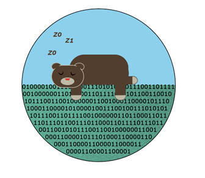

# FAQ

*   **What is the default retention period for archived data?**

    10 Years. If longer (or shorter) retention is required, PI/Researchers should work with the OIT-Storage team to make necessary provisions.
*   **How long does it take to archive/retrieve data once the request is submitted?**

    Factors that affect recovery times are (in descending order):

    1. Number of objects (files, directories)
    2. Total Size of recovery job
    3. Number of recovery jobs in Queue
    4. Size of the recovery partition/cache (Hard set) 

    With the current system, once the job is approved/submitted and assuming no queue contention, we can recover up to 5TB or 500,000 objects (whichever comes first) in 48 hours. This time includes starfish validation (after recovery we do a scan to validate recovery).


_**Example:**_ A folder of size 2TB with 2000 objects will be much faster to recover than a folder of size 100GB with 2 million objects.


*   **Can a single file or a folder be recovered?**

    Yes, we have the flexibility to recover a single file or a folder.
*   **How can I see my archived data?**

    Using Starfish, _**Recovery**_ mode.
*   **Will the file permissions be saved?**

    No.
*   **What type of storage media is used to store archived data?**

    Tape
*   **Why are recoveries slower than archiving?**

    Unlike archive, recovery is a two-step process. First, data has to be recovered from tape to recovery partition/cache (most time-consuming and limited to #4), then the data has to be moved from cache to a primary storage platform (like files22).
*   **How many times per year can one recover data from Hibernate?**

    Frequent recoveries of archived data are not recommended. Hibernate service is designed for storing static and unused data but may still have relevance (compliance requirements, patents, DUA, etc.). If you have a requirement to recover data very often (once a quarter or monthly), please reach out to the OIT-Storage team to discuss other options.

<figure><figcaption>
"Don't poke the sleeping Bear"
</figcaption></figure>
