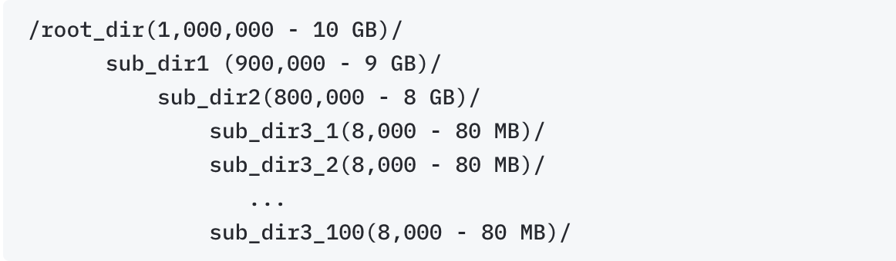

# Archive Data

The archive feature is a very useful tool for researchers. Some typical use cases are:

* Cold data: Data that is not actively accessed but needs to be preserved (Ex: Patent datasets). Archiving such data also helps in reducing data usage/capacity planning.
* Snapshot/secondary copy: A point-in-time copy of a research dataset that can be recovered if required (Ex: Simulation datasets for publications).

The following are the steps to archive data using the Hibernate service:

**Step 1 (Identify the data):** Navigate into the directory you wish to archive

**Step 2a (Tag the data):** Right-click on the particular directory and select <mark style="color:green;">`Tags > Action Tags > A Hibernate: Archive`</mark>

<figure><figcaption></figcaption></figure>


Before tagging the data, please check our [**best practices**](archive-data.md#best-practices-archive) section for tips and hints that will help the archival process to run smoothly.


**Step 2b:** Once you select that, the <mark style="color:green;">A Hibernate: Archive</mark> tag should appear on the directory

<figure><figcaption></figcaption></figure>

**Step 2c:** Repeat the procedure to tag all relevant folders and files to be archived.

**Step 3 (Notify the Storage team):** Once tagging is complete, please complete the [Hibernate Service Request form](https://brown.atlassian.net/servicedesk/customer/portal/16/group/55/create/468) and select the appropriate action tag. This will automatically submit a ticket to the storage team to start the appropriate process.


Currently, we are able to archive **6-8TB/day** OR **about 1 million objects a day** (whichever threshold is met first).


**Step 4 (Staging of Data for Archive):** Once the ticket is submitted, the Storage team will start the process of prepping the data for Archival. The following tasks are done within the tagged data paths:

1. Move tagged folders to a staging Area
2. Add staging area path to the respective researchers StarFish zone
3. All **empty folders** are deleted - _S3 archival process doesn't allow archiving empty folders._
4. Delete **Temp files** (ex: .DS\_store).
5. **Tar/compress folders** that are relatively small in size but have a large object count (_See the example in_ [_Best Practices_](archive-data.md#best-practices-archive) _below_)


**Files or folder names with special characters cannot be archived.** We suggest renaming them before tagging.


**Step 5 (Delete the data from the source):** Once the data is validated in the staging area, the original data on the respective source(s) will be deleted. This will clear up usage for researchers.

**Step 6 (Archive the data):** Once the data prep process is complete, all the tagged data is archived to two geographically separated Object Archive platforms using the Starfish tool.

**Step 7 (Generate Manifest):** A manifest and CSV are generated for each archive request, logging critical metadata such as volume and path. These documents will be uploaded to a dedicated Google Drive shared with the Principal Investigator (PI). Organized by job date, these searchable logs enable users to quickly locate and identify specific directories for restoration.

**Step 8 (Delete the data from the staging area):** Once the data is validated on the two Object Archive platforms, the original data in the staging area will be deleted.

Once the data is deleted from the staging area, users can still refer to their archived data through the [starfish interface](https://app.gitbook.com/o/-LLCCXzgv2-pRyGi-QB2/s/sj8xGxdXkKXBKnl6vJ1K/).

## Best Practices (Archive)

Archiving data is a very tedious process. A lot of factors like directory/file sizes, number of files in a single directory, etc. play a critical role in determining how efficiently data can be archived. Here are some best practices to facilitate an efficient archive process:

* **Tagging Directories**: Always tag folders, not individual files (except compressed folders - see next tip). If a single file(s) needs to be archived, move it to a folder.
* **Delete Empty Directories:** It's a best practice to delete empty directories before archiving.
* **Logically arrange data that might help with efficient recoveries.**
* **Compressing Folders**: Folders that are small in size but contain thousands of files should be compressed (zip, tar). _For example, archiving a folder of size 10GB containing 500,000 files will be treated as 500,001 objects (files+folder) to archive and the same for retrieval. However, if the same folder is compressed, it is treated as one (1) object to archive._

<figure><figcaption>
Folder Structure
</figcaption></figure>

* Example:
  * Given the folder path as shown above with the number of objects and size at each folder level, it's essential to determine where to compress folders.
  * Compressing at 'root\_dir' level
    * Pros: Will consolidate 1 million objects into a single object.
    * Cons: Will lose the flexibility to recover individual sub-folders; need to recover an entire folder, requires more system resources and time to compress 1 million objects (even though they are small in size)
  * Compressing at 'sub\_dir3' level
    * Pros: Will consolidate 1 million objects into less than 200 objects while providing great flexibility while recovering. It does not require too many system resources while compressing.
    * Cons: Requires admin's time to analyze and identify the path where compression needs to happen and automate compressing multiple sub-directories.
