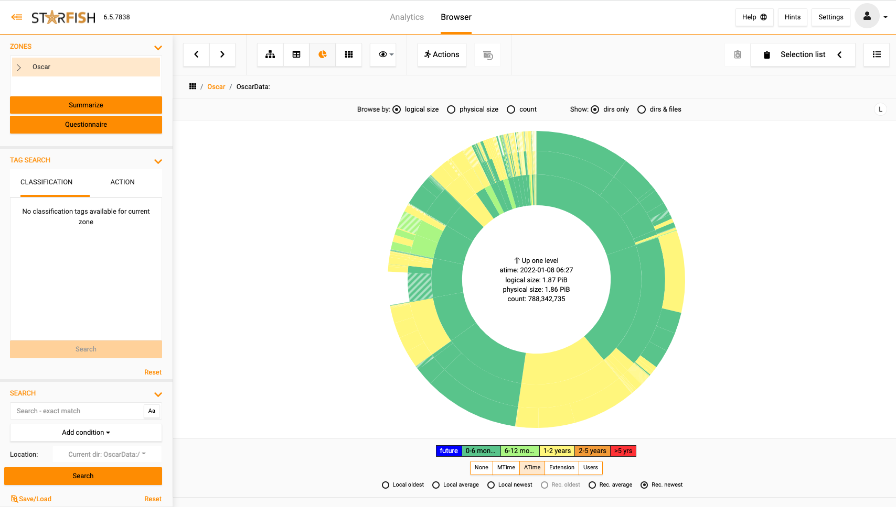

# Data Insights

Along with major attributes (Archive, Delete, Recover). Hibernate also provides insights into your data usage:

* Types/sizes of files, access times
* Hot Spots (Growth, user(s)/Group(s)

