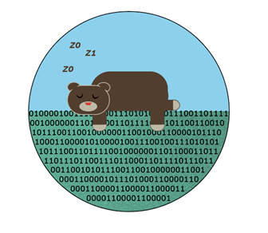

# Overview

<figure><figcaption>
Hibernate
</figcaption></figure>

Hibernate is a Brown OIT archival service for the research community to migrate inactive data off active NAS platforms onto a lower-cost, long-term retention environment. Data will be archived on two geographically separated Object Archive platforms to provide at least two copies of the data.

Data on the following storage platforms can be archived:

* Campus File Storage (files22)
* Oscar Data

**Hibernate has the following attributes:**

* <mark style="color:orange;">**Archive**</mark> - move a directory to hibernate storage (archive)
* <mark style="color:red;">**Delete**</mark> - delete a directory from primary storage (files22, Oscar data, etc)
* <mark style="color:green;">**Recover**</mark> - retrieve a directory or file from hibernate storage (archive)


Brown VPN is required to access Hibernate Service.

