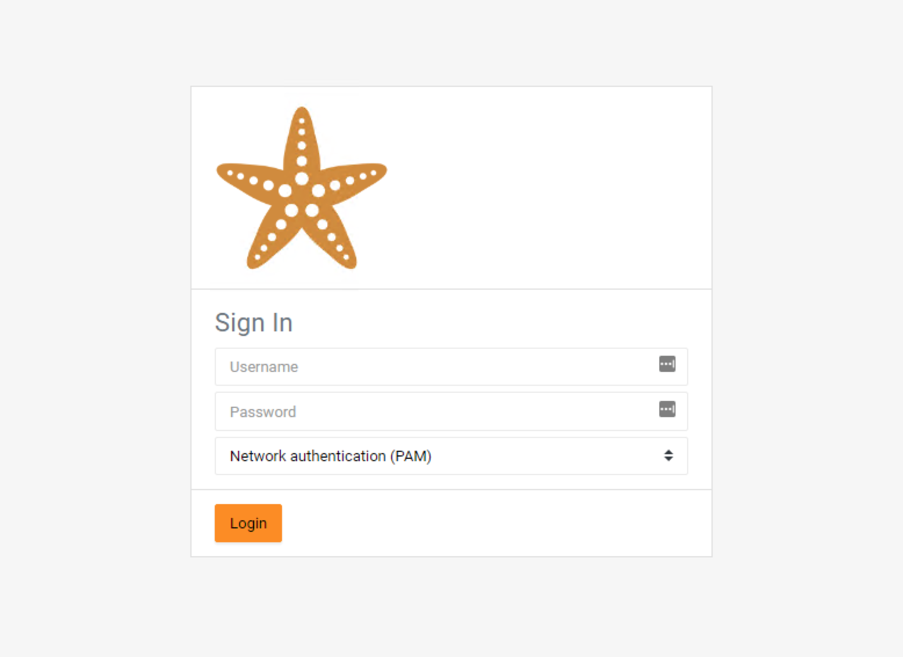
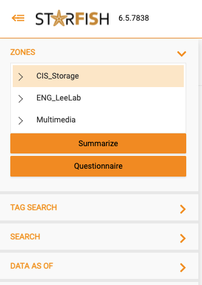

# Access

To access the Starfish tool interface, plese go to:


Note: You can only access Starfish via VPN (for now).


* Web address: [**https://starfish.brown.edu**](https://starfish.brown.edu)
* Login with your Brown ID and password
* Select 'Network Authentication (PAM)'

<figure><figcaption>
Starfish Login page
</figcaption></figure>

Once logged in, a user can access all their zones.

<figure><figcaption>
Starfish Access Menu
</figcaption></figure>


If any 'Zones' are missing, please reach out to support - mailto:[support@ccv.brown.edu](mailto:support@ccv.brown.edu)

