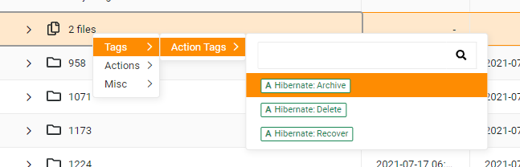

# Archive Tags

## Add a Tag to a Directory or File

* move your mouse over the directory or file
* right click your mouse
* move your mouse over Tags
* move your mouse over Action Tags
* select one of the three tags
  * `Hibernate: Archive` - this tag will move the directory or file to hibernate storage (archive)
  * `Hibernate: Delete` - this tag will delete the directory or file from primary storage (files, lrs, oscar, etc)
  * `Hibernate: Recover` - this tag will recover the directory or file from hibernate storage

<figure><figcaption>
Archive Tags
</figcaption></figure>

## Submit a Request to Execute Tags

After adding a tag to a directory or file in Starfish, a user must [submit a request to execute the tag.](https://brown.co1.qualtrics.com/jfe/form/SV_3V3SZ2HSJLxoCs6)
