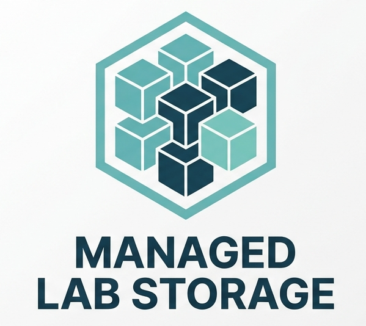

# Overview

<figure><figcaption></figcaption></figure>

**Managed Lab Storage** is a professionally managed storage service designed to provide researchers with an affordable, secure, and locally accessible storage solution for grant-funded research. The service is intended for workloads where enterprise-level performance and high resiliency are not the primary requirements, but where researchers benefit from low-latency access to data within or near their labs. Storage systems are purchased using research grant funds and deployed as consumer-grade NAS appliances, with OIT providing the initial configuration, ongoing operating system and firmware maintenance, and hardware replacement throughout the system’s lifecycle. This model provides researchers with greater control and convenient local access to their research data while reducing the cost and management burden associated with maintaining storage independently.
