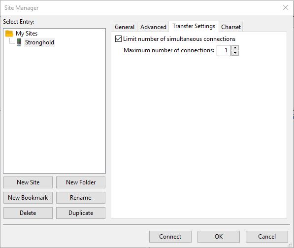
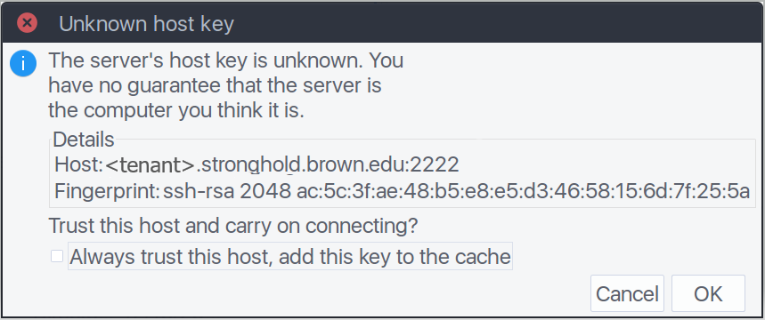
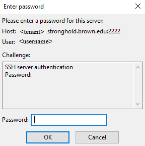
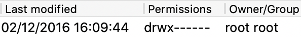
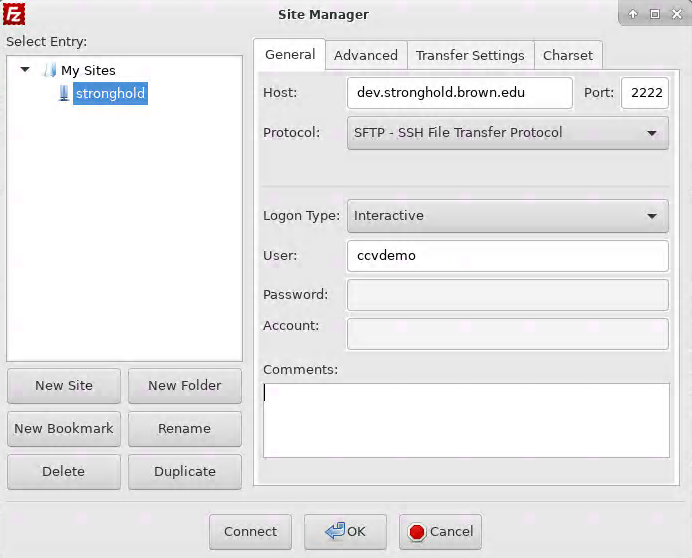
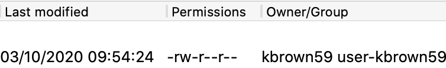

# Data Imports

## Overview

Data imports allow users in correct security groups to transfer data from outside systems into their Stronghold environments. **Please note that all files transferred to the xfer server will be virus scanned, during which time they will be unavailable for transfer off of the server. This should only take a few minutes to complete, though it is dependent on the size and type of file being transferred.** Here's how it works:

1. First transfer the data to the xfer server via SFTP from a computer outside of your Stronghold environment
   * Users must be part of the `sh_<tenant>_import_w`security group for their tenant to complete this step
2. Then transfer the data off of the xfer server from inside your Stronghold environment
   * Users must be part of the `sh_<tenant>_import_r`security group for their tenant to complete this step

## Instructions

### 1. Transferring Import Data to Xfer Server from Outside System

In order to import data into Stronghold you must first set up a site outside of your workstation.

From a system outside of Stronghold, open **FileZilla** and click **File > Site Manager**

Click **New Site** and enter a name for it (e.g. "stronghold").

Under the **General** tab, add the following entries, replacing `<tenant>` with the tenant you were assigned and `<username>` with the same username used to log in to Workday.

* Host: `<tenant>.stronghold.brown.edu`
* Port: `2222`
* Protocol: `SFTP - SSH File Transfer Protocol`
* Logon Type: `Interactive`
* User: `<username>`

Under the Transfer Settings tab:

* Limit number of simultaneous connections: `CHECK`
* Maximum number of connections: `1`

Click `OK` to close the **Site Manager** window and click on the **Edit** drop down menu and select **Settings…**

* In **Select Page** and under **Connection**, click on **FTP**
* Change **Transfer Mode** to `Active`

.png>)

Click `Connect` to begin the login process.

Accept the server’s host key by clicking `OK`. You can check the box to `always trust this host`.

You will first be prompted for your password, enter the same password used to log in to Workday and click `OK`

Next you will see what looks like another password prompt, but if you read the text you’ ll see it’s actually prompting you to select a Duo authentication method. Enter the number of your choice and click `OK`. Confirm your Duo authentication in the manner you selected.

.PNG>)

On the Remote site (right) pane, you should see an **import** and **export** directory. Double-click the **import** directory to expand it.

On the Local site (left) pane, browse to the location of the file(s) you’d like to upload.

Drag the file(s) to your user directory in the Remote site under your import directory and wait for the upload process to complete.

**Next, the files will be virus scanned, during which time they will be unavailable for transfer off of the server. You can see if a file has not yet been scanned by checking the** `Owner/Group` **of the file in FileZilla:**

If `Owner/Group` is listed as `root root` the files have not finished being virus scanned. **You will not be able to access the files until the virus scan completes.**

### 2. Transferring Import Data from Xfer Server to Workstation

In order to download your import data you will first have to set up a site inside of your Stronghold workstation

From your Stronghold workstation, open **FileZilla** and click **File > Site Manager**


* If your Stronghold tenant is running **Windows** or **Linux (pre-HyperV migration)**, you can skip this hint box and proceed with the main steps.
* If your Stronghold tenant is <mark style="color:blue;">**Linux (post-HyperV migration)**</mark>, please follow the steps below to launch FileZilla:
  * 1\) Click the top-left **Stronghold** menu and select **Terminal Emulator**.
  * 2\) Run `module load filezilla` command in the terminal to load FileZilla module:
  * 3\) Run `module load gcc/8.3.0 wxWidgets/3.0.4 nettle/3.4 libfilezilla/0.15.1 gnutils/3.5.18` command to load the required dependencies.
  * 4\) Run `filezilla` to launch FileZilla.


Click **New Site** and enter a name for it (e.g. "stronghold").

Under the **General** tab, add the following entries, replacing `<tenant>` with the tenant you were assigned and `<username>` with the same username used to log in to Workday.

* Host: `<tenant>.stronghold.brown.edu`
* Port: `2222`
* Protocol: `SFTP - SSH File Transfer Protocol`
* Logon Type: `Interactive`
* User: `<username>`

Under the Transfer Settings tab:

* Transfer mode: `Active`
* Limit number of simultaneous connections: `CHECK`
* Maximum number of connections: `1`

.png>)

Click `Connect` to begin the login process.

Accept the server’s host key by clicking `OK`

.png>)

You will first be prompted for your password, enter the same password used to access Stronghold and click `OK`

Next you will see what looks like another password prompt, but if you read the text you’ ll see it’s actually prompting you to select a Duo authentication method. Enter the number of your choice and click `OK`. Confirm your Duo authentication in the manner you selected.

.PNG>)

On the Remote site (right) pane, you should see an **import** and **export** directory. Double-click the **import** directory to expand it.

On the Local site (left) pane, browse to a folder located somewhere inside /data. Drag the import files from the Remote site to the folder you selected and wait for the download process to complete.\
\
Pay attention to the `Owner/Group` of the files you are trying to move. If `Owner/Group` is listed as `root root` the files have not finished being virus scanned. **You will not be able to access the files until the virus scan completes.** If the virus scan is complete, `Owner/Group` will be your username and a group which you are a member of:

**Note:** FileZilla does not refresh automatically. In order to continue to check if your files are ready yet, you either will need to navigate to a different folder and back again OR close FileZilla and reopen the connection.
