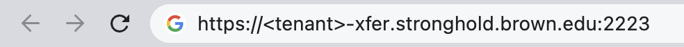

# FastX 3

The latest method for logging into Linux environments is **FastX 3**. Here's how it works:

1. Connect to **FastX 3 transfer workstation** and launch the Desktop;
2. Start **FileZilla** or **Firefox** Session to access data;
3. Transfer data from Xfer server to workstation.

## **Instructions:**

## 1. Connect to **FastX 3 transfer workstation** and launch the Desktop

Please choose the appropriate method based on your Stronghold tenant's HyperV migration status:

| HyperV Migration Status                                    | Method |
| ---------------------------------------------------------- | ------ |
| <mark style="color:blue;">**Pre**</mark>-HyperV migration  | 1 or 2 |
| <mark style="color:blue;">**Post**</mark>-HyperV migration | 3      |

### <mark style="color:orange;">Method 1: FastX3 Client</mark>

#### **1.1 Download FastX3 Client**

Click the link to Software Catalog below:



Then log in with your Brown credentails.

<figure><figcaption>
Brown Software Catalog Website - Log In Required
</figcaption></figure>

Select the OS version of FastX software and download it:

<figure><figcaption>
FastX3 Software
</figcaption></figure>

#### **1.2 Open and connect Stronghold workstation**

1.2.1 Click the FastX3 icon to open FastX3 client.


If you have a Mac, and receive the message "Apple can’t check app for malicious software" after clicking the FastX3 icon, follow [the three steps below](https://support.apple.com/guide/mac-help/apple-cant-check-app-for-malicious-software-mchleab3a043/mac) to open FastX3 client.


1.2.2 Click the "+" button to start a new connection.

<figure><figcaption>
New FastX3 Connection
</figcaption></figure>

1.2.3 Fill out the connection form (_**Port number is 2223**_) and click "OK":

<figure><figcaption></figcaption></figure>

1.2.4 Double click the new connection

<figure><figcaption></figcaption></figure>

1.2.5 Select a server of your tenant if required.

1.2.6 Enter your Brown password and click "Continue":

<figure><figcaption></figcaption></figure>

1.2.7 Select a DUO option and click "Continue".

<figure><figcaption></figcaption></figure>

1.2.8 Then click "+" button to start a Desktop or Terminal session:

<figure><figcaption></figcaption></figure>

1.2.9 Click 'Desktop' to start a desktop session:

<figure><figcaption></figcaption></figure>

### <mark style="color:orange;">Method 2: Web Browser (Pre-HyperV migration)</mark>

Point a web browser to your tenant page at the following address. `<tenant>` should be replaced by the actual Stronghold tenant name.

<mark style="color:red;">**`https://<tenant>-xfer.stronghold.brown.edu:2223`**</mark>

<figure><figcaption></figcaption></figure>

Enter your Brown credentials and select Login.

<figure><figcaption></figcaption></figure>

To continue the login process, you will need to consent to the terms listed and select `Submit`.

<figure><figcaption></figcaption></figure>

Select a Duo option for two-factor verification. Type the number of your choice and select `Submit`.

<figure><figcaption></figcaption></figure>

Start a Desktop session.

<figure><figcaption></figcaption></figure>

### <mark style="color:orange;">Method 3: Web Browser (Post-HyperV migration)</mark>

Point a web browser to your tenant page at the following address. `<tenant>` should be replaced by the actual Stronghold tenant name.

<mark style="color:red;">**`https://<tenant>-xfer.stronghold.brown.edu:2223`**</mark>

<figure><figcaption></figcaption></figure>

Enter your Brown credentials and select Login.

<figure><figcaption></figcaption></figure>

Select a Duo option for two-factor verification. Type the number of your choice and select `Submit`.

<figure><figcaption></figcaption></figure>

Start a Desktop session.

<figure><figcaption></figcaption></figure>

## 2. Start **FileZilla** or **Firefox** Session

After launching the Desktop session, please use one of the following methods (_**FileZilla**_ or _**Firefox**_) to finish the downloads.

* Method 1: Please review [Data Transfer instruction](../data-transfers/sftp-data-imports.md#instructions) to use **FileZilla**.

<figure><figcaption></figcaption></figure>

* Method 2: Use **Firefox** to navigate to one of your whitelisted websites.

<figure><figcaption></figcaption></figure>

## 3. Transfer data from Xfer server to workstation

You can then log into your Stronghold workstation to complete the transfer by following the **Transferring Import Data from Xfer Server to Workstation** section in our [Data Imports](../data-transfers/sftp-data-imports.md) guide. You will need to be part of the `sh_<tenant>_import_r` group to finish the transfer to your workstation. Your file will be under the`import/<username>` directory.
