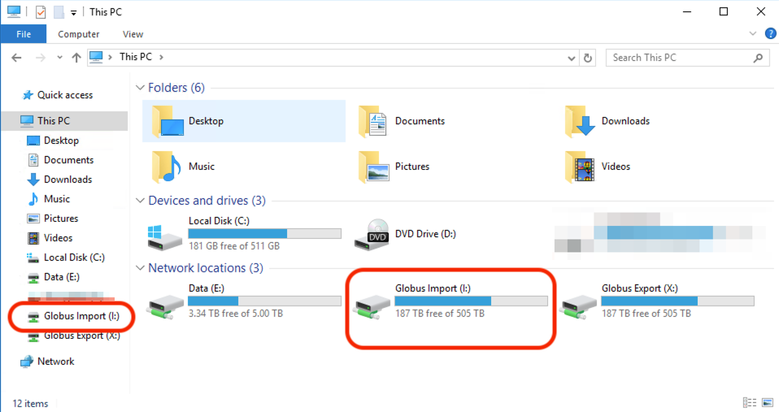
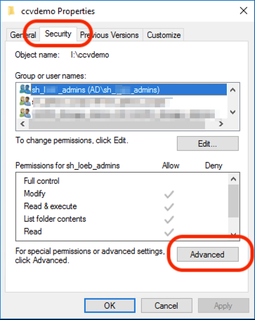
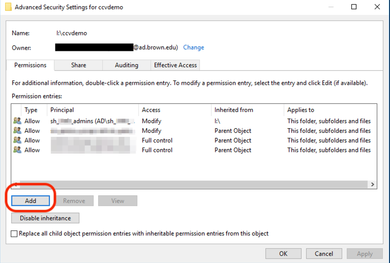
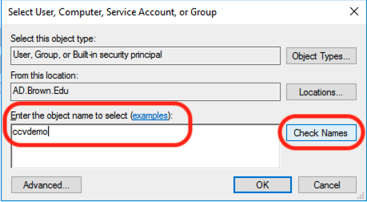
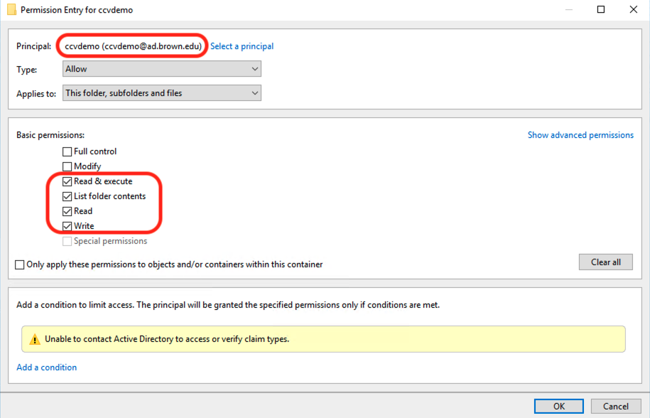
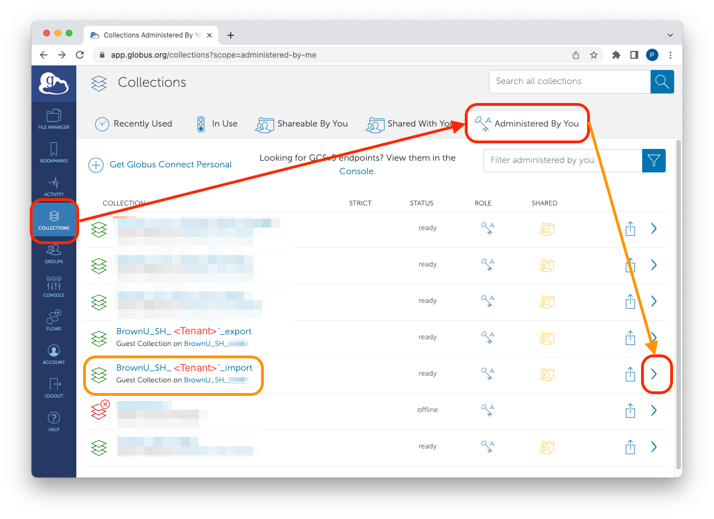
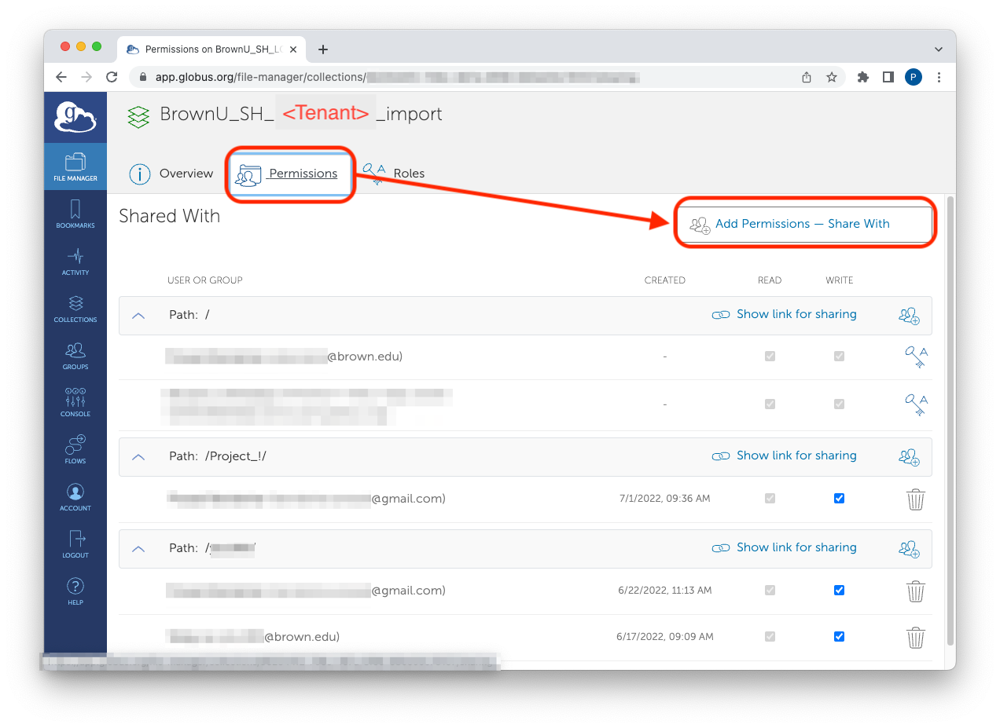
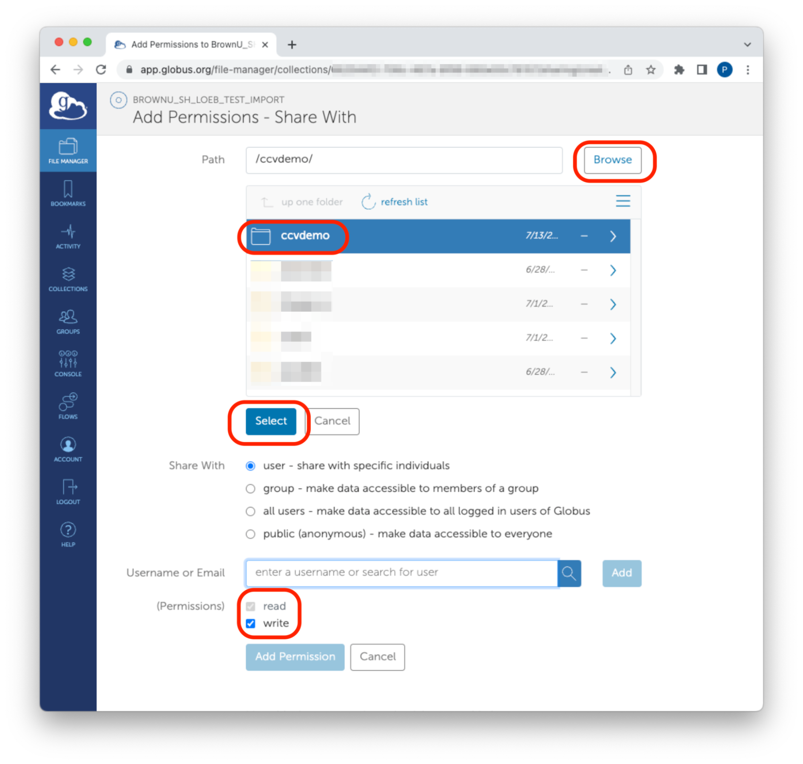
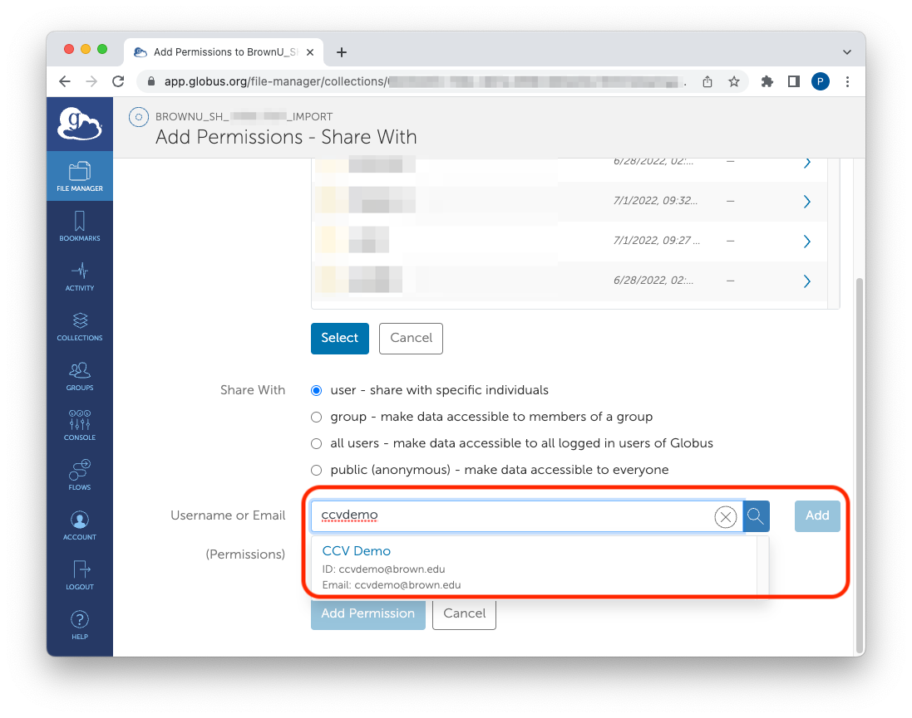
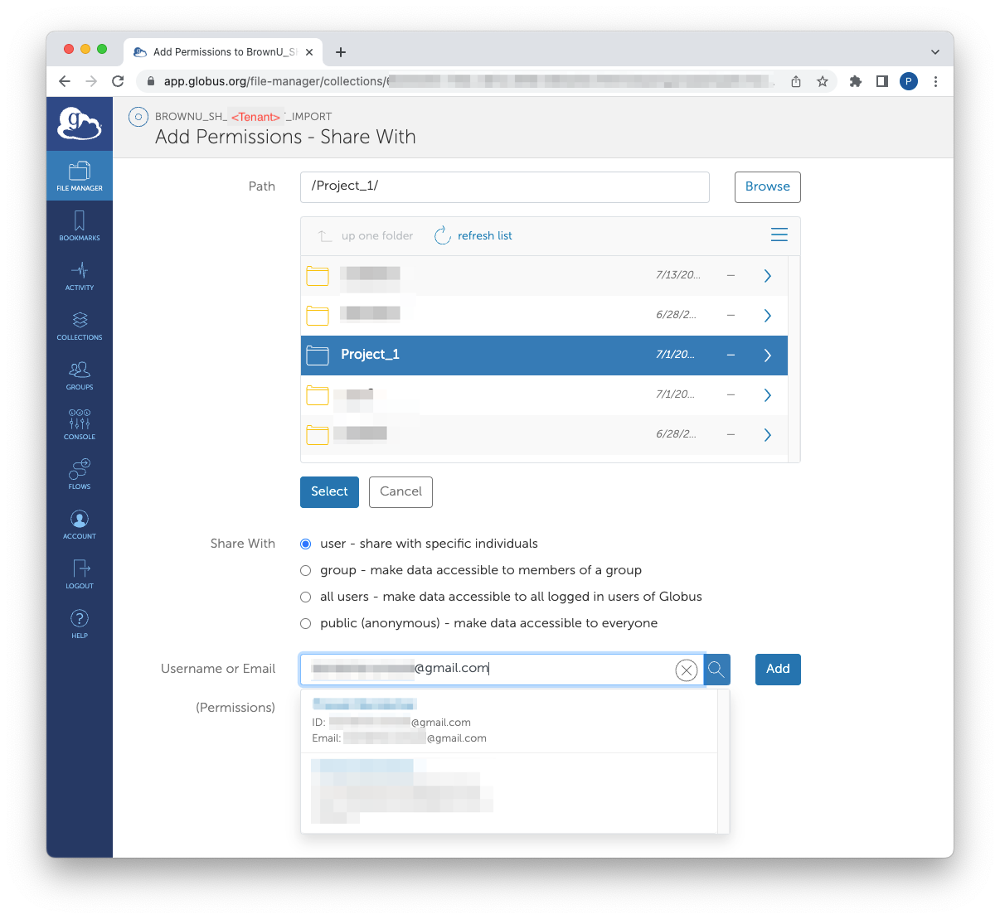

# Adding New Users

Managers of Globus Collections can follow these instructions to grant users access to the Globus collection. Other users will NOT be able to perform the actions in this tutorial.

## Granting Import “Read+Write” Access

For this access, the user should Have a Brown Account Be able to access the Stronghold workstation ( member of sh\_\<Tenant>\_users)

### Steps:

1. Log in to the Workstation, open File Explorer and navigate to the "Globus Import" Drive (Choose "Globus Export" Drive for export access)

2\. Create a new folder and name it the BrownID of the user.

3\. Right click on the new folder -> Properties -> “Security” tab -> Advanced

4\. Click “Add”. This will open a new window.

5\. Click “Select Principal” in the next window

6\. Enter the BrownID of the user in the box titled “Enter the object name to select”. Click Check Names. If the name is valid, the BrownID will now have an underline. Click OK.

7\. On the next window, make sure that the following permissions are set. This includes “Read” and “Write” Permissions.

This folder is now set correctly.

8\. Login to the [globus page](https://app.globus.org/file-manager) from your local computer.

9\. Click Collections on the left side panel -> “Administered By You” tab -> the right arrow next to “BrownU\_SH\_\_import”

10\. Click the “Permissions” tab -> “Add Permissions - Share With”

11\. Click Browse -> Navigate to the newly created directory named -> click select. Make sure that the file permissions are set as both “read” and “write” . (For export access, just choose "read"; do not choose "write")

12\. Enter the user’s BrownID in the “Username or Email” field. Choose the appropriate option in the dropdown list. Click “Add Permission”

13\. The user will receive an email with the name of the collection. You can also ask them to search for “BrownU\_SH\_import” collection.

## Granting Import “Write” Access:

This access will allow users to put files into Globus, but not log into the workstation and pull the files out of the import drive (I:/). This access is ideal for external affiliates who may not have a Brown account: For this access, the user should Have an email Create a Globus account with this email.

Follow the instructions [here](https://docs.ccv.brown.edu/storage-and-transfer/globus/getting-started/without-brown-credentials/create-globus-id) to create a Globus account/ID.

### Steps:

1. Log in to the Workstation, open File Explorer and navigate to the "Globus Import" Drive (Choose "Globus Export" Drive for export access)

2\. Create a new folder inside the Import drive. Name it the user’s email. If sharing data is not a concern, you can skip this step and use an existing folder. All users who are added to the folder on Globus will be able to see each other’s files.

This folder is now set correctly.

3\. Login to the Globus page from your local computer.

4\. Click Collections on the left side panel -> “Administered By You” tab -> the right arrow next to “BrownU\_SH\_import”

5\. Click the “Permissions” tab -> “Add Permissions - Share With”

6\. Click Browse -> Navigate to the newly created directory named -> click select. Make sure that the file permissions are set as both “read” and “write” . (For export access, just choose "read"; do not choose the "write" option)

7\. Add the user by entering their email in the "Username or Email" field. Choose one of the options in the dropdown list.

The user will be sent an email with a link to this collection. They should be able to add data to Globus in their web browser.

## Granting Export “Read+Write” Access

For this access, the user should Have a Brown Account Be able to access the Stronghold workstation ( member of sh\_\<Tenant>\_users)

### Steps:

Follow the same steps as granting [import permission with "Read+Write" Access](adding-new-users.md#granting-import-read+write-access) except these differences:

* Choose the "Export" Drive in Step 1
* Choose just "Read" permission in Step 11.

## Granting Export “Read” Access:

This access will allow users to retrieve files from Globus, but not log into the workstation and put files into the export drive (X:/). This access is ideal for external affiliates who may not have a Brown account: For this access, the user should Have an email Create a Globus account with this email.

Follow the instructions [here](https://docs.ccv.brown.edu/storage-and-transfer/globus/getting-started/without-brown-credentials/create-globus-id) to create a Globus account/ID.

### Steps:

Follow the same steps as granting [Export "Read" Access](adding-new-users.md#granting-import-write-access) except these differences:

* Choose the "Export" Drive in Step 1
* Choose just "Read" permission in Step 6.
