# GitLab

## 1. Access

1. Connect to your tenant workstation using [Remote Desktop](../usage/windows_workstation/) or [FastX](../usage/linux_workstation/).
2. Open a web browser (Firefox or Edge) in your tenant, and type in the url `https://<tenant>-git.stronghold.brown.edu/`

* \<tenant> should be replaced by your tenant name. In this page, the example tenant is `dev7`.
* The first time you access gitlab, you will get a warning message about the certificate. You just need click the `Advanced' button`(Figure 1), and then click the `Accept the Risk and Continue` button (Figure 2). After that, you will land at the Sign In page.

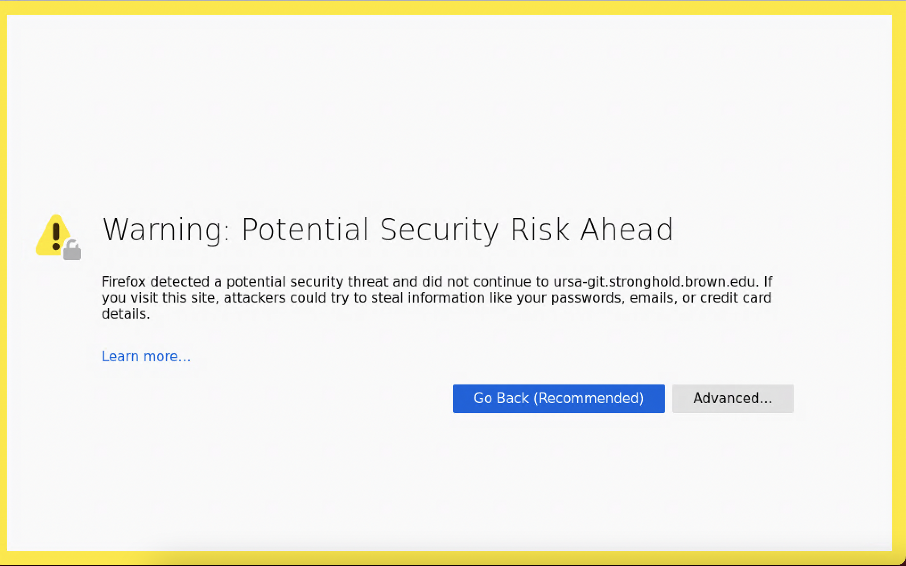

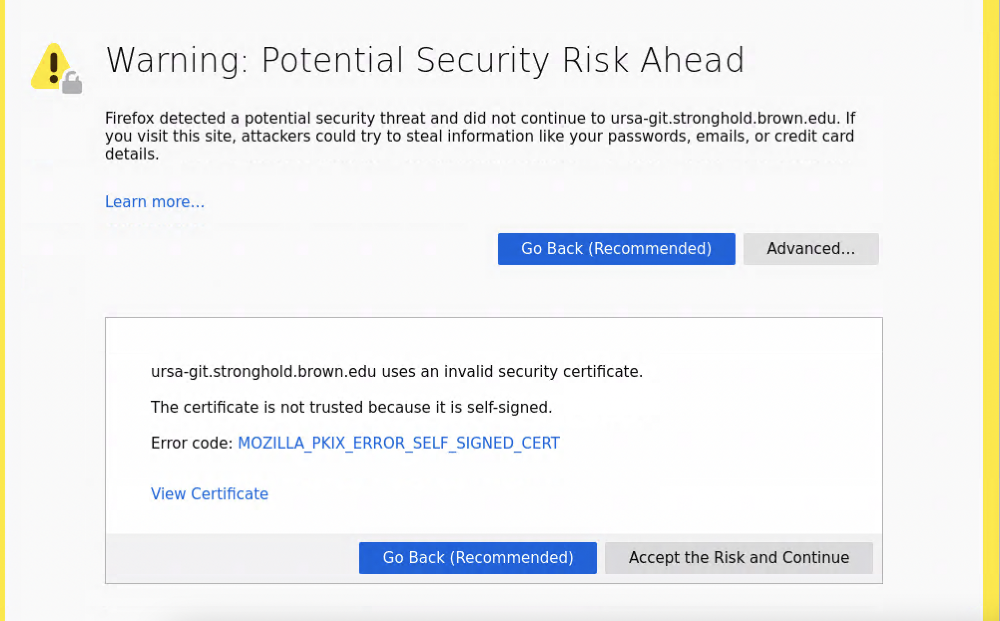

* If the GitLab root user is not created yet, you will be directed to the password page (Figure 3) to set the root password.

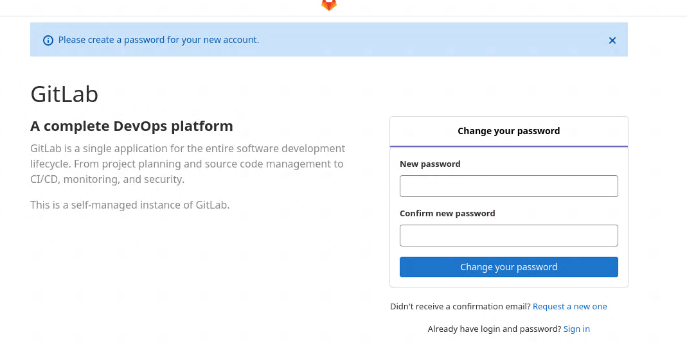

Enter your username and password to log in (Figure 4)

*
  * To login as the root, click the 'Standard' tab, and then enter the password for the root user
  * To login as a normal user, click the 'LDAP' tab, and then enter the password for your Brown account

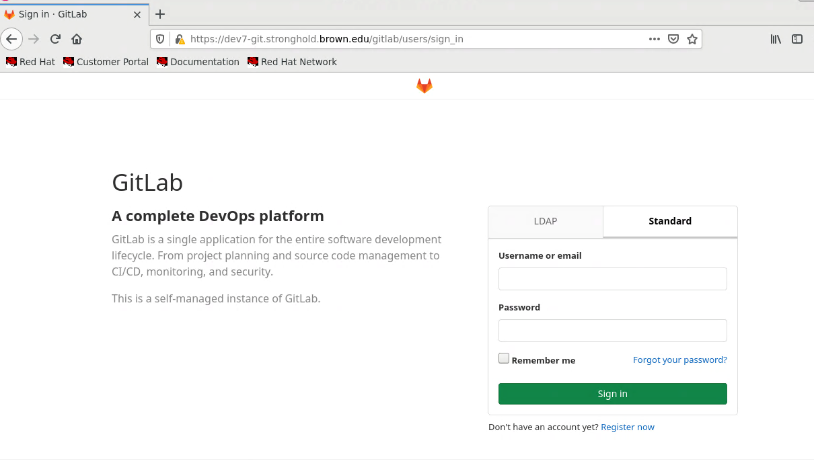

## 2. Create a User

A Gitlab admin can create a user.

* Click on "Menu" in the top left and click "Admin". This opens the dashboard in the "Admin Area"

<figure>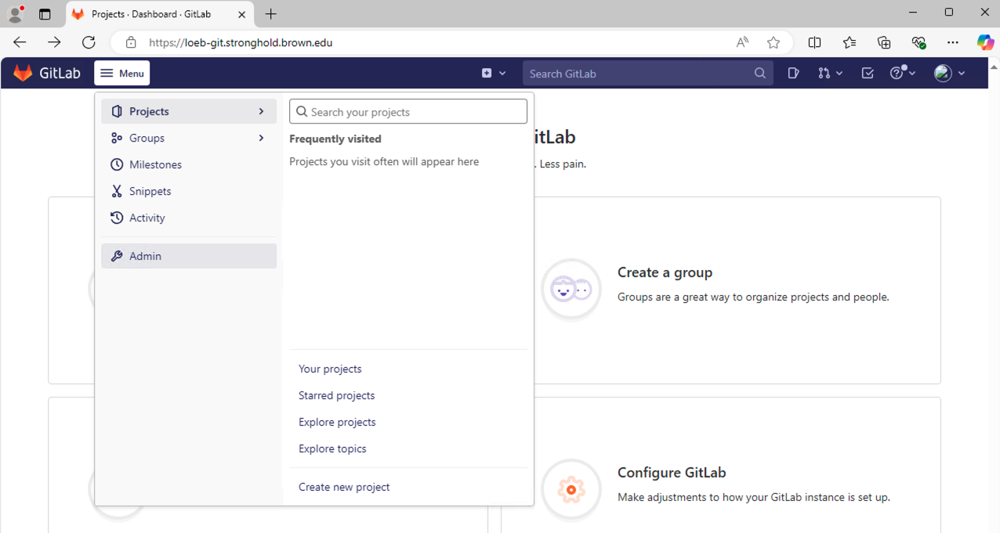<figcaption>
Admin Dashboard
</figcaption></figure>

* Go to the User tab of the Admin Area (Figure 5), click the `New User` button

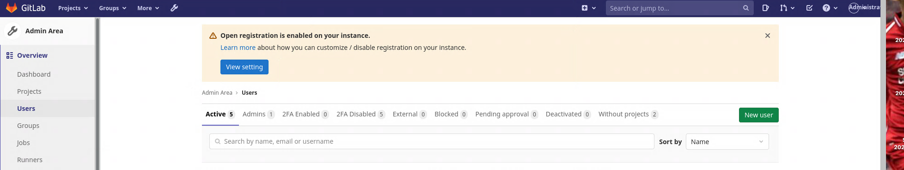

* Enter the details of a new user
  * Name: Full name of the user (Figure 6)
  * Username: Brown username (Figure 6)
  * Email: the user's Brown email (Figure 6)
  * Access (Figure 7)
    * Admin or Regular

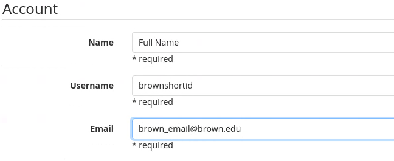

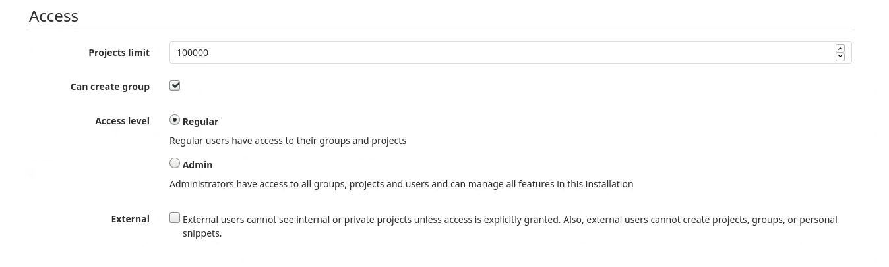

## 3. Create a Group and Add Group Members

A user can create a group and add members. An admin can do these from the Admin area as well.

### 3.1 Create a Group

* Click Groups on the top menu, then click Your Groups (Figure 8)

<figure>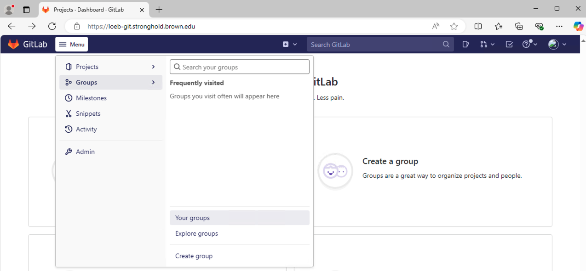<figcaption></figcaption></figure>

* Click the `Create Group` button (Figure 9)
  * Enter `Group Name`, which automatically populates the `Group URL`(Figure 10)
  * Normally you want to select Internal for `Visibility Level`
* Click the `Create Group` button to complete the creation of the new group

<figure>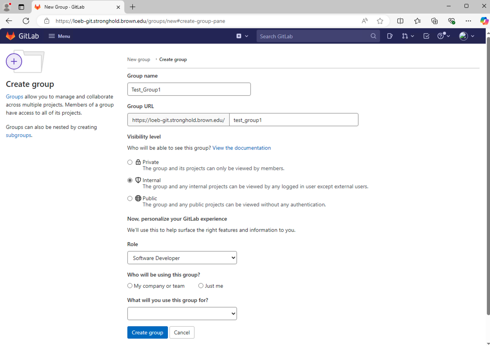<figcaption></figcaption></figure>

### 3.2 Add Group Members

* Choose the group you want to add members to (Figure 9).
* Click Members on the left hand side (Figure 11).
* Add members to the group (Figure 12)
  * only Maintainer and Owner are able to actually push into the Master Branch of any project.
  * Developers are able to create the own branch of a project, but will need to put in a merge request that will then be approved by someone with higher permission.

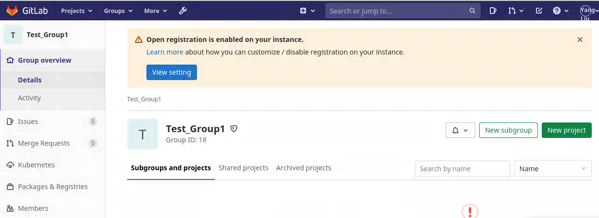

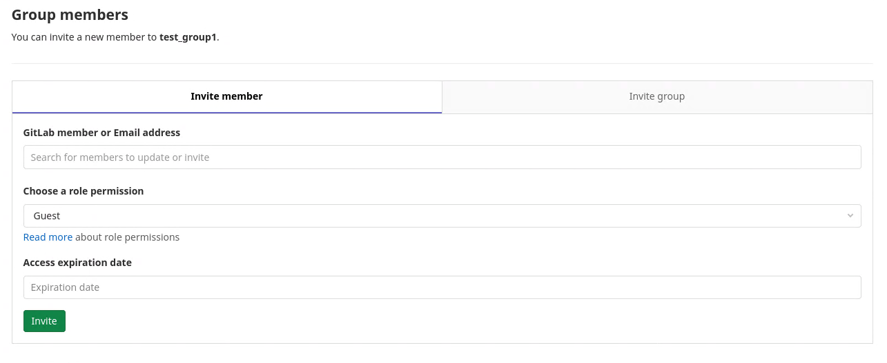

## 4. Create a Project

Here we create a project at group level to allow everyone in your group access to the project and their necessary permission level.

* Go to the group for which the project is to be created for, and then click the `New Project` button (Figure 11)
* Click `Create Blank Project` (Figure 12)
* Enter project details (Figure 13) and then click the `Create Project` button
  * Project Name: the name of your project, which automatically populates `Project URL`
  * Visibility Level: normally you want to select 'Internal'

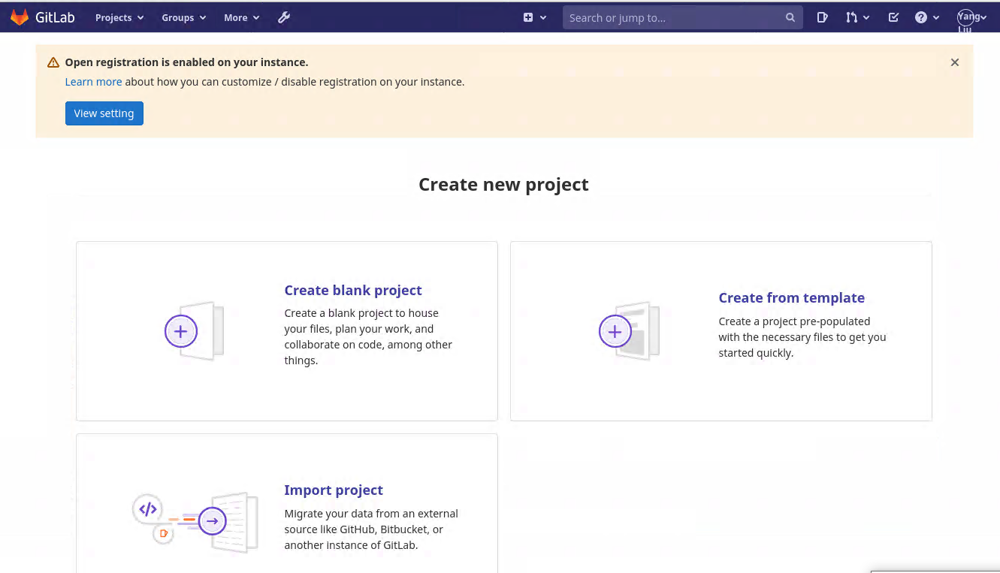

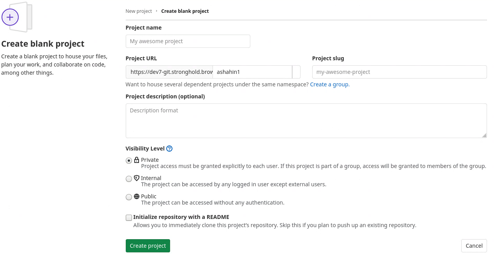

## 5. Set up an SSH Key

In order to perform a git push and pull without putting in the username and password, each user will need to setup an ssh key. A user needs do the followings to set up an SSH key:



Search for git bash on the Start Menu and launch it. This gives you a bash shell for Windows.



Open a regular terminal on the workstation.



1. Open a terminal
2. `cd .`
3. `mkdir .ssh`
4. `cd .ssh`
5. `ssh-keygen -t rsa` (no need to set a password for your ssh key)
6. `cat ~/.ssh/id_rsa.pub` (This will print your public key to the screen. Select and copy it)
7. add your ssh key
   1. Click by your User Name on the top menu bar, and then click the `Preferences` menu (Figure 14)
   2. Click on `SSH Keys` tab on left
   3. Copy your public key of (_id\_rsa.pub)_ file (Figure 15) to the key box (Figure 16).

<figure><figcaption></figcaption></figure>

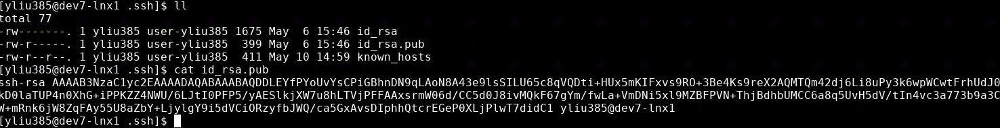

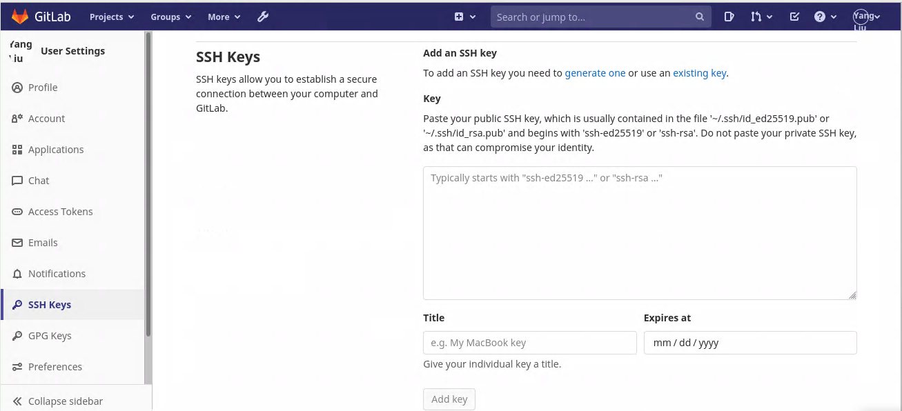

## 6. Common Commands

### 6.1 Git Global Setup


You need to change the git email to your email to push commits as the correct user. The default email is not correct.


* git config --global user.name "Your Brown Username"
* git config --global user.email "Your Brown Email"

### 6.2 Create a New Repository

* git clone git@\<tenant>-git.stronghold.brown.edu:groupname/project\_name.git
* cd project\_name
* touch README.md
* git add README.md
* git commit -m "add README"
* git push -u origin master

### 6.3 Push an Existing Directory

* cd existing\_folder
* git init
* git remote add origin git@\<tenant>-git.stronghold.brown.edu:groupname/project\_name.git
* git add .
* git commit -m "Initial commit"
* git push -u origin master

### 6.4 Push and Existing Repository

* cd existing\_repo
* git remote rename origin old-origin
* git remote add origin gitsys@\<tenant>-git.stronghold.brown.edu:group/prjoect\_name.git
* git push -u origin --all
* git push -u origin --tags
