# Access Same Data from Windows and Linux Workstations

## Overview

If your tenant has both a Windows workstation and a Linux workstation CCV can create a shared drive of non-encrypted storage that can be accessed by both workstations. Control of the security group permissions on files and folders must be controlled from the Windows workstation, but users will be able to perform normal folder navigation and file access from either workstation. Here's how it works:

1. CCV team mounts a drive to both workstations
2. `sh_<tenant>_admins` group members login to the Windows workstation and create folders for their separate projects to share data
3. On the Windows workstation, assign folder permissions to security groups that are appropriate
4. Users with the correct security group access can navigate the drive normally, according to their level of security group access

## Instructions

### 1. Contact CCV

Please email `stronghold-help@brown.edu` to request a shared drive. Once our technicians have enabled your shared drive, you will be notified and can continue to the next step

### 2. Create Folders

Only members of the security group `sh_<tenant>_admins` will have access to the shared drive by default. It is important for a member of `sh_<tenant>_admins` to create a folder structure inside the drive that can later be setup to allow access for users.

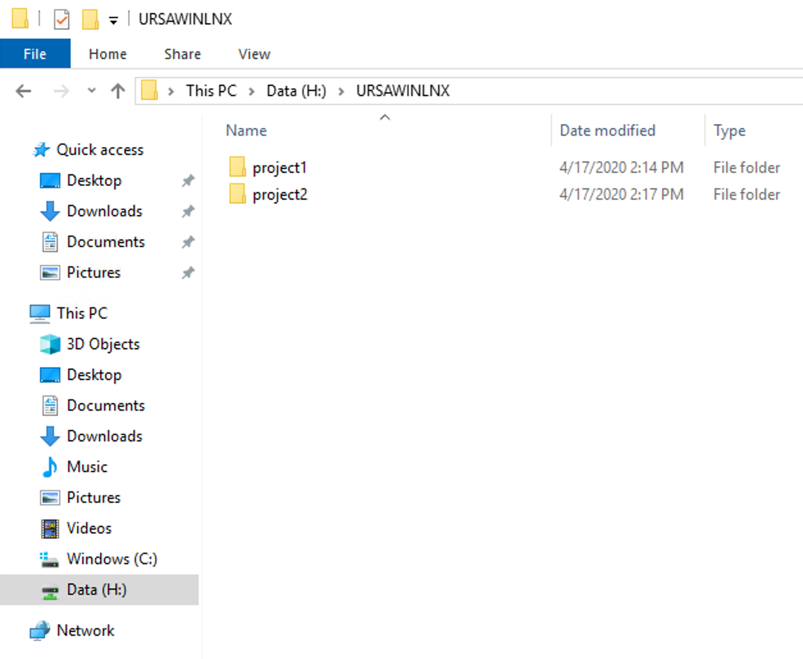

In the above example our shared drive is `Data (H:)`, our top-level folder is `URSAWINLNX`, and we have two project folders (`project1` & `project2`). We are using a top-level folder because the drive may have different names on the two different workstations.

### 3. Assign Permissions

You **MUST** assign privileges from the Windows workstation for those privileges to be enforced on the storage volume. To get started, right-click the folder and select "Properties"

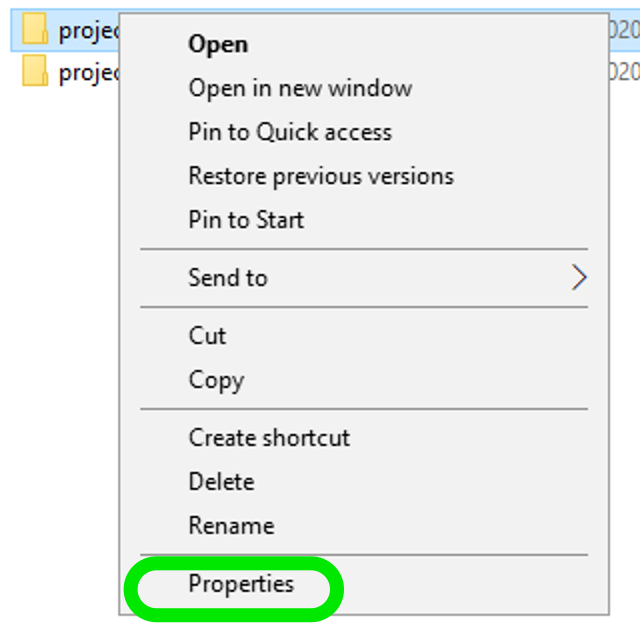

On the Properties window, select the tab labeled "Security" and then click the button labeled "Advanced"

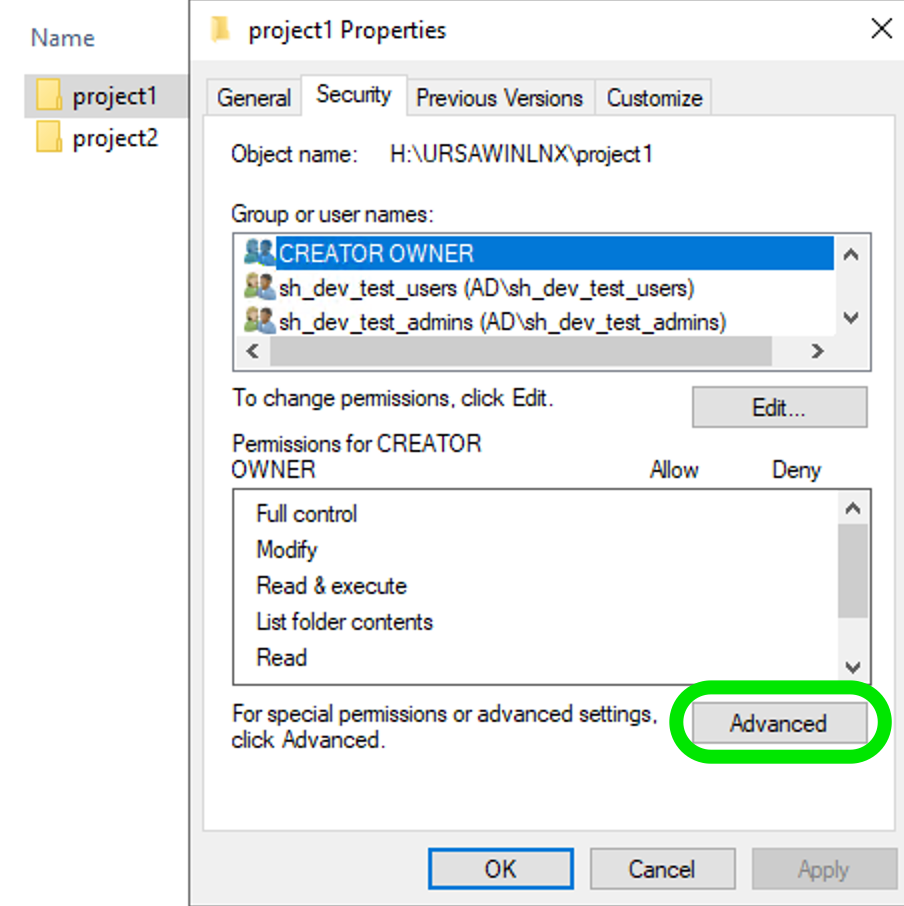

The Advanced window will show you all of the current permissions on that folder

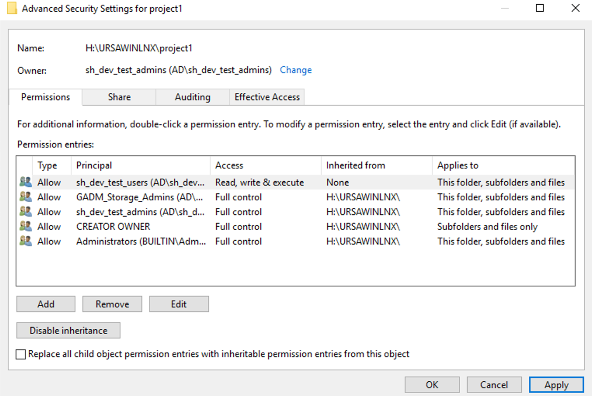

As you can see above, we have the group `sh_dev_test_admins` as our demonstration group that corresponds to `sh_<tenant>_admins` in a regular tenant, and thus has "Full control" of the folders `URSAWINLNX`, `project1`, and `project2`. We have given another group (`sh_dev_test_users`) "Read, write & execute" access to the folder `project1` but no access to `project2`; you will see the repercussions of this in the next section.

To add a security group to a folder from this Advanced window, click the "Add" button

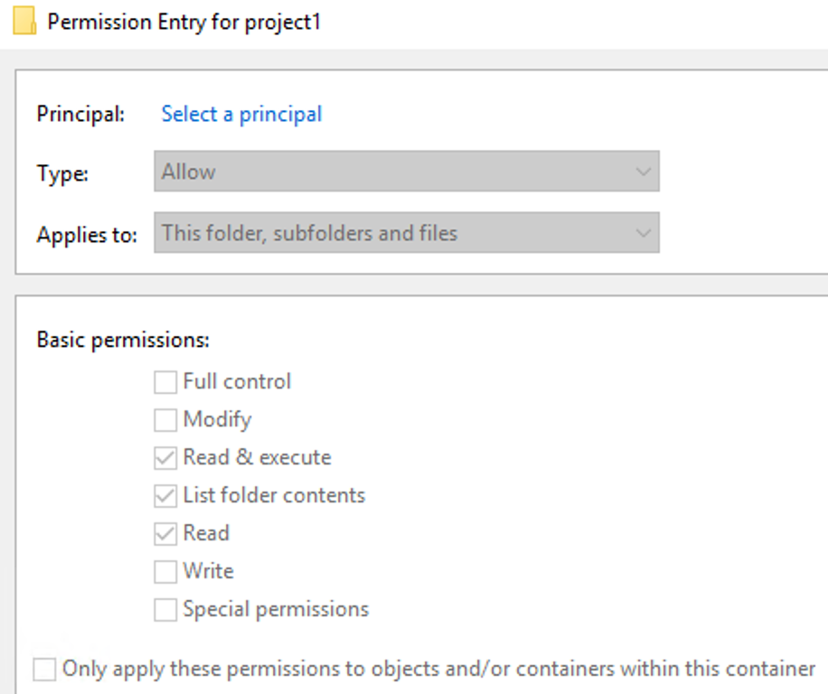

On this Permission Entry page you will need to click "Select a principal" to start assigning privileges to a new group

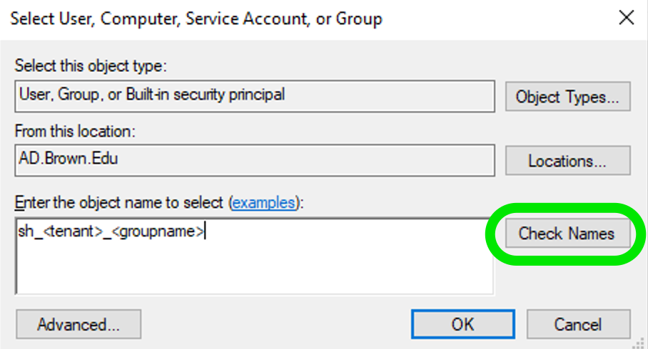

A new window will popup and give you a place to enter the group name you wish to select. **MAKE SURE TO CLICK "Check Names" BEFORE CLICKING OK!** If the group name is valid, you will see the `sh_<tenant>_<groupname>` become underlined. Click "OK" to return to the previous window

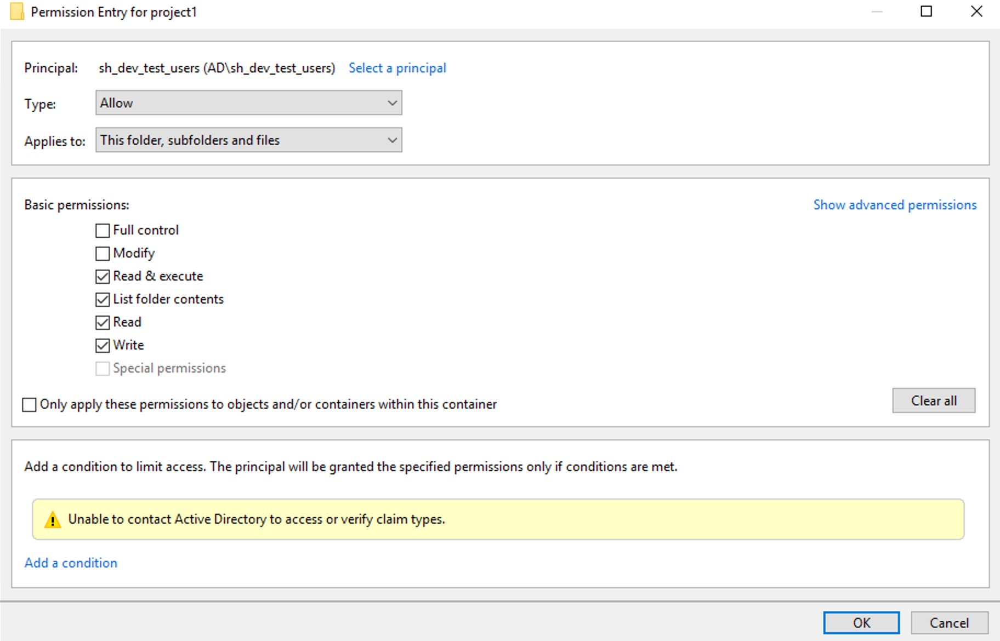

Now that a valid group has been selected, the permission options will no longer be grayed-out. Make the changes you need to and click "OK" to save and get back to the Advanced window

If everything looks correct, feel free to click "Apply" and then "OK" to save the new settings and exit this window. You are now ready to test the folder permissions

### 4. Test Access Permissions

Testing permissions can be done from either the Windows workstation or the Linux workstation, but there are slight differences that we will point out

#### Windows

Folder navigation will be completely normal from the Windows workstation for members of security groups with access to the folders. Right-clicking a folder and selecting "Properties" will correctly show the permissions set in Step #3.

If a user does not have access to a folder, they will not be able to view permissions on the folder

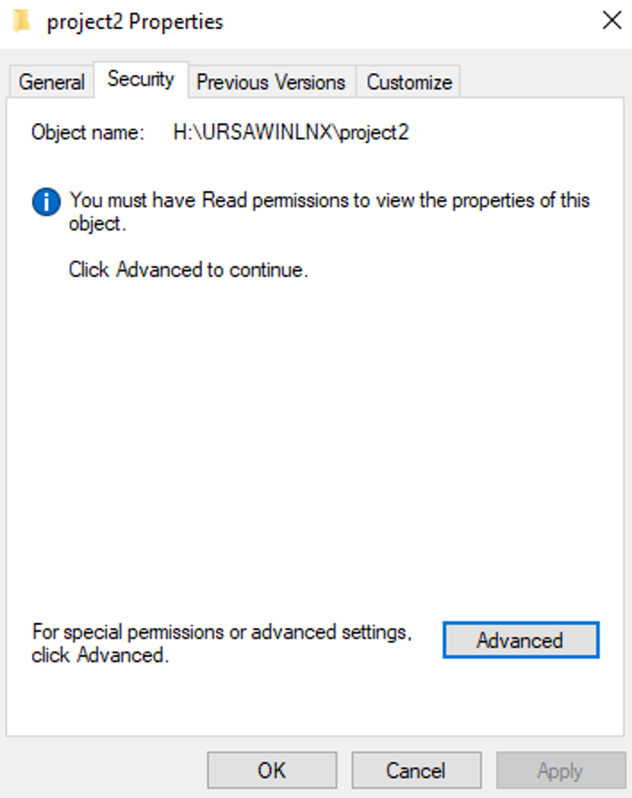

If a user does not have access to a folder, they will also not be able to open the folder

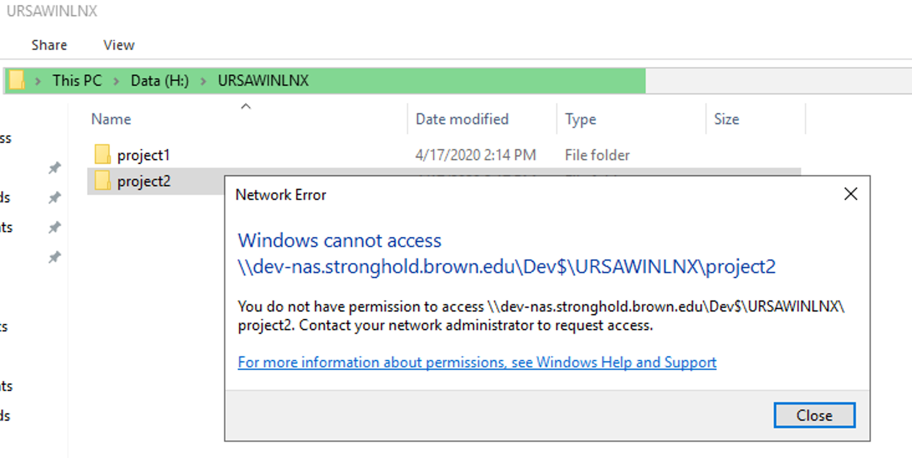

#### Linux

Users on the Linux workstation can access folders and files on the shared drive, but the Linux Operating System is not aware of the permissions that were set on the Storage Volume from the Windows workstation; this causes some strange interactions with POSIX commands not returning what a user may expect.

For example: the command `ls -la` would normally show the permissions on a folder or file, but in this case it returns the following

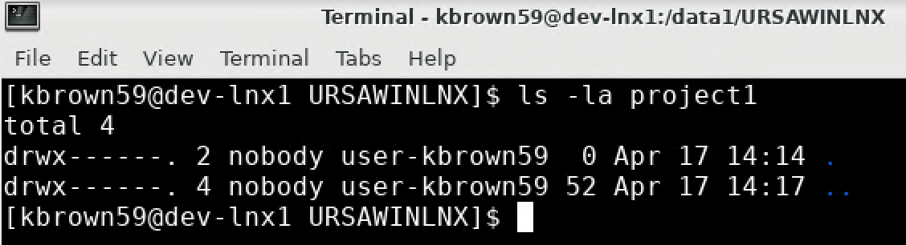

That is not what was setup on the Windows workstation, but the OS isn't aware of that. Instead, we can use a storage volume command `nfs4_getfacl` to read the permissions of the folder to get the following response

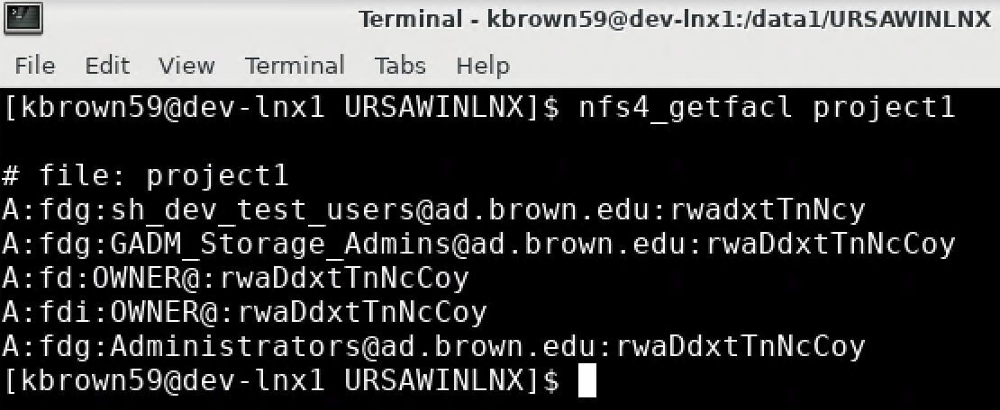

With `nfs4_getfacl` we correctly see `sh_dev_test_users` has access of some kind, as does the "OWNER" (which we know from Windows is `sh_dev_test_admins`) but what do those letters all mean? [The full documentation can be found here](https://www.osc.edu/book/export/html/4523), but the critical piece is the following

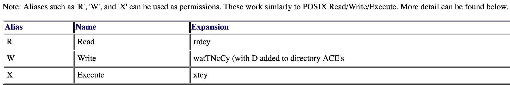

We should also test out what happens when a user who does not have permission tries to access a folder

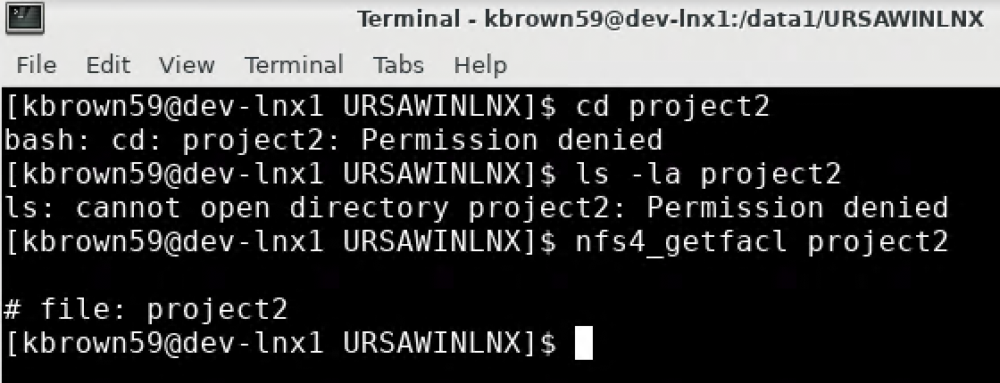

As you can see above, POSIX commands return explicit "Permission denied" errors and `nfs4_getfacl` returns only the folder name, with no further details. The permissions set on the Windows workstation are respected on the Linux workstation!
