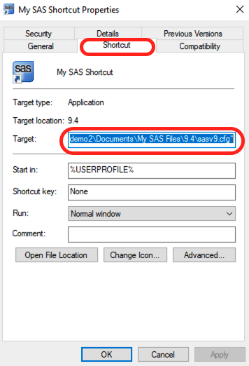

# SAS

SAS saves all temporary files in the C:/ in Windows workstations. Since storage quota are limited on the C:/, you should follow these steps to change the temporary directory

## 1. Create SASv9.cfg file

1. Open Windows File Browser on the Stronghold Windows machine.
2. Go to C:\Program Files\SASHome\SASFoundation\9.4
3. Copy sasv9.cfg . The file might be named "sasv9"
4. Go to Documents-> My SAS Files -> 9.4
5. Paste the file


If you cannot find the "My SAS Files" folder, open SAS and close it. This folder is created when you open SAS for the first time on a computer.


## 2. Identify a folder outside C:\\

Find a folder where you are allowed to create and modify files. This is going to be the new SAS temporary folder. In this tutorial, let's assume that the directory is "E:\SASTemp\ccvdemo2"

## 3. Modify SASv9.cfg file

1\. Open the new sasv9.cfg in Notepad. You can right-click this file -> Open With .. -> Notepad

2\. On the second line, add the line below and save the file

`-WORK "E:\SASTemp\ccvdemo2"`


Your Temporary folder might be different than the one mentioned here. Use the correct folder.


## 4. Modify SAS shortcut

1. On the Desktop, right click the SAS Icon -> Create Shortcut
2. Rename the new SAS icon to distinguish it from the earlier version.
3. Right-click this new icon and open Properties
4. You will see a textbox in the Properties window that labeled "Target". We will have to modify the Target.

The original text in this box says:

`"C:\Program Files\SASHome\SASFoundation\9.4\sas.exe" -CONFIG "`**`C:\Program Files\SASHome\SASFoundation\9.4\nls\en\sasv9.cfg`**`"`

Change it to the following text:

`"C:\Program Files\SASHome\SASFoundation\9.4\sas.exe" -CONFIG "`**`C:\Users\ccvdemo2\Documents\My SAS Files\9.4\sasv9.cfg`**`"`

5. Note that we have just changed the text in bold. This example shows the text for a user named "**ccvdemo2**" . **Replace that with your Brown Username**.

6. Click Apply.
7. Use this new shortcut whenever you need to launch SAS.
