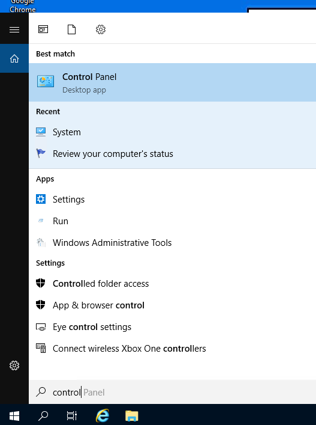
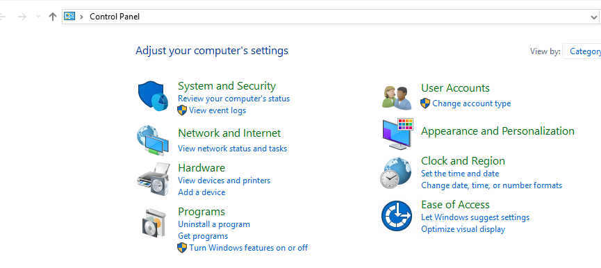
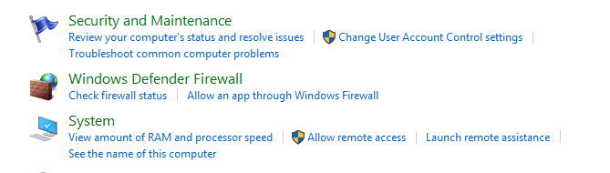
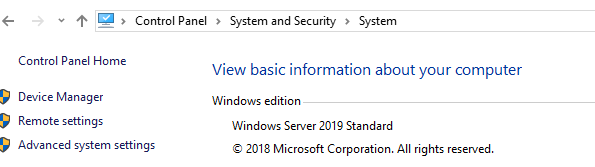
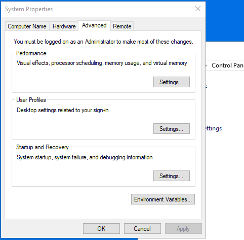
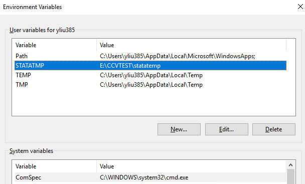
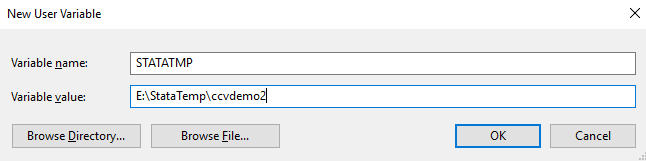
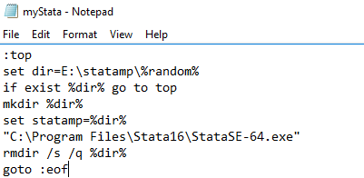

# STATA

STATA saves all temporary files in the C:/ in Windows workstations. Since storage quota are limited on the C:/, you should follow these steps to change the temporary directory

## 1. Identify a folder outside C:\\

Find a folder where you are allowed to create and modify files. This is going to be the new SAS temporary folder. In this tutorial, let's assume that the directory is "E:\StataTemp\ccvdemo2"

## 2. Change the temporary directory

Users can change the temporary directory in different ways. The second way is required for multiple users to run Stata as it allows each user to have their own temporary directory for Stata.

### 2.1 Change Windows Environment Variable

Users only need to make the following changes **ONCE**.

Step 1: Launch "Control Panel"

<figure><figcaption></figcaption></figure>

Step 2: Click "System and Security" in Control Panel

<figure><figcaption></figcaption></figure>

Step 3: Click "System"

<figure><figcaption></figcaption></figure>

Step 4: Click "Advanced system settings"

<figure><figcaption></figcaption></figure>

Step 5: Click "Environment Variables"

<figure><figcaption></figcaption></figure>

Step 6: Click "New"

<figure><figcaption></figcaption></figure>

Step 7: Enter the variable name `STATATMP` and value that is your temp folder, i.e., `E:\StataTemp\ccvdemo2.`Then click "OK"

<figure><figcaption></figcaption></figure>

After the changes above, whenever `Stata`is launched, it saves temporary files in the configured temporary folder.

### 2.2 Create myStata.bat

1. Launch Notepad. (You can click the search icon in the bottom left of the screen on the Taskbar. Type Notepad and click the first icon)
2.  Enter the following text. It contains **4 lines**, including a blank line at the bottom:

    ```bat
    :top
    set dir=E:\statatmp\%random%
    if exist %dir% goto top
    mkdir %dir%
    set statatmp=%dir%
    "C:\Program Files\Stata16\StataSE-64.exe"
    rmdir /s /q %dir%
    goto :eof
    ```

    <figure><figcaption></figcaption></figure>
3. On Notepad, click on File -> Save As ...
4. Click on "Desktop" on the left "Quick Access Panel"
5. Enter "myStata.bat" in the File name field.
6. In the "Save as Type" dropdown list, choose "All Files"
7. Click Save

After the changes above, whenever users double click "**myStata**" file on the Desktop, `Stata` is launched and saves temporary files in the configured temporary folder.
