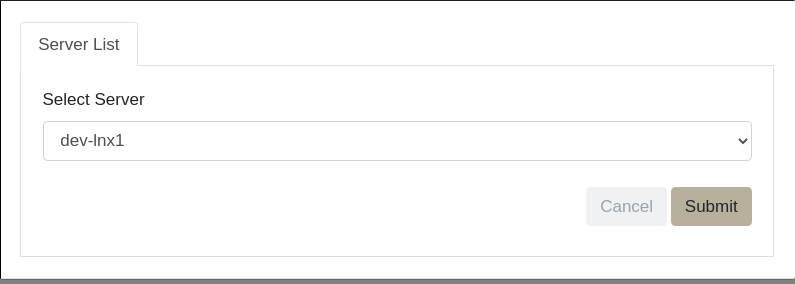
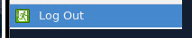
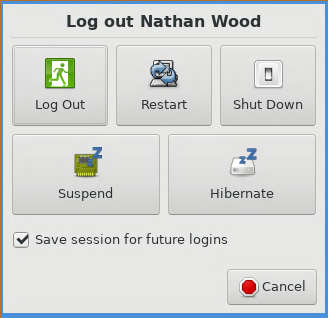
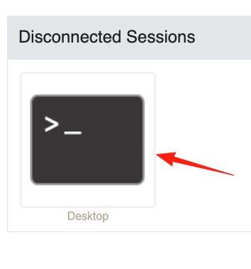

# Access from Web Browser

## Overview

After the 2025 Stronghold HyperV migration, all Linux workstations must be accessed via a web browser.

## Connecting via a Web Browser

NOTE: Users on campus must be connected to the Brown WiFi or a wired connection in a research building. Off-campus users can access their environments by connecting through the [Brown VPN](https://it.brown.edu/services/virtual-private-network-vpn).

### 1. Log in with your web browser

Point a web browser to your tenant page at **https://`<tenant>`.stronghold.brown.edu**

<figure><figcaption></figcaption></figure>

Enter your Brown credentials and select Login.

<figure><figcaption></figcaption></figure>

Select a Duo option for two-factor verification. Type the number of your choice and select `Submit`.

<figure><figcaption></figcaption></figure>

Click the `Proceed` button to move forward.

<figure><figcaption></figcaption></figure>

### 2. Start a Session

After completing Duo verification, you’ll be taken to the session window. Any active sessions would appear here, but since this is your first login, you’ll need to start a new one.

Select the **"Desktop"** bookmark and click it to launch your session.

> **Note:** The **"Terminal"** option is intended for advanced users comfortable working from the command line.

<figure><figcaption></figcaption></figure>

Then, click on **Browser Client**. Currently, only the browser client is supported.

<figure><figcaption></figcaption></figure>

Tenants with multiple Linux workstations will be prompted to select a server. Talk to your PI or tenant admin for more information.



### 3. Navigate Environment

A dropdown menu of applications is found in the top-left of the desktop environment under "Stronghold".

.png>)

If you click the terminal icon from the Stronghold dropdown, you’ll open a new terminal window. In it, you can load [software modules](../../software/linux-standard-software/#software-modules), [Conda environments](../../software/linux-standard-software/#environment-modules), and run other commands. Expect to do most of your work here.

Note: you can only run one desktop session per workstation. Launching additional sessions will automatically terminate any other running sessions.

### 4. Exit/Leave a Session

**To save your session and disconnect:** exit out of your browser window or tab.

**To terminate your session:**

* In the Stronghold dropdown menu, select `Log Out`.



* Then click the "Log Out" button.




Logging out will terminate your running applications. You may lose any work that hasn't been saved.


### 5. Reconnect to Linux Workstation

If you lose connection to your **Stronghold Linux workstation**, you can safely reconnect without losing any data or environment settings.

To reconnect:

1\) Close the browser tab of your previous session.

<figure><figcaption></figcaption></figure>

2\) Open a new browser tab and navigate to:

```http
https://<tenant>.stronghold.brown.edu
```

<figure><figcaption></figcaption></figure>

3\) On the dashboard, click one of the “Disconnected Sessions.”

<figure><figcaption></figcaption></figure>

4\) Select Browser Client to reopen your session.

<figure><figcaption></figcaption></figure>

5\) When prompted, enter your password to log back in.

<figure><figcaption></figcaption></figure>

6\) All contents of your environment — including files, virtual environments, and configurations — will remain intact.
