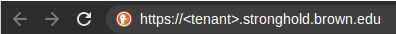
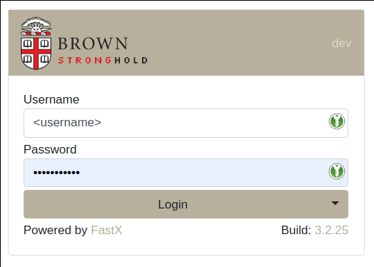
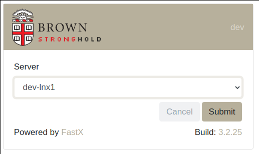
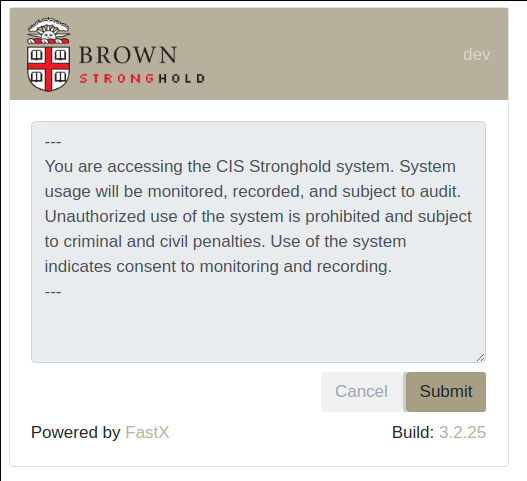
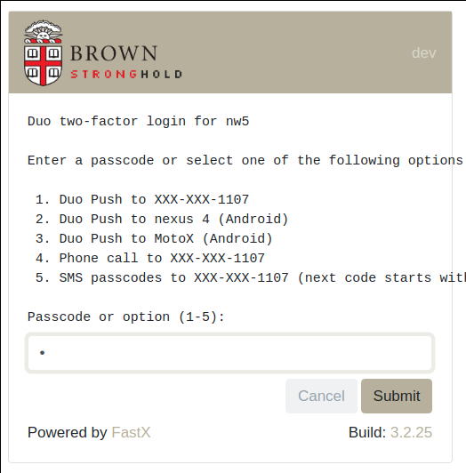
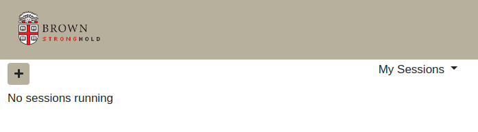
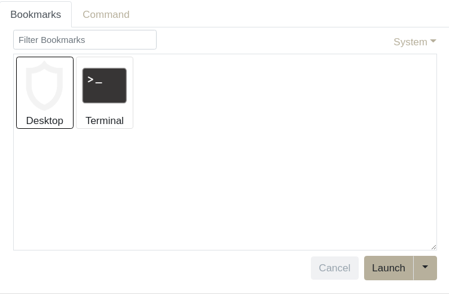
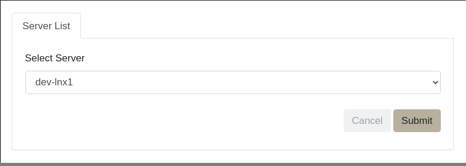
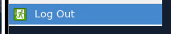
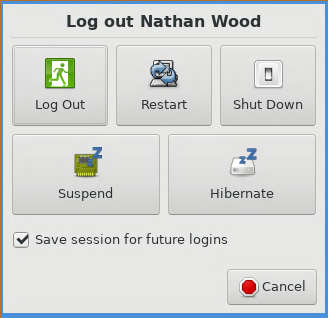

# FastX 3

## Overview

Due to the highly sensitive nature of the data contained in Stronghold, CIS has taken measures to restrict the ability to accidentally or intentionally move data out of the environment. Direct SSH access is not enabled for end users, as there is no way to restrict copying and pasting the contents of a file from an SSH session.

FastX 3 allows users to copy and paste from their local clipboard into their Stronghold session, but not in the opposite direction.

Users can connect to Stronghold via FastX3 from either a web browser, or a [FastX3 client](https://www.brown.edu/information-technology/software/catalog/fastx-0) that can be downloaded from Brown Software Catalog.

## Connecting via a FastX3 Client

### 1. Download FastX3 Client

Click the link to Software Catalog below:



Then log in with your Brown credentails.

<figure><figcaption>
Brown Software Catalog Website - Log In Required
</figcaption></figure>

Select the OS version of FastX software and download it:

<figure><figcaption>
FastX3 Software
</figcaption></figure>

### 2. Open and connect Stronghold workstation:

1\. Click the FastX3 icon to open FastX3 client.


If you have a Mac, and receive the message "Apple can’t check app for malicious software" after clicking the FastX3 icon, follow [the three steps below](https://support.apple.com/guide/mac-help/apple-cant-check-app-for-malicious-software-mchleab3a043/mac) to open FastX3 client.


2\. Click the "+" button to start a new connection.

<figure><figcaption>
New FastX3 Connection
</figcaption></figure>

3\. Fill out the connection form (_**Port number is 443**_) and click "OK":

<figure><figcaption></figcaption></figure>

4\. Double click the new connection

<figure><figcaption></figcaption></figure>

5\. Select a server of your tenant if required, if your tenant has multiple workstations.

6\. Enter your Brown password and click "Continue":

<figure><figcaption></figcaption></figure>

7\. Select a DUO option and click "Continue".

<figure><figcaption></figcaption></figure>

8\. Then click "+" button to start a Desktop or Terminal session:

<figure><figcaption></figcaption></figure>

9 Click 'Desktop' or 'Terminal' to start a desktop or terminal session

<figure><figcaption></figcaption></figure>

<figure><figcaption></figcaption></figure>

<figure><figcaption></figcaption></figure>

## Connecting via a Web Browser

NOTE: Users on campus must be connected to the Brown WiFi or a wired connection in a research building. Off-campus users can access their environments by connecting through the [Brown VPN](https://it.brown.edu/services/virtual-private-network-vpn).

### 1. Log in with your web browser

Point a web browser to your tenant page at **https://`<tenant>`.stronghold.brown.edu**

Enter your Brown credentials and select Login.

If your tenant has multiple Linux workstations, you may be prompted to select a server to log into . If you’re unsure here, please contact your PI or tenant admin for more information.

To continue the login process, you will need to consent to the terms listed and select `Submit`.

Select a Duo option for two-factor verification. Type the number of your choice and select `Submit`.

### 2. Start a Session

After your Duo verification has been completed, you’ll proceed to the session window. If you had any running sessions, they would be listed here. Since this is your first time logging in, we’ll need to start a new session.

Click the `+` icon

Select the "Desktop" bookmark and click `Launch`. Note: the “Terminal” option is for advanced users that are comfortable launching all of their applications from the command line.

Tenants with multiple Linux workstations will be prompted to select a server. Talk to your PI or tenant admin for more information.

### 3. Navigate Environment

A dropdown menu of applications is found in the top-left of the desktop environment under "Stronghold".

.png>)

If you click the terminal icon from the Stronghold dropdown, you’ll open a new terminal window. In it, you can load [software modules](../../software/linux-standard-software/#software-modules), [Conda environments](../../software/linux-standard-software/#environment-modules), and run other commands. Expect to do most of your work here.

Note: you can only run one desktop session per workstation. Launching additional sessions will automatically terminate any other running sessions.

### 4. Exit/Leave a Session

**To save your session and disconnect:** exit out of your browser window or tab.

**To terminate your session:**

* In the Stronghold dropdown menu, select `Log Out`.

* Then click the "Log Out" button.


Logging out will terminate your running applications. You may lose any work that hasn't been saved.

