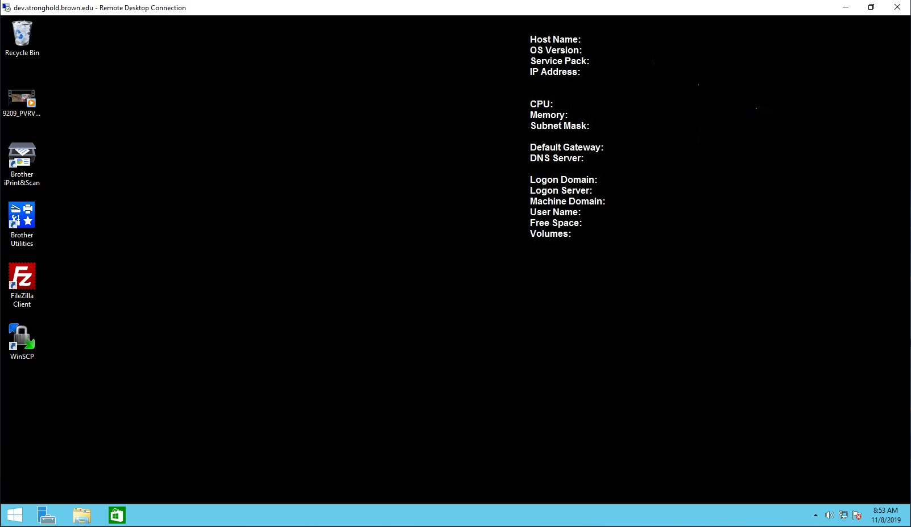
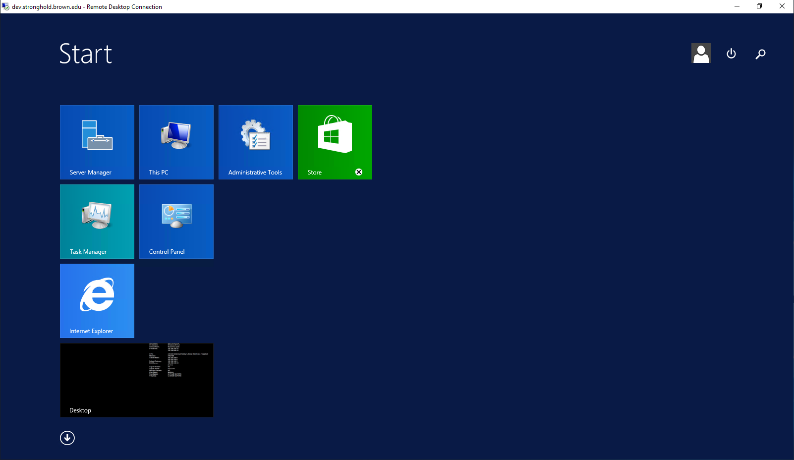
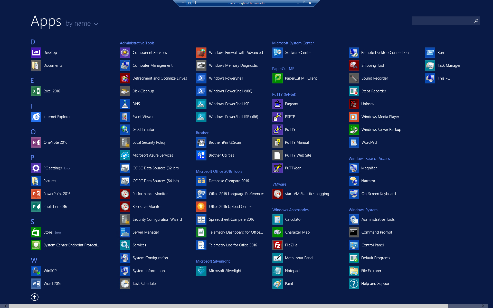
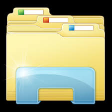
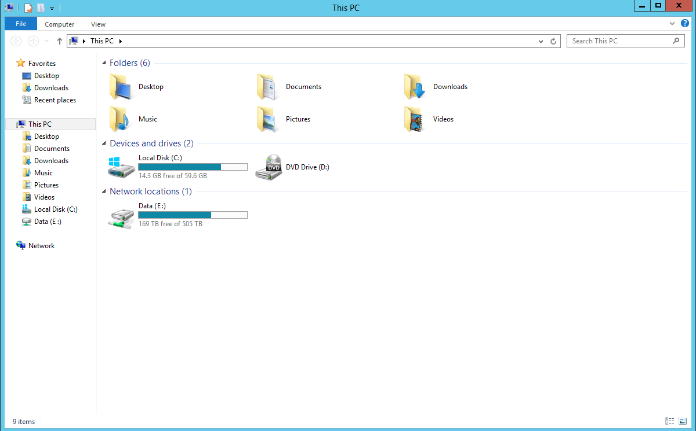

# Access from Windows

## Overview

1. Access your Stronghold tenant through the Microsoft Remote Desktop Client
2. Navigate your environment to access applications and data

## 1. Access Tenant

Run the Microsoft RDC client to access `<tenant>.stronghold.brown.edu` or the server of your choice through one of the below options

* Start > All Programs > Accessories > Remote Desktop Client
* Start > Run > MSTSC.EXE
* Search Remote Desktop Client

Run the Remote Desktop Client, replacing \<tenant> with your assigned tenant

Click ‘Connect’

Log in using your Active Directory credentials (Use AD\\\<username>) and enter your password and click OK (below).

Once you open a RDP connection, you will be prompted for your ‘Duo’ authentication. Select how you would like to be authenticated under "Choose an authentication method." The device tab should contain your device's name and the last 4 digits of that device's phone number.

## 2. Navigate Environment

### Applications

You can access your applications using the shortcuts on the taskbar or start menu.

You can also click the Windows icon in the bottom left corner of the screen to access installed programs.

Click the arrow under Desktop in the bottom left of the screen to access applications sorted alphabetically:

You can then choose your app from the list or you can search for a specific app using the search bar in the upper right hand corner:

### Files and Storage

Data and files should be saved to the shared **DATA** drive instead of the local C: drive. You can access the **DATA** drive by opening File Explorer in either the Apps list or by clicking on the File Explorer icon on the bottom left of the Desktop Screen toolbar

* File Explorer will open up your view of "This PC" where you can see all your folders and files. Navigate to the **DATA** drive to access or create folders and files

