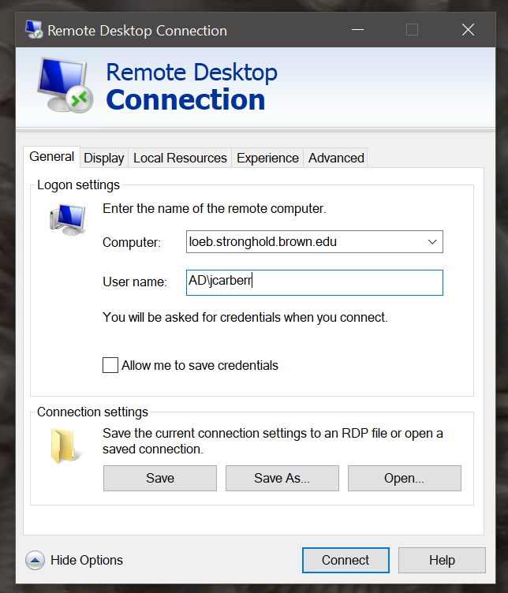
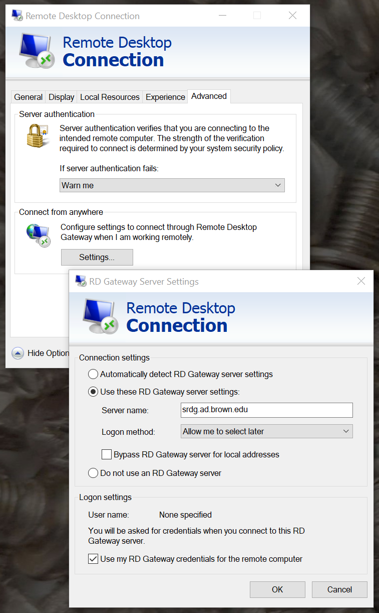
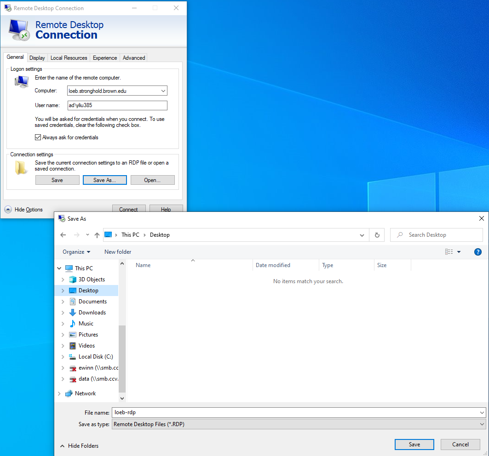

# RDP Gateway from Windows

The RDP gateway allows users to access Windows workstations in a Stronghold tenant **without** connecting to the Brown VPN. This service is intended for users who experience a degradation in performance while they are connected to the VPN.

**Please confirm with support@ccv.brown.edu if RDP gateway is enabled for your tenant before following these instructions.**

We **do not** recommend connecting to the RDP gateway if you are already connected to a Brown compliant network (Brown wifi, wired connection on campus or Brown VPN ). The additional overhead from the RDP gateway will lead to further degradation in performance.

Follow the instructions below to setup the connection to an RDP gateway from a Windows computer

## Set up a RDP Connection

1. Run the Microsoft RDC client through one of the below options

* Start > All Programs > Accessories > Remote Desktop Client
* Start > Run > MSTSC.EXE
* Search Remote Desktop Client

2\. Enter the tenant name in the "Computer" field (Figure 1).

3\. Enter "AD\\\<username>" in the User name field (Figure 1).

4\. Open the 'Advanced' tab and 'Settings'. A new window should pop up (Figure 2).

5\. Select 'Use these RD gateway settings: (Figure 2)'

6\. Enter 'srdg.ad.brown.edu' as server. Select 'use my RD Gateway credentials for the remote computer'. Click 'OK' to leave advanced settings (Figure 2).

7\. Switch to the General tab and save an RDP file for this connection. We recommend naming it "\<tenant>-RDP" to differentiate it from any other RDP file that does not use the RDP Gateway. 

## Connect from a Existing RDP Connection

You can double click your save RDP file to launch the workstation. You will be asked for two factor authentication from the RDP gateway as well workstation itself. Complete this process to connect to the workstation.
